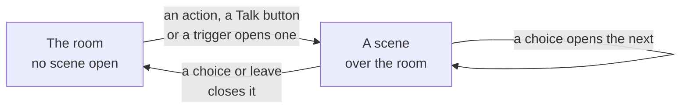

This page explains how time passes in an IFLoom game and what the player sees while it does. The engine has one clock, the turn, and two kinds of screen, a scene and the room. Real-time timers and the calendar's days both work through those two ideas rather than beside them.

## The turn is the one clock

`state.turn` counts the turns that have passed, starting at 0. The engine dates in turns: when a scene was first seen, when a trigger last fired, when a notice arrived and how long a storyline stays closed. So `{ since }` in a condition counts turns, and a choice marked `once: { per: 'turn' }` comes back on the next one.

The engine doesn't say how long a turn is. Your game decides. In a novel a turn can be a chapter, in a management game a week, and in a life sim a day. The engine turned down a built-in time of day because no one length suits every shape of game, and a game with no clock at all, such as a short novel, shouldn't have to carry one.

## Only the turn effect ends a turn

A turn ends when the [`turn` effect](/docs/reference/effects) runs, `{ turn: true }` for one turn or `{ turn: { by: 3 } }` for several. Any choice or action can carry it. The Letter's choices that move on to the next chapter carry one, so its turn is the chapter the reader has reached.

Plugins end turns through the same effect. The calendar never moves the turn counter itself. When its clock passes a boundary, it applies a `turn` effect, so a game with a calendar and a game without one end turns the same way.

The end of a turn runs the same steps whoever ends it:

1. The counter goes up by one.
2. The engine puts back the kv keys the content lists in `resets`.
3. The game's `rules.onTurn` runs, then each plugin's `onTurn` hook in the order the base lists them.
4. The game's `rules.onTurnDone` runs, then each plugin's `onTurnDone`.

The second round of hooks exists so that some code can see what the first round did. A rule that tops up energy each morning wants the calendar's new day, so it goes in `onTurnDone`, after the calendar's `onTurn` has moved the clock. A `turn` effect run inside these hooks does nothing, since it would end the turn again without stopping. [Rules](/docs/reference/rules) lists the hooks.

## A scene and the room

A scene is a screen of story. The [`scene` effect](/docs/reference/effects) opens one, `{ scene: 'cafe.counter' }`, and `{ scene: null }` closes it. With no scene open, the screen is the [room](/docs/reference/glossary#room), which offers the things to do from where the player is.

The view changes with the screen. While a scene is open, `view.scene` has the scene's title, words and choices, and the room's actions are empty. While none is open, `view.scene` is the room's, and `view.actions` lists the room's actions and then the game's own. The engine itself has no room to show. A plugin's `scene` provider gives it one, such as the places plugin's room for the location the player is at, with its description, its exits and who is here. Without one, the room is the game's title with no words.

The two screens suit different games. A game with places spends most of its time in the room, and opens a scene for a conversation or an event. A novel has no room to go back to, so it keeps a scene open from its first to its ending: every choice opens the next scene, and none offers `leave`.

## How the engine runs a scene

A scene in content is data: its body of blocks, its choices and its conditions. The engine turns it into something it can render the first time the view or a command needs it, and keeps that for the game. So the same scene listed in two games runs with each game's own prose and code.

A scene that reads differently on each visit does it with seeded draws, not with state you keep. A `variants` block shows one line from a set. The turn picks where the rotation starts, mixed with the save's seed, and a count of draws so far walks on from there. A scene doesn't repeat itself on consecutive visits, two playthroughs don't deal the same lines, and the same save always deals the same one. [Randomness](/docs/reference/random) has the details.

## Timers run in real time, not turns

A [timer](/docs/reference/glossary#timer) counts down in milliseconds, such as a phone ringing for ten seconds. It has nothing to do with turns, and the engine still keeps no clock for it. Time passes only when something sends a `tick` command, `{ type: 'tick', ms }`, which takes `ms` off every running timer and a minigame's clock.

In a browser, `startClock` from `@ifloom/browser` sends a tick about every 100 ms while something counts down, and the React UI starts it for you. In a test or a playtest, a timer moves only when you tick it yourself. That keeps the engine deterministic, because ticks are commands. The runner logs them, and a replay plays them back exactly. Undo steps over them, so one undo goes back to the last thing the player did, not to a moment 100 ms ago.

## The calendar makes a turn a period, a day or a week

The core has no time of day. The [calendar plugin](/docs/reference/plugins/calendar) adds the periods of a day, the days of a week, sleep and a curfew, and its `turn` option says how its clock and the turn keep step: `'period'`, `'day'` (the default), `'week'` or `false`.

Two things move the calendar's clock, and both end turns through the `turn` effect:

- **Passing time.** `calendar.pass()` moves the clock on and ends one turn for each boundary it crosses. With a turn of a day, passing from the night of day 0 into the evening of day 1 ends one turn. Going to bed with `calendar.sleep()` passes time to the next morning, so it ends the day's turn.
- **Ending a turn another way.** A `{ turn: true }` on a button runs the calendar's `onTurn` hook, which moves the clock to the start of the next unit. A management game whose turn is a week can close the week with a button, and the clock jumps to the first morning of the next week.

Order matters here. The game's `rules.onTurn` runs before every plugin's `onTurn`, so it sees the clock as the turn ended, before the calendar moves it. If the player goes to bed at night, `rules.onTurn` sees night, and `rules.onTurnDone` sees the next morning. Pick the hook by which clock your code wants to read.

For the details, see [Game state](/docs/reference/state#turn), [Scenes](/docs/reference/scenes), [Timers](/docs/reference/timers) and [the calendar](/docs/reference/plugins/calendar). [Set up days and times of day](/docs/how-to/set-up-the-clock) and [Run code at the end of a turn](/docs/how-to/run-code-at-the-end-of-a-turn) are the tasks.
