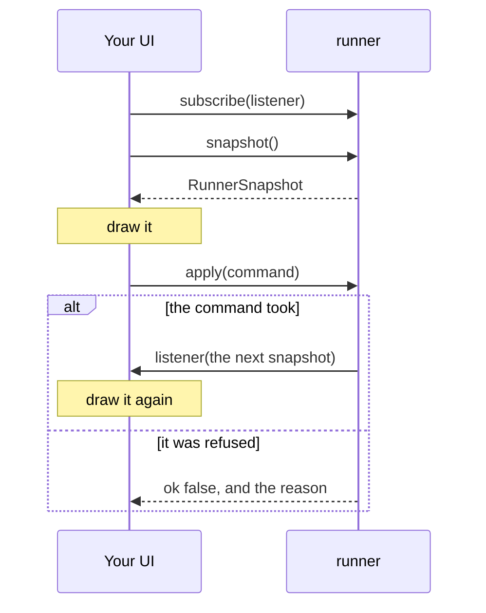

Here you drive the engine directly, with no UI package in between. The code works the same in a browser, in Node and in a test, and it's what every UI, including the [React UI](/docs/reference/react), does underneath.

You'll need a game to run. The one `ifloom new` makes is enough, or the one from [Your first story](/docs/guide/first-story).

## Make a runner

A [runner](/docs/reference/runner) holds the game in play and is the one object your code talks to. There are two ways to make one.

In a browser, use [`browserRunner`](/docs/reference/browser#browserrunner). It starts a new game with a random seed, keeps 50 steps of undo, saves to `localStorage` and autosaves each turn:

```ts
import { browserRunner } from '@ifloom/browser'
import module from './game.ts'

const { game } = module.build()

const runner = await browserRunner(game)
```

Anywhere else, or when you want to choose every option yourself, use [`createRunner`](/docs/reference/runner#createrunner). It takes the state to start from, and turns on nothing you don't ask for:

```ts
import { createRunner, startingState } from '@ifloom/engine'
import module from './game.ts'

const { game, problems } = module.build()
if (problems.length) console.warn(problems)

const runner = createRunner(game, startingState(game), { history: true })
```

[`startingState`](/docs/reference/commands#startingstate) builds a new game. Without a `seed` it uses one made from the game's id, so every run draws the same random variants, which is what you want in a test. A game in front of a player passes its own, `startingState(game, { seed: Math.floor(Math.random() * 2 ** 31) })`, as `browserRunner` does.

## The loop

A UI needs three things from the runner:

```ts fragment
runner.snapshot()          // RunnerSnapshot: what to draw right now, its view and the rest
runner.apply(command)      // run a command, such as a choice the player pressed
runner.subscribe(listener) // hand listener each new snapshot; returns a function that stops it
```

The loop is the same whatever draws the screen:

1. Draw `runner.snapshot()`. Its `view` is the scene, the choices, the stats and the rest of the game. Beside it are what the runner keeps itself: the settings, the backlog, whether undo would do anything and the saves.
2. When the player presses something, send its `command` with `runner.apply`.
3. When the runner hands your listener a new snapshot, draw that.



`subscribe` hears about every change, not only your own commands. Undo, redo, loading a save, a new game, a setting changed and a save written all call it too, so you don't need to redraw after each of those yourself.

`runner.snapshot()` returns the same object until something in it changes (see [RunnerSnapshot](/docs/reference/runner#runnersnapshot)). You can call it as often as you like, and a framework that compares values to decide what to redraw sees a new snapshot exactly when there's something new to draw. `runner.view()` is its `view` alone, for code that needs nothing else.

## Send commands

Every button in the view carries the command it sends, so most of the time you pass it straight back:

```ts given
for (const choice of runner.view().scene.choices) {
  // choice.label: 'Knock'
  // choice.command: { type: 'choose', id: 'knock' }
  // choice.disabled: why it can't be pressed, or undefined
}

const choice = runner.view().scene.choices[0]
const result = runner.apply(choice.command)
if (!result.ok) console.warn(result.reason)
```

`apply` answers with a [`Result`](/docs/reference/common#result). On success, `result.value` is the next state. On a refusal, `result.reason` says why in words a player can read, and nothing changed. A greyed-out button already carries the same reason as `disabled`, so show it next to the button rather than hiding it.

A few commands come from things that aren't buttons. You build those yourself:

| Command | When to send it |
|---|---|
| `{ type: 'input', id, to }` | The player entered a value the game asked for, such as a name. See [Inputs](/docs/reference/inputs). |
| `{ type: 'minigame', input }` | The player pressed one of a running minigame's inputs. |
| `{ type: 'tick', ms }` | Time passed during a minigame. [`startClock`](/docs/reference/browser#startclock) sends it for you in a browser. |
| `{ type: 'dismiss' }` | The player cleared the notices. |

[Commands](/docs/reference/commands) lists them all. A plugin's own commands are made by its helpers, such as `places.go('cafe')` from the [places plugin](/docs/reference/plugins/places#commands), and its buttons in the view carry them like any other.

## What's in the view

The [view](/docs/reference/view) is one plain object. These are the parts most screens draw:

| Field | What it holds |
|---|---|
| `title` | The game's title. |
| `when` | Where the game is in time and place, in the plugins' words, such as `'Day 2 · Tuesday morning · The corner café'`. `null` without a plugin that says. |
| `scene.title`, `scene.beats` | The open scene's title and its paragraphs, already parsed into [beats](#the-beats): narration, spoken lines and pictures. With no scene open, it's the room the player is in, when a plugin such as places shows one. |
| `scene.body` | The same words as one plain string, paragraphs apart, for a test or a terminal. A UI draws `beats`. |
| `scene.speaker`, `scene.image` | Who the scene is with, such as a character's `name` and picture, or `null`, and the big picture to draw with the scene: the speaker's, else `null`. |
| `scene.choices` | The scene's choices, each with its `label`, `command`, and `disabled` reason when it can't be picked. |
| `actions` | The buttons on the idle screen, with no scene open (see [The scene and the room](/docs/guide/concepts#the-scene-and-the-room)): the plugins' and the game's own, each with its `price`. |
| `stats`, `statsById` | The player's stats, as text ready to show, such as `'5c'`. `stats` lists the visible ones in order, and `statsById` has every one by id. |
| `inputs` | The values the game is asking for now, such as the player's name. |
| `minigame` | The minigame being played, or `null`. |
| `notices` | News the player hasn't dismissed, with counts by tag for badges. |
| `settings` | Every setting the game declares, to draw a settings screen. See [Saves and settings](/docs/guide/saves-and-settings). |
| `audio` | What should be playing. [`@ifloom/audio`](/docs/reference/browser/audio-player) plays it for you. |
| `plugins` | Each plugin's own part, by plugin id. |

You never read the state to decide what to draw. The view already says what can be pressed and why not, and the engine refuses commands with the same reasons, so the screen and the rules can't disagree.

### The beats

`scene.beats` is the scene's body, already split into pieces a UI draws one after another. Each has a `type`, and a UI switches on it:

| `type` | What it is | What to draw |
|---|---|---|
| `text` | A paragraph of narration, in `text` | A paragraph. `spans` is there when it has bold, italics, a tooltip or an inline button |
| `say` | A spoken line: a paragraph that is all one quote, or one written under who says it | The line in `text`, under `name` when there is one. A bare quote has no name, and the scene's `speaker` is who the scene is with |
| `image` | A picture, `src` and `alt` | An image |
| `video` | A clip, with `autoplay`, `loop`, `muted` and `controls` | A video |
| `sound` | A sound played as the scene is shown | Nothing. The [audio player](/docs/reference/browser/audio-player) plays it |
| `chose` | A pick the player made earlier in a [flowing scene](/docs/recipes/flowing-scenes), its words in `label` | The pick, styled as the player's, or nothing |

A UI that draws only `text` beats loses every spoken line, so draw `say` beats from the start. [SceneBeat](/docs/reference/prose#scenebeat) has every field, and [Speech](/docs/reference/prose#speech) how a line is written.

### Each plugin's part

Each plugin declares the type of its part in the engine's [`ViewRegistry`](/docs/reference/plugins#typed-calls-queries-and-views), so once your game imports the plugin, `view.plugins.places` is typed as the places plugin's view, or `undefined` in a game without it. A plugin that declares nothing is `unknown`.

```ts given
const room = runner.view().plugins.places
for (const exit of room?.exits ?? []) console.log(exit.label, exit.disabled ?? '')
```

## Undo, redo and a new game

With `history` on, the runner keeps the steps behind the player:

```ts given
runner.snapshot().canUndo   // whether there's anything to undo, for greying out the button
runner.undo()
runner.redo()
await runner.newGame() // start again in place, with a fresh history
```

Each of these calls your listener, so the screen redraws by itself. [The runner](/docs/reference/runner#historyoptions) has the options, such as no undo past the start of a turn.

## Play it without a browser

Nothing above needs a page. This script plays the `ifloom new` template's game in Node and prints each screen. Run it with `node play.ts`, as Node 22.18 and later run TypeScript directly:

```ts
// play.ts
import { createRunner, startingState, type View } from '@ifloom/engine'
import module from './src/game.ts'

const { game } = module.build()
const runner = createRunner(game, startingState(game))

function print(view: View): void {
  console.log(`\n# ${view.scene.title}`)
  for (const beat of view.scene.beats) if ('text' in beat) console.log(beat.text)
  view.scene.choices.forEach((choice, at) => console.log(`${at + 1}. ${choice.label}${choice.disabled ? ` (${choice.disabled})` : ''}`))
}

runner.subscribe((snapshot) => print(snapshot.view))
print(runner.view())

runner.apply({ type: 'choose', id: 'knock' })
console.log(runner.state.stats) // { courage: 2 }
```

A test does the same, with assertions in place of `console.log`. See [Testing your game](/docs/guide/testing).

## Next

- [Saves and settings](/docs/guide/saves-and-settings) adds a save menu and settings to the loop.
- [A UI from scratch](/docs/guide/ui-from-scratch) draws the whole view in the browser in plain JS.
- [The runner](/docs/reference/runner) and [The view](/docs/reference/view) list every member and field.
