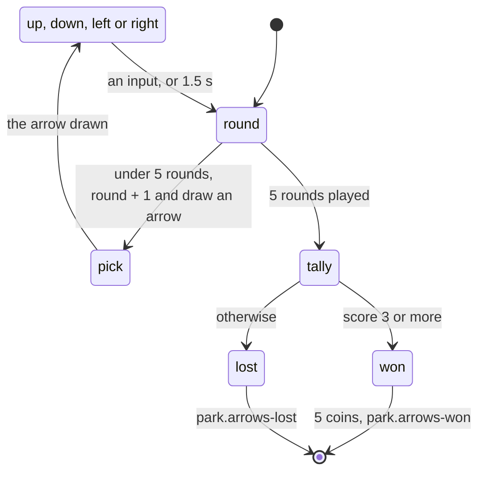

Use this for a small game inside the story, played with buttons or keys against the clock. A [minigame](/docs/reference/minigames) is data, like a scene. It has states, the inputs each state listens for, timers that move it on, and a few numbers it keeps while it runs. The steps build quick feet from the showcase's park: an arrow appears, and the player has a second and a half to press it.

Quick feet has five rounds. Each round picks one of four arrows at random. Pressing the right arrow scores a point, and a wrong one or running out of time scores none. After the fifth round, three or more points wins five coins.

## Write a state for each arrow

Write one state per arrow. Each shows its words, waits 1.5 seconds, and listens for all four inputs:

```ts
import type { MinigameStateDef } from '@ifloom/engine'

export const ARROWS = ['up', 'down', 'left', 'right'] as const

const POINTS: Record<(typeof ARROWS)[number], string> = {
  up: 'The girl with the whistle points at the sky. Up!',
  down: 'She points at her shoes. Down!',
  left: 'She points at the river. Left!',
  right: 'She points at the swings. Right!',
}

export const showArrow = (arrow: (typeof ARROWS)[number]): MinigameStateDef => ({
  label: POINTS[arrow],
  after: { ms: 1500, go: 'round' },
  on: ARROWS.map((input) => ({ input, go: 'round', ...(input === arrow ? { effects: [{ kv: 'score', of: 'minigame', by: 1 }] } : {}) })),
})
```

`label` is the words the player reads in that state. `after` goes to `round` once 1.5 seconds of ticks have passed. Each `on` entry is what an input does. All four go to `round`, and only the right one adds a point to the minigame's own [kv store](/docs/reference/glossary#kv), `of: 'minigame'`.

The input names are yours. Name them `up`, `down`, `left` and `right` where they fit, and the React UI gives them the arrow keys and labelled buttons without being told.

## Write the rounds

Add the states that decide where to go next and show nothing:

```ts continues
import type { MinigameDef } from '@ifloom/engine'

export const quickFeet: MinigameDef = {
  id: 'arrows',
  title: 'Quick feet',
  start: 'round',
  kv: { round: 0, arrow: 0, score: 0 },
  keys: { up: ['ArrowUp', 'w'], down: ['ArrowDown', 's'], left: ['ArrowLeft', 'a'], right: ['ArrowRight', 'd'] },
  states: {
    round: {
      always: [
        { when: { kv: 'round', of: 'minigame', gte: 5 }, go: 'tally' },
        { go: 'pick', effects: [{ kv: 'round', of: 'minigame', by: 1 }, { kv: 'arrow', of: 'minigame', random: [1, 4] }] },
      ],
    },
    pick: { always: ARROWS.map((arrow, index) => ({ when: { kv: 'arrow', of: 'minigame', is: index + 1 }, go: arrow })) },
    ...Object.fromEntries(ARROWS.map((arrow) => [arrow, showArrow(arrow)])),
    tally: { always: [{ when: { kv: 'score', of: 'minigame', gte: 3 }, go: 'won' }, { go: 'lost' }] },
    won: { final: { effects: [{ stat: 'coins', by: 5 }, { scene: 'park.arrows-won' }] } },
    lost: { final: { effects: [{ scene: 'park.arrows-lost' }] } },
  },
}
```

Reading it from the top:

- **`kv`** declares the minigame's own keys, which start at 0 and go when it ends.
- **`keys`** adds W, A, S and D beside the arrow keys.
- **`round`** has `always` entries, taken as soon as the state is entered. After five rounds it goes to `tally`. Otherwise it counts the round, draws an arrow from 1 to 4, and goes to `pick`.
- **`pick`** turns the number into one of the arrow states.
- **`tally`** checks the score and goes to `won` or `lost`.
- **`won`** and **`lost`** are final, so entering one ends the minigame and runs its effects.

The states and the ways between them, with the four arrows in one box:



The arrow is drawn from the save's seed, so the same save always gets the same arrows, and undo can't draw them again.

## Start it

Add the minigame to your content's `minigames`, with the two scenes it ends in, and start it with the [`minigame` effect](/docs/reference/effects#minigame). In the park, a location's action does it:

```ts continues
import type { ActionDef, Content } from '@ifloom/engine'

export const play: ActionDef = { id: 'arrows', label: 'Play quick feet with the kids', effects: [{ minigame: 'arrows' }] }

export const park: Content = {
  minigames: [quickFeet],
  scenes: [
    { id: 'park.arrows-won', title: 'Quick feet', body: [{ text: 'Five coins change hands from a jam jar.' }], choices: [{ id: 'leave', effects: [{ scene: null }] }] },
    { id: 'park.arrows-lost', title: 'Quick feet', body: [{ text: '"Too slow!"' }], choices: [{ id: 'leave', effects: [{ scene: null }] }] },
  ],
}
```

A scene can also start one as it opens, with its `minigame` field, and a [flowing scene](/docs/how-to/write-a-flowing-scene#play-a-minigame-or-open-a-panel-where-it-stands) can play one where it stands.

## Play it

Every template renders a running minigame. The React UI's `Scene` renders a [`MinigameCard`](/docs/reference/react/components#minigamecard) in place of the scene, with the title, the words, a bar for the 1.5 seconds and a button for each arrow. The arrow keys and W, A, S and D press them too. The `vanilla` and `vue` templates show the words, the timer and a button for each input, and [`startKeys`](/docs/reference/browser#startkeys) maps the keys.

The engine keeps no clock. The React UI, or [`startClock`](/docs/reference/browser#startclock) in the other templates, sends a [`tick`](/docs/reference/commands#tick) about ten times a second while a timer runs. While a minigame runs, the engine refuses every other command with `Finish this first.`

To render quick feet your own way, see [Render a minigame](/docs/how-to/render/timers-minigames-panels#render-a-minigame). With the React UI, give `mountGame`'s `panels` a component under the minigame's id, `{ arrows: QuickFeet }`, and it renders in place of the `MinigameCard`.

## Check it worked

Run `npm run check`, which reports a `go` to a state the minigame doesn't have, a minigame with no final state it can reach, and a key no minigame declares. A test plays the minigame with no browser and no waiting, since ticks are ordinary commands:

```ts given
import { apply, view } from '@ifloom/engine'

// `state` has the player in the park.
let next = apply(state, game, { type: 'action', id: 'places/arrows' }).state
const arrow = next.minigame!.state // 'left', say
next = apply(next, game, { type: 'tick', ms: 400 }).state
next = apply(next, game, { type: 'minigame', input: arrow }).state
view(next, game).minigame?.kv.score // 1
```

One long tick runs out every timer in its way, so `{ type: 'tick', ms: 10_000 }` plays out all five rounds with no presses.

## Variations

**A quiz with its answers on the buttons.** Give each `on` entry a `label`, the words on that input's button while the minigame is in that state. One set of inputs, `a`, `b` and `c`, then shows different answers for each question:

```ts
import type { MinigameDef } from '@ifloom/engine'

export const quiz: MinigameDef = {
  id: 'quiz',
  title: 'Pub quiz',
  start: 'q1',
  kv: { right: 0 },
  states: {
    q1: {
      label: 'Which street is the café on?',
      on: [
        { input: 'a', label: 'High Street', go: 'done', effects: [{ kv: 'right', of: 'minigame', by: 1 }] },
        { input: 'b', label: 'Mill Lane', go: 'done' },
        { input: 'c', label: 'Station Road', go: 'done' },
      ],
    },
    done: { final: { copy: { right: 'quiz.right' } } },
  },
}
```

The final state copies the score to the kv key `quiz.right`, so `{{quiz.right}}` prints it after the minigame ends.

In the showcase, Small Town, quick feet is in [`examples/showcase/src/story/park.ts`](https://github.com/IFLoom/ifloom/blob/main/examples/showcase/src/story/park.ts). Its `tests/showcase.test.ts` plays it with ticks, and `tests/quick-feet.test.tsx` plays it in the React UI with the arrow keys. For more, see:

- [Minigames](/docs/reference/minigames), with every field of `MinigameDef` and its states.
- The [`minigame` effect](/docs/reference/effects#minigame) and the [`minigame` and `tick` commands](/docs/reference/minigames#commands).
- [Timers run in real time, not turns](/docs/explanation/turns-and-time#timers-run-in-real-time-not-turns).
