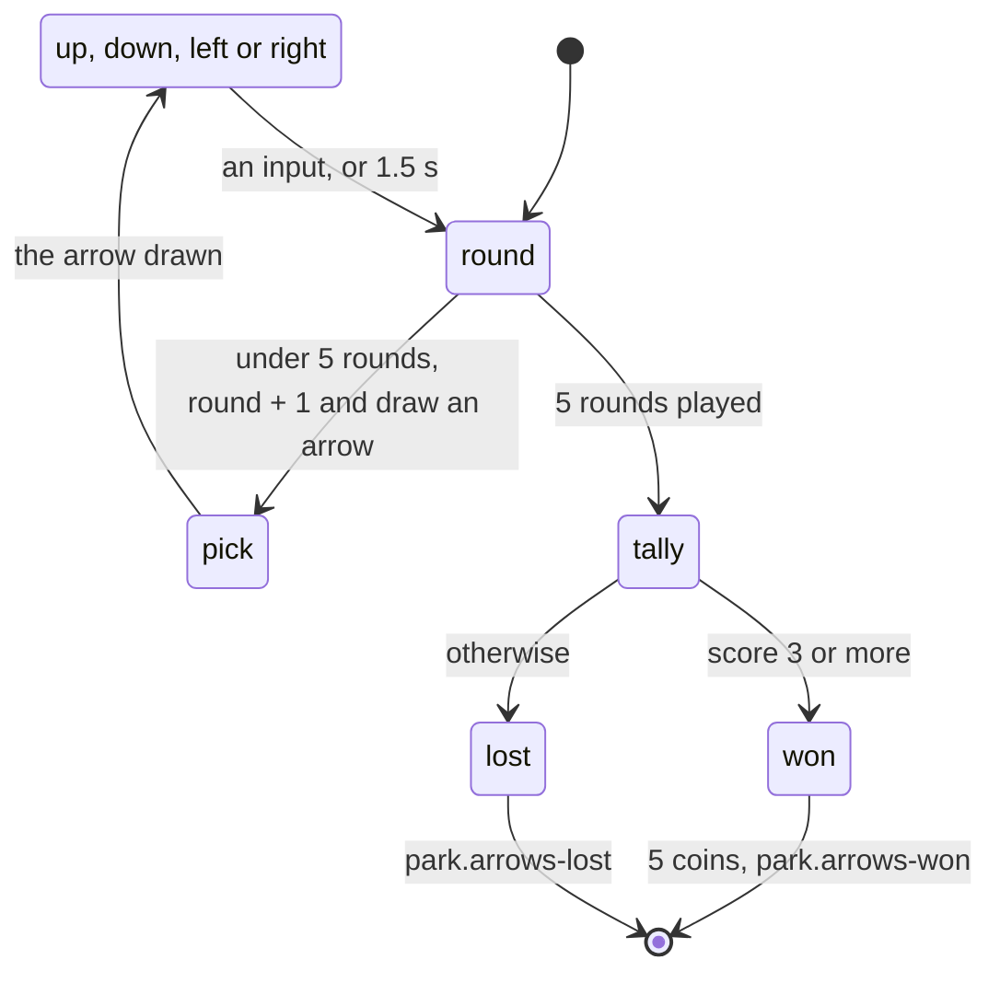

You'll build a small quick-time game: an arrow appears, and the player has a second and a half to press it. It's the game of quick feet in [Small Town](/docs/guide/showcase)'s park, so you can play it there and read its source in `examples/showcase/src/story/park.ts`. Then it draws the same minigame with a panel of your own instead of the built-in one, in plain DOM, React, Vue or Svelte.

A minigame is data, like a scene. You declare its states, what each input does in each state, the timers that move it on, and a few numbers it keeps while it runs. The engine runs it, and the page draws it and keeps its clock. Every field is in the [minigames reference](/docs/reference/minigames).

## The rules

Quick feet has five rounds. Each round picks one of four arrows at random and shows it for 1.5 seconds:

- Pressing the right arrow scores a point and starts the next round.
- Pressing a wrong one, or running out of time, starts the next round with no point.

After the fifth round, three or more points wins five coins and a short scene. Fewer gets a different scene.

## The arrows

Start with the four arrows. Each one is a state that shows its words, starts a 1.5 second timer, and listens for all four inputs:

```ts
import type { Content, MinigameDef, MinigameStateDef } from '@ifloom/engine'

/** The four arrows of quick feet, in the order the minigame's `arrow` variable numbers them from 1. */
const ARROWS = ['up', 'down', 'left', 'right'] as const

/** What the girl with the whistle does for each arrow. */
const POINTS: Record<(typeof ARROWS)[number], string> = {
  up: 'The girl with the whistle points at the sky. Up!',
  down: 'She points at her shoes. Down!',
  left: 'She points at the river. Left!',
  right: 'She points at the swings. Right!',
}

/** One arrow on screen: 1.5 seconds to press it. The right one scores; a wrong one or the time running out doesn't. */
const showArrow = (arrow: (typeof ARROWS)[number]): MinigameStateDef => ({
  label: POINTS[arrow],
  after: { ms: 1500, go: 'round' },
  on: ARROWS.map((input) => ({ input, go: 'round', ...(input === arrow ? { effects: [{ kv: 'score', of: 'minigame', by: 1 }] } : {}) })),
})
```

`label` is the words the player reads in that state, written in place, with tokens filled in. A translation gives each other words under `minigame.arrows.states.<state>.label`.

`after` is the timer. When 1.5 seconds of ticks have passed in the state, it goes to `round`. Each `on` entry is what an input does. All four go to `round`, and only the right one also adds a point with the [`kv`](/docs/reference/effects#whose-key-it-is) effect, `of: 'minigame'`.

The input names are yours to choose. `up`, `down`, `left` and `right` are worth using where they fit, because the React UI gives them the arrow keys and labelled buttons without being told. In the other templates, [`startKeys`](/docs/reference/browser#startkeys) gives them the arrow keys.

## The rounds

The rest of the minigame is a few states that decide where to go next and draw nothing:

```ts continues
/**
 * Quick feet, at the park: five rounds, each a random arrow to press in time.
 * Three or more right wins a few coins from the kids' pot.
 */
const quickFeet: MinigameDef = {
  id: 'arrows',
  title: 'Quick feet',
  start: 'round',
  kv: { round: 0, arrow: 0, score: 0 },
  keys: { up: ['ArrowUp', 'w'], down: ['ArrowDown', 's'], left: ['ArrowLeft', 'a'], right: ['ArrowRight', 'd'] },
  states: {
    // A new round draws an arrow, or after the fifth, the score is counted.
    round: {
      always: [
        { when: { kv: 'round', of: 'minigame', gte: 5 }, go: 'tally' },
        {
          go: 'pick',
          effects: [
            { kv: 'round', of: 'minigame', by: 1 },
            { kv: 'arrow', of: 'minigame', random: [1, 4] },
          ],
        },
      ],
    },
    pick: { always: ARROWS.map((arrow, index) => ({ when: { kv: 'arrow', of: 'minigame', is: index + 1 }, go: arrow })) },
    ...Object.fromEntries(ARROWS.map((arrow) => [arrow, showArrow(arrow)])),
    tally: { always: [{ when: { kv: 'score', of: 'minigame', gte: 3 }, go: 'won' }, { go: 'lost' }] },
    won: { final: { effects: [{ stat: 'coins', by: 5 }, { scene: 'park.arrows-won' }] } },
    lost: { final: { effects: [{ scene: 'park.arrows-lost' }] } },
  },
}
```

Reading it from the top:

- **`kv`** is the minigame's own kv store: the round, the arrow drawn for it, and the score. They start at 0 and are gone when it ends.
- **`keys`** adds W, A, S and D beside the arrow keys. Leave it out and the React UI uses the arrow keys alone.
- **`round`** has `always` entries, which are taken as soon as the state is entered. After five rounds it goes to `tally`. Otherwise it counts the round, draws an arrow from 1 to 4 and goes to `pick`.
- **`pick`** turns the number into one of the arrow states.
- **`tally`** checks the score and goes to `won` or `lost`.
- **`won`** and **`lost`** are final. Entering one ends the minigame and runs its effects. Here that's five coins and a scene, or just a scene.

Drawn out, with `up`, `down`, `left` and `right` in one box, the states and the ways between them look like this:



Only the input that matches the arrow on screen adds 1 to `score`.

The random draw comes from the save's seed, so the same save always gets the same arrows, and undo can't re-roll them.

## Starting it

Add the minigame to your content, with the two closing scenes and something that starts it. In the park, that's one of the park's actions, with the [`minigame`](/docs/reference/effects#minigame) effect:

```ts continues
export const park: Content = {
  minigames: [quickFeet],
  // and in the park's location: actions: [{ id: 'arrows', label: 'Play quick feet with the kids', effects: [{ minigame: 'arrows' }] }]
  scenes: [
    { id: 'park.arrows-won', title: 'Quick feet', body: [{ prose: 'park.arrows-won' }], choices: [{ id: 'leave', effects: [{ scene: null }] }] },
    { id: 'park.arrows-lost', title: 'Quick feet', body: [{ prose: 'park.arrows-lost' }], choices: [{ id: 'leave', effects: [{ scene: null }] }] },
  ],
}
```

A scene can also start one as it opens, with a `minigame` field. See [`MinigameSceneFields`](/docs/reference/minigames#minigamescenefields).

## Playing it

That's all the page needs. Every template draws a running minigame for you:

- In the React UI, [`Scene`](/docs/reference/react/components#scene) draws [`MinigameCard`](/docs/reference/react/components#minigamecard) in place of the scene: the title, the shout, a bar counting down the 1.5 seconds, and a button for each arrow. The arrow keys (and W, A, S and D) press them too.
- In the `vanilla`, `vue` and `svelte` templates, the scene shows the minigame's words, and a [minigame panel](/docs/guide/frameworks#minigames) draws the timer and a button for each input. `startKeys` from [`@ifloom/browser`](/docs/reference/browser) maps the arrow keys and space to the inputs.

The engine has no clock of its own. The React UI, or [`startClock`](/docs/reference/browser#startclock) in the other templates, sends a [`tick`](/docs/reference/commands#tick) command about ten times a second while a timer runs, with the real time that passed. If the player switches to another tab, the clock pauses, so the round is still there when they come back.

While it runs, the player can't do anything else. Every other command is refused with `Finish this first.` until it ends.

## Your own panel

The built-in panels are plain on purpose. To draw quick feet your own way, read the running minigame from `view.minigame` and send its inputs as `{ type: 'minigame', input }`. In the React UI, [`useMinigame`](/docs/reference/react/components#useminigame) reads it and sends for you:

```ts tab="Plain JS" tab-group="framework"
// src/quickFeet.ts
import type { MinigameView, Runner } from '@ifloom/engine'

const GLYPHS: Record<string, string> = { up: '↑', down: '↓', left: '←', right: '→' }

export function quickFeet(minigame: MinigameView, runner: Runner): HTMLElement {
  const section = document.createElement('section')
  section.className = 'quick-feet'
  section.appendChild(document.createElement('p')).textContent = `Round ${minigame.kv.round} of 5 · ${minigame.kv.score} right`
  // The arrow states are named after their arrow, so the state says which to draw.
  const arrow = section.appendChild(document.createElement('p'))
  arrow.className = 'arrow'
  arrow.setAttribute('aria-live', 'polite')
  if (minigame.label) arrow.setAttribute('aria-label', minigame.label)
  arrow.textContent = GLYPHS[minigame.state] ?? ''
  if (minigame.timeLeft !== null && minigame.timeTotal) {
    const timer = section.appendChild(document.createElement('div'))
    timer.className = 'timer'
    timer.appendChild(document.createElement('span')).style.transform = `scaleX(${minigame.timeLeft / minigame.timeTotal})`
  }
  for (const input of minigame.inputs) {
    const button = section.appendChild(document.createElement('button'))
    button.textContent = GLYPHS[input.id] ?? input.label
    button.onclick = () => runner.apply(input.command)
  }
  return section
}
```

```tsx tab="React" tab-group="framework"
// src/QuickFeet.tsx
import { useMinigame, type PanelComponent } from '@ifloom/react'
import { buttonVariants } from '@ifloom/react/kit'

const GLYPHS: Record<string, string> = { up: '↑', down: '↓', left: '←', right: '→' }

export const QuickFeet: PanelComponent = () => {
  const { minigame, send } = useMinigame({ keys: true })
  if (!minigame) return null
  // The arrow states are named after their arrow, so the state says which to draw.
  const arrow = GLYPHS[minigame.state]
  const left = minigame.timeLeft !== null && minigame.timeTotal ? minigame.timeLeft / minigame.timeTotal : 0
  return (
    <section className="flex flex-col items-center gap-4 text-center">
      <p className="text-sm text-muted-foreground">
        Round {minigame.kv.round} of 5 · {minigame.kv.score} right
      </p>
      <p className="text-8xl" aria-live="polite" aria-label={minigame.label ?? undefined}>
        {arrow}
      </p>
      <div className="h-2 w-full overflow-hidden rounded-full bg-muted">
        <div className="h-full origin-left bg-primary transition-transform duration-100 ease-linear" style={{ transform: `scaleX(${left})` }} />
      </div>
      <div className="flex gap-2">
        {minigame.inputs.map((input) => (
          <button key={input.id} type="button" className={buttonVariants({ variant: 'outline', size: 'lg' })} onClick={() => send(input.id)}>
            {GLYPHS[input.id] ?? input.label}
          </button>
        ))}
      </div>
    </section>
  )
}
```

```vue tab="Vue" tab-group="framework"
<!-- src/QuickFeet.vue -->
<script setup lang="ts">
import { runner, view } from './runner.ts'

const GLYPHS: Record<string, string> = { up: '↑', down: '↓', left: '←', right: '→' }
</script>

<template>
  <section v-if="view.minigame" class="quick-feet">
    <p>Round {{ view.minigame.kv.round }} of 5 · {{ view.minigame.kv.score }} right</p>
    <!-- The arrow states are named after their arrow, so the state says which to draw. -->
    <p class="arrow" aria-live="polite" :aria-label="view.minigame.label ?? undefined">{{ GLYPHS[view.minigame.state] }}</p>
    <div v-if="view.minigame.timeLeft !== null && view.minigame.timeTotal" class="timer">
      <span :style="{ transform: `scaleX(${view.minigame.timeLeft / view.minigame.timeTotal})` }" />
    </div>
    <button v-for="input in view.minigame.inputs" :key="input.id" @click="runner.apply(input.command)">
      {{ GLYPHS[input.id] ?? input.label }}
    </button>
  </section>
</template>
```

```svelte tab="Svelte" tab-group="framework"
<!-- src/QuickFeet.svelte -->
<script lang="ts">
  import { runner, view } from './runner.ts'

  const GLYPHS: Record<string, string> = { up: '↑', down: '↓', left: '←', right: '→' }
</script>

{#if $view.minigame}
  {@const minigame = $view.minigame}
  <section class="quick-feet">
    <p>Round {minigame.kv.round} of 5 · {minigame.kv.score} right</p>
    <!-- The arrow states are named after their arrow, so the state says which to draw. -->
    <p class="arrow" aria-live="polite" aria-label={minigame.label ?? undefined}>{GLYPHS[minigame.state]}</p>
    {#if minigame.timeLeft !== null && minigame.timeTotal}
      <div class="timer"><span style:transform={`scaleX(${minigame.timeLeft / minigame.timeTotal})`}></span></div>
    {/if}
    {#each minigame.inputs as input (input.id)}
      <button onclick={() => runner.apply(input.command)}>{GLYPHS[input.id] ?? input.label}</button>
    {/each}
  </section>
{/if}
```

Then draw it in place of the usual panel while quick feet is running. The React UI takes it in `panels`, under the minigame's id:

```ts fragment tab="Plain JS" tab-group="framework"
// src/main.ts, in the vanilla template's draw()
if (view.minigame?.id === 'arrows') root.append(quickFeet(view.minigame, runner))
else if (view.minigame) drawMinigame(view.minigame)
```

```ts tab="React" tab-group="framework"
// src/main.ts
import { mountGame } from '@ifloom/react'
import { QuickFeet } from './QuickFeet.tsx'
import module from './game.ts'

mountGame(module.build(), { panels: { arrows: QuickFeet } })
```

```vue tab="Vue" tab-group="framework"
<!-- src/App.vue, in the vue template -->
<QuickFeet v-if="view.minigame?.id === 'arrows'" />
<Minigame v-else-if="view.minigame" :minigame="view.minigame" />
```

```svelte tab="Svelte" tab-group="framework"
<!-- src/App.svelte, in the svelte template -->
{#if $view.minigame?.id === 'arrows'}<QuickFeet />{:else if $view.minigame}<Minigame minigame={$view.minigame} />{/if}
```

What the panels use:

- **`view.minigame`** is a [`MinigameView`](/docs/reference/minigames#minigameview): the running state, its words, `timeLeft` and `timeTotal` in milliseconds, the live `inputs` and the minigame's `kv`.
- **`{ type: 'minigame', input }`** presses an input. `useMinigame`'s `send(input)` sends it for you.
- **`keys: true`** in `useMinigame` maps the keyboard to the inputs as the built-in panel does, from the minigame's `keys` or the arrow keys. In the other templates, `startKeys` from `@ifloom/browser` does that whatever panel is drawn.

You don't have to run the clock in your panel. In the React UI, `GameProvider` runs it for the whole game, which also ticks the game's [timers](/docs/reference/timers), and `useMinigame` would run it too. There's only ever one clock per game, however many components ask. In the other templates, `startClock` runs beside the runner.

To change every minigame's panel at once in the React UI, rather than one by id, replace `MinigameCard` in [`components`](/docs/reference/react/customising#6-replace-a-component). A panel by id wins over it.

## A quiz with its answers on the buttons

A state's `on` entries can each carry a `label`, the words on that input's button while the minigame is in that state. So one set of inputs, `a`, `b` and `c`, can show different answers for each question. Here's a two-question quiz about the town that counts the right answers:

```ts
import type { MinigameDef } from '@ifloom/engine'

const quiz: MinigameDef = {
  id: 'quiz',
  title: 'Pub quiz',
  start: 'q1',
  kv: { right: 0 },
  states: {
    q1: {
      label: 'Which street is the café on?',
      on: [
        { input: 'a', label: 'High Street', go: 'q2', effects: [{ kv: 'right', of: 'minigame', by: 1 }] },
        { input: 'b', label: 'Mill Lane', go: 'q2' },
        { input: 'c', label: 'Station Road', go: 'q2' },
      ],
    },
    q2: {
      label: 'What day is the market?',
      on: [
        { input: 'a', label: 'Monday', go: 'done' },
        { input: 'b', label: 'Saturday', go: 'done', effects: [{ kv: 'right', of: 'minigame', by: 1 }] },
        { input: 'c', label: 'Every day', go: 'done' },
      ],
    },
    done: { final: { copy: { right: 'quiz.right' } } },
  },
}
```

While it's on the first question, `view.minigame.inputs` is three buttons reading `High Street`, `Mill Lane` and `Station Road`, and on the second `Monday`, `Saturday` and `Every day`. Any panel draws them as it draws the arrows, from each input's `label`. The labels are words in place, so a translation's [words table](/docs/reference/words) can give them other words, and they can carry [tokens](/docs/reference/prose#tokens) such as `{{playerName}}`.

Afterwards `{{quiz.right}}` prints the score, since the final state copies it to the kv key `quiz.right`.

## Testing it

Ticks are ordinary commands, so a test can play a minigame with no browser and no waiting. Send the ticks yourself:

```ts given
import { apply, view } from '@ifloom/engine'

// `state` is a game with the player in the park.
let next = apply(state, game, { type: 'action', id: 'places/arrows' }).state
const arrow = next.minigame!.state                                         // 'left', say
next = apply(next, game, { type: 'tick', ms: 400 }).state                  // a moment's thought
next = apply(next, game, { type: 'minigame', input: arrow }).state        // the right arrow
view(next, game).minigame?.kv.score                                       // 1
```

One long tick runs out every timer in its way, so `{ type: 'tick', ms: 10_000 }` plays out all five rounds with no presses. Small Town's `tests/showcase.test.ts` plays quick feet this way, and `tests/quick-feet.test.tsx` plays it in the React UI with fake timers and the arrow keys.
