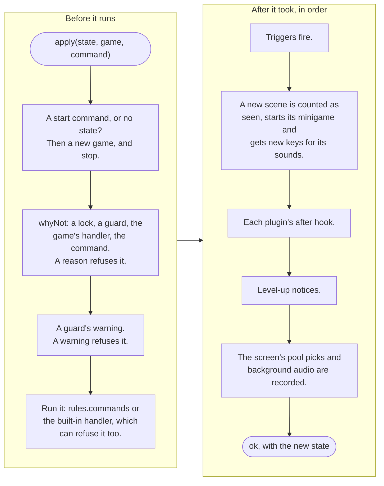

A command is one thing the player does, such as choosing a choice, doing an action or sending a plugin's own command. A UI sends commands, and [`apply`](#apply) answers each with the next [state](/docs/reference/state), or refuses it with a reason. Running a command is a pure function, so the same state, game and command always give the same answer. [State, commands and the view](/docs/explanation/state-and-commands) explains the loop, and [Run a game in code](/docs/how-to/run-a-game-in-code) sends commands from Node.

In the showcase: `examples/showcase/tests/showcase.test.ts`, which plays the town by sending commands.

```ts
import { apply, startingState, type Applied, type Command, type StartOptions } from '@ifloom/engine'
```

## Command

A request to change the game, told apart by its `type`, such as `{ type: 'choose', id: 'chat' }`. Every form is in [`Command`](/docs/api/engine#command).

A command that names one thing names it `id`, and one that sets a value takes it as `to`. The union is closed, so a game adds no command type of its own. A new thing for the player to do is an [action](/docs/reference/actions), sent with the `action` command. A plugin's command, or the game's own from [`rules.commands`](/docs/reference/rules#commands), goes under the one type [`custom`](#custom), by name.

`apply` also takes a [`CommandRef`](/docs/reference/custom#commandref), so a plugin's command in its short form works too, as a plugin's helpers write it:

```ts
import type { CommandRef } from '@ifloom/engine'
import { places } from '@ifloom/plugin-places'
import { cast } from '@ifloom/plugin-cast'

export const walkAndTalk: CommandRef[] = [places.go('cafe'), cast.talk('ava'), { type: 'choose', id: 'chat' }, { type: 'leave' }]
```

While a [minigame](/docs/reference/minigames) runs, every command but `tick`, `minigame`, `dismiss`, `setting` and `closePanel` is refused with "Finish this first.", before any lock. So is a plugin command that doesn't ignore locks.

## Applied

The answer of [`apply`](#apply), with the state on both sides. Every form is in [`Applied`](/docs/api/engine#applied).

On success, `ok` is `true` and `state` is the next state, with `newGame: true` when the command started a new game. On a refusal, `ok` is `false`, `state` is the state passed in, and `reason` says why. It has the shape of a [`Result`](/docs/reference/common#result), and the runner's own `apply` gives a plain `Result` with the next state as its `value`.

## StartOptions

Settings for [`startingState`](#startingstate) and the runner's `newGame`. Every field is in [`StartOptions`](/docs/api/engine#startoptions), each optional.

| Field | Meaning |
|---|---|
| `seed` | The save's [seed](/docs/reference/state#seed). A hash of `game.id` if left out, so every new game draws the same. |
| `kv` | Keys written to the [kv store](/docs/reference/state#kv) over the content's `kv`, such as a name typed on a title page. |
| `settings` | The player's stored values for the game's `play` [settings](/docs/reference/settings), such as the profile's `core:settings`, which `browserRunner` passes. An unknown id, a `ui` setting or a value a setting can't take is ignored. |
| `carry` | The state a finished game ended on, for a New Game+. The engine copies what the content's [`carryOver`](/docs/reference/state#carryover) lists from it. |

## Commands

Each command the engine keeps, with the refusals of its built-in handler. A [lock](/docs/reference/locks) and a plugin's [guard](/docs/reference/plugin-api) refuse a command before its handler runs, and a guard's warning after it. The refusals quoted here are the engine's English [strings](/docs/reference/strings#refusals), which a game, a pack or a translation can reword, and a reason the game wrote prints as written.

### start

Starts a new game with the given `seed` and `kv`, as [`startingState`](#startingstate) does. It's never refused and no lock stops it.

### newGame

Starts over, a new game in place of the one in play. Content sends it from a choice, such as an ending's "Play again". It's never refused, and no lock or plugin guard stops it.

```ts fragment
{ id: 'again', label: 'Play again', command: { type: 'newGame' }, effects: [] }
```

A [runner](/docs/reference/runner#newgame)'s `apply` starts it as `runner.newGame()` does, with the player's play settings from the profile, a random seed and a fresh history, backlog and command log. `apply` on its own answers `{ ok: true, newGame: true, state }`, where `state` is a new game with the play settings of the run that ended and a seed drawn from its seed and turn. The same state and command always give the same new game, so a [replay](/docs/reference/runner#replay) is exact.

The run ends where the command is sent. The choice that sends it isn't counted in [`chosen`](/docs/reference/state#chosen), its effects don't run, and no trigger or hook runs after it. Nothing carries over, so it isn't a New Game+. [`ifloom playtest`](/docs/reference/cli#ifloom-playtest) stops when it meets one.

### action

Does the [action](/docs/reference/actions) with this `id`: one of the content's `actions`, or a plugin's with the plugin's id in front, such as `places/coffee`. It sends the action's `command` first, if it has one, then pays its cost and applies its effects. An action with `once` is counted in [`chosen`](/docs/reference/state#chosen) under its id before anything runs.

It's refused with "There is no such thing to do." for an unknown id. Otherwise it's refused for the first reason [`whyNot`](/docs/reference/actions#whynot) gives. Those reasons are an open scene, a `when` that doesn't hold, a lock, a `blocked` entry, `once` already spent, too little of a stat the cost spends, and its command's own refusal.

```ts fragment
{ type: 'action', id: 'wait' }
```

### scene

Opens a scene by id. It's refused with "Finish this first." while a scene is open, and "There is no such scene." for an unknown id.

### choose

Takes a choice in the scene on screen, found by id in the scene rendered against the current state. Its record in [`chosen`](/docs/reference/state#chosen), under `scene#choice`, counts one more on the current turn, and then its effects run in order. If the open scene's id no longer exists in the game, `choose` closes it instead of refusing.

It's refused with, in order:

- "There is nothing to choose." when no scene is open.
- "That is not on offer." when there's no such choice, or it's hidden.
- The choice's own `blocked` reason.
- A plugin guard's warning, such as the calendar's "That would run past dawn."

### leave

Closes the scene on screen. The engine never refuses it, even with no scene open, though a lock can stop it.

### dismiss

Marks one [notice](/docs/reference/notices) seen by `id`, or every notice without one. Only a lock stops it, so it works with a scene open and with nothing to dismiss. It doesn't end a turn.

```ts fragment
{ type: 'dismiss', id: 'rent' }
```

### input

Writes the value `to` to an [input](/docs/reference/inputs)'s kv key, its `key` or else its id, with text trimmed. It takes no time and works with a scene open. A button can carry the command without `to` so the UI asks for one, and a command sent without a value is refused.

After a lock, it's refused with the input's own reasons, such as "Enter something first.", "Keep it to <n> characters." or "That is not one of the options." See [`InputDef`](/docs/reference/inputs#inputdef).

```ts fragment
{ type: 'input', id: 'catName', to: 'Biscuit' }
```

### setting

Changes a `play` [setting](/docs/reference/settings) in the state, as a settings page sends it mid-game. It goes in the runner's [log](/docs/reference/runner#commandlog), so a [replay](/docs/reference/runner#replay) gives the same game, and a runner with a [profile](/docs/reference/profile) also stores the value for the next new game. No lock or plugin guard stops it.

It's refused with:

- "There is no such setting." for an id the game doesn't declare.
- "That setting does not change the game." for a `ui` setting, which [`runner.setSetting`](/docs/reference/runner#setsetting) changes instead.
- "Choose on or off." for a toggle given anything but `true` or `false`.
- "That is not one of the options." for a choice given a value it doesn't list.
- "Enter a number.", "Between <min> and <max>." or "In steps of <step>." for a range.

### tick

Time passing, `ms` milliseconds of it. It takes `ms` off every running [timer](/docs/reference/timers) and adds it to the time the running [minigame](/docs/reference/minigames) has spent in its state. Whatever runs out does so in order, with its effects or its transition run at that moment, so one long tick can run out up to 1,000 things in a row. No lock or plugin guard stops it.

A UI sends ticks about every 100 ms while [`view.timers`](/docs/reference/timers#timerview) isn't empty or a minigame's `timeLeft` isn't `null`, as [`startClock`](/docs/reference/browser#startclock) does. Ticks go in the runner's log, so a replay is exact. The runner's undo steps over them, and the backlog ignores them.

It's refused with "Nothing is counting down." when nothing is running, and "A tick is a number of milliseconds above 0." for an `ms` that isn't.

### minigame

An `input` to the [minigame](/docs/reference/minigames) being played. It takes the running state's first `on` entry for that input whose `when` holds, runs its effects, then goes where the entry says. No lock or plugin guard stops it. It's refused with "Nothing is being played." when no minigame runs, and "That does nothing now." for an input that isn't live.

### closePanel

Closes the open [panel](/docs/reference/panels), as a UI sends it when the player dismisses the panel. No lock or plugin guard stops it, so a lock can't hold a panel open. It's refused with "Nothing is open." when no panel is open, and it ends no turn.

### custom

Runs a plugin's command by its full name, the plugin's id in front, or one of the game's own [`rules.commands`](/docs/reference/rules#commands) with `game/` in front. `with` holds its arguments, `{}` if left out. Content, `apply` and the runner also take the short form, `{ 'quests/track': { id: 'bread' } }`, and the view always gives the long one.

It's refused with "There is no such thing to do." when neither the game nor a plugin has the name, and then with the plugin's own refusal. A command its plugin marks `ignoresLocks` skips the lock and guard checks.

```ts fragment
{ type: 'custom', name: 'quests/track', with: { id: 'bread' } }
```

## Functions

### apply

Runs a command and returns the next state. A refused command returns the state unchanged, with the reason. Its signature is in [`apply`](/docs/api/engine#apply).

A refused command and a command that changed nothing leave the same state behind, so code that needs to know checks `ok`. The `reason` is a sentence for the player, the same line [`whyNot`](/docs/reference/actions#whynot) gives and the view puts on the greyed-out button.

```ts given
import { apply } from '@ifloom/engine'
import { places } from '@ifloom/plugin-places'

const out = apply(state, game, places.go('cafe'))
if (!out.ok) console.warn(out.reason)
const next = out.state
```

`apply` runs a command in these steps:

1. **A new game.** A `start` command, or a `null` state, returns a new game and stops there. A `newGame` command stops where it runs, with `newGame: true`.
2. **Refusals.** [`whyNot`](/docs/reference/actions#whynot) checks a lock, then a plugin's guard, then the game's own handler, then the command's own needs. Its first reason refuses the command. A plugin command marked `ignoresLocks`, and `setting`, skip the lock and guard.
3. **A warning.** A plugin guard's soft refusal, such as the calendar's "That would run past dawn.", refuses the command too. The view puts the same line on the button as its `warning`.
4. **The handler.** A function in [`rules.commands`](/docs/reference/rules#commands) for the type runs in place of the built-in handler, which can still refuse.
5. **Triggers.** Each [trigger](/docs/reference/triggers) that is due and whose condition now holds fires, in the game's order, each on the state the one before left.
6. **A new scene.** A scene the command left on screen counts in [`seen`](/docs/reference/state#seen), starts its [minigame](/docs/reference/minigames#minigamescenefields), and gets new keys for its [sounds](/docs/reference/audio#audiostate).
7. **Hooks.** Each plugin's `onCommand` [hook](/docs/reference/plugin-api) runs, in the order of `game.plugins`, with the states before and after.
8. **Level-ups.** Each player stat that reached a new level and has a [`notice`](/docs/reference/stats#statlevels) raises one, after the hooks, so a level a hook's reward reached is noticed too.
9. **The screen.** The engine renders the new state's [`screen`](/docs/reference/view#screen) once, and records the pool picks and the background audio on it.



### startingState

Returns a new game at turn 0, with the content's `introScene` open and counted as seen. Its signature is in [`startingState`](/docs/api/engine#startingstate), and its options are [`StartOptions`](#startoptions).

Every other state, such as a save, comes in through [`loadState`](/docs/reference/saves#loadstate), and `apply` expects a state from one of the two. A game without `introScene` starts on its room with nothing seen. In a new game:

- Each plugin's state is its `start`, such as the places plugin's starting location.
- The kv store holds the content's `kv`, with the `kv` option over it.
- Each declared stat is at its `start`, and each storyline is open and empty.
- Nothing is in [`held`](/docs/reference/state#held), so each entity's `at` says where it starts.
- Each `play` setting is at the value in `settings`, or its default.

`apply(null, game, { type: 'start', seed, kv })` gives the same state.

```ts given
import { startingState } from '@ifloom/engine'

// A UI: a fresh seed, and the name typed on the title page.
const fresh = startingState(game, { seed: Math.floor(Math.random() * 2 ** 31), kv: { playerName: 'Sam' } })

// A test: the same seed every run.
const fixed = startingState(game)
```

## Caveats

- A new game started without a seed draws the same [variants](/docs/reference/random) and [rolls](/docs/reference/rolls) every time. A test wants that, and a UI passes a fresh seed.
- The engine checks a lock before the game's own handler, so a lock can stop a command the game handles itself.
- The engine keeps no player name. A name is a kv key like any other, passed in `kv` or asked for with an [input](/docs/reference/inputs), and prose prints it with `{{playerName}}`.
