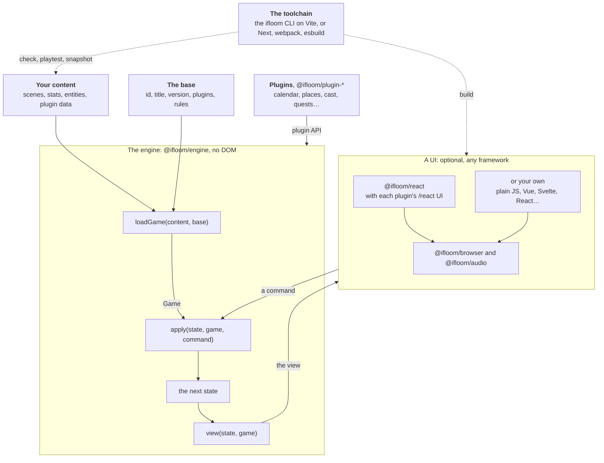

An IFLoom game is built in four layers, the engine, plugins, a UI and the toolchain, and only the engine is required. The engine is the one every game uses. A game adds each of the others when it needs it, leaves it out, or puts something of its own in its place.

## The engine is a library

The engine is a TypeScript library with no DOM and no UI framework. It takes three things in and gives one thing out:

- **Content in.** A game is [content](/docs/0.1.0/reference/glossary#content), plain data split across your files. [`loadGame`](/docs/0.1.0/reference/content#loadgame) merges it with the base into one `Game`, lays any [packs](/docs/0.1.0/reference/glossary#pack) such as mods over it, and checks the result.
- **Commands in.** When the player presses a button, the UI sends that button's command to [`apply`](/docs/0.1.0/reference/commands#apply). The engine checks it and returns the next state, or the reason it refused.
- **A view out.** [`view`](/docs/0.1.0/reference/view) turns a state into the screen as data: the scene's paragraphs, each button with the command it sends and, for a button the player can't press, the reason. It also lists the stats, the inputs, the audio and each plugin's part.

The engine never reaches out to anything, so the same code runs in a browser, in Node, in a test and in a worker. A [runner](/docs/0.1.0/reference/runner) wraps the three in one object with undo, saves and autosave, and every UI uses one. [State, commands and the view](/docs/0.1.0/explanation/state-and-commands) explains the loop in full.

The engine keeps what changes the game: the state, the rules and what a replay has to repeat. The look of the game is the UI's. A fade or a stat shown as pips is a [UI hint](/docs/0.1.0/reference/glossary#ui-hints), which the engine carries to the view without reading it. [Why IFLoom works this way](/docs/0.1.0/explanation/design) gives the reasons for that split.

## Plugins add systems

A plugin adds a system to the core, such as the calendar's days and times, the locations the player walks between, or the cast who keep their own hours. It brings its own conditions, effects, commands, state and part of the view, and imports nothing but the engine. The game lists the plugins it uses in the base, and the engine runs them through the plugin API.

Plugins share the game's world through the engine, never through each other. A sandwich, a scarf and a person are all [entities](/docs/0.1.0/reference/glossary#entity), and each plugin reads the [trait](/docs/0.1.0/reference/glossary#trait) it knows on each one. So the shop can sell what the wardrobe dresses you in without either plugin knowing the other. [How plugins work](/docs/0.1.0/explanation/plugins) explains the rules a plugin keeps, and [Entities, things and traits](/docs/0.1.0/explanation/entities-and-traits) explains the shared world.

A plugin's engine side has no UI. Its part of the screen goes into the view, under `view.plugins.<id>`, and any UI can render it. Every first-party plugin with something for the player also ships a React UI in a `/react` subpath of its package, such as `@ifloom/plugin-shop/react`. A game rendered by the React UI lists the ones it wants. A game rendered some other way never loads them.

## A UI renders the view and sends commands

A UI does two jobs. It renders the view, and it sends a command when the player presses something. Any code that does both is an IFLoom UI, in any framework or none:

- **`@ifloom/react`** is one ready-made UI. It renders the whole game with React, Tailwind and shadcn/ui, and you restyle it with presets and CSS or replace any part of it. It names no plugin: each plugin's React UI comes from that plugin. Nothing else in IFLoom depends on it.
- **Your own UI** can be plain JS, Vue, Svelte, or React by hand. The `vanilla`, `vue` and `svelte` templates each render the game with no React.
- **`@ifloom/browser` and `@ifloom/audio`** do the browser jobs every UI needs. The first gives a runner with saves in `localStorage`, the clock that ticks timers, keyboard shortcuts and the key that shows held-back prose. The second plays the game's music and sounds. Both are plain DOM and import only the engine, and the React UI uses them too.

A test or a script needs no UI at all. It calls `apply` and reads the view, as a UI would. [Choosing a UI](/docs/0.1.0/explanation/choosing-a-ui) compares the React UI with a UI of your own.

## The toolchain builds and checks

The packages are compiled JavaScript with type declarations, so any bundler builds a page with them and needs no special settings. The `ifloom` [CLI](/docs/0.1.0/reference/cli) is a convenience built on Vite. `ifloom new` starts a game from a template, which is what `npm create ifloom` runs, and `ifloom dev` serves the game while you edit.

The main reason the CLI exists is `ifloom build`. It makes the game into one `index.html` with relative paths, and checks that the page opens from disk with no server. A player can download that file and play offline, which players expect of interactive fiction. [Why IFLoom works this way](/docs/0.1.0/explanation/design#nothing-loads-at-runtime) explains why a page from disk is hard to make.

`ifloom check`, `ifloom playtest` and `ifloom snapshot` load the game module in `src/game.ts` with the CLI's own Vite. So they check and play the game's content whatever bundler builds its page. Next, webpack and esbuild each have a how-to, and of the three only Next can't make the single offline file.

## The pieces a game needs

The engine is the only package every game has. The rest depend on what you're making:

- **A game in the browser, ready to play.** The `react` template uses the engine, `@ifloom/react` and the CLI.
- **Your own look, in Vue, Svelte or plain JS.** The `vue`, `svelte` and `vanilla` templates use the engine, `@ifloom/browser`, `@ifloom/audio` and the CLI.
- **A game on a page of your website.** The `next` template, or [Build with Next](/docs/0.1.0/how-to/build-with-next) in an app you already have.
- **Tests, or a script that plays the game.** The engine on its own, with the CLI for playtests.

Plugins come on top of any of these, one package each, only for the systems the game uses. A novel uses none. [Three shapes of game](/docs/0.1.0/explanation/shapes-of-game) shows which a novel, a management game and a life sim each take.

For the details, see [Content and packs](/docs/0.1.0/reference/content), [Commands](/docs/0.1.0/reference/commands), [The view](/docs/0.1.0/reference/view) and [The runner](/docs/0.1.0/reference/runner) in the reference, and [Create a game](/docs/0.1.0/how-to/create-a-game) and [Add a plugin](/docs/0.1.0/how-to/add-a-plugin) for the tasks.
