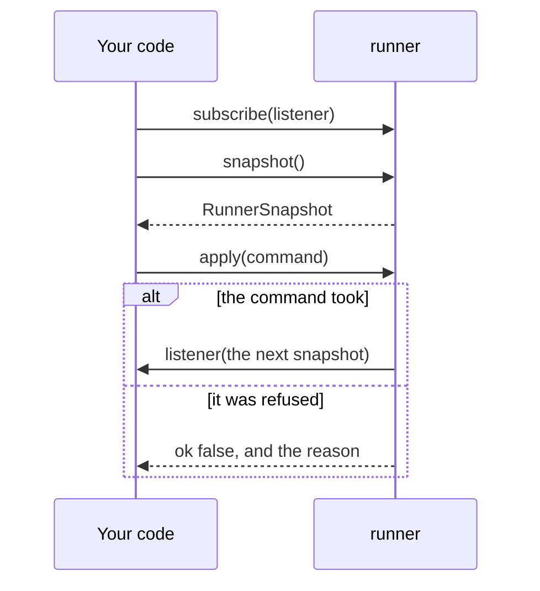

Use this to play a game from your own code: a script, a tool, a test, or the loop under a UI of your own. Nothing here needs a page, so it runs the same in Node and in a browser. You need a game module, such as the one `npm create ifloom` makes in `src/game.ts`.

## Make a runner

A [runner](/docs/0.1.0/reference/runner) holds the game in play, and your code talks only to it. Build the game from its game module, then make the runner with [`createRunner`](/docs/0.1.0/reference/runner#createrunner) and a new game from [`startingState`](/docs/0.1.0/reference/commands#startingstate):

```ts
import { createRunner, describeProblem, startingState } from '@ifloom/engine'
import module from './game.ts'

const { game, problems } = module.build()
for (const problem of problems) console.warn(describeProblem(problem))

const runner = createRunner(game, startingState(game))
```

`createRunner` turns on nothing you don't ask for. Without a `seed`, `startingState` uses one made from the game's id, so every run draws the same variants, which suits a test. A game in front of a player passes its own, `startingState(game, { seed: Math.floor(Math.random() * 2 ** 31) })`.

In a browser, [`browserRunner`](/docs/0.1.0/reference/browser#browserrunner) from `@ifloom/browser` makes one with a random seed, 50 steps of undo, saves in `localStorage` and an autosave each turn: `const runner = await browserRunner(game)`.

## Send commands

Everything the player does is a [command](/docs/0.1.0/reference/commands). Every button in the view carries the command it sends, so pass it back to `runner.apply`:

```ts given
const knock = runner.view().scene.choices.find((choice) => choice.id === 'knock')
if (knock) {
  const result = runner.apply(knock.command)
  if (!result.ok) console.warn(result.reason)
}
```

`apply` answers with a [`Result`](/docs/0.1.0/reference/glossary#result). A refused command changes nothing, and `reason` says why in words a player can read. A greyed-out button carries the same words in `disabled`, so the screen and the refusal agree.

Build the few commands that come from no button yourself:

- **`{ type: 'input', id, to }`** sends a value the game asked for, such as a name. See [Ask the player for a name](/docs/0.1.0/how-to/ask-for-a-name).
- **`{ type: 'minigame', input }`** presses one of a running minigame's inputs.
- **`{ type: 'tick', ms }`** runs timers and a minigame's clock down. In a browser, [`startClock`](/docs/0.1.0/reference/browser#startclock) sends it.
- **`{ type: 'dismiss' }`** clears the notices.

A plugin's helpers write its commands, such as `places.go('cafe')` from the [places plugin](/docs/0.1.0/reference/plugins/places), and `apply` takes them as they are.

## Read the view

The [view](/docs/0.1.0/reference/view) is one plain object with everything a screen shows, worded for the player. Read it with `runner.view()`, never from the state:

```ts given
const shown = runner.view()
shown.scene.title // 'The door'
shown.scene.beats // the paragraphs and spoken lines, in order
shown.scene.choices.map((choice) => [choice.label, choice.disabled]) // [['Knock', undefined], …]
shown.actions // the room's buttons while no scene is open
shown.statsById.courage?.text // '1'
shown.plugins.places?.exits // each plugin's part, typed, or undefined without it
```

`scene.body` is the same words as one string, paragraphs apart, for a test or a terminal. A UI renders `beats`, which keep spoken lines and pictures apart. [Render the scene and its choices](/docs/0.1.0/how-to/render/scene) walks through each part.

## Follow changes with subscribe

`runner.subscribe` hands your listener a new [snapshot](/docs/0.1.0/reference/runner#runnersnapshot) whenever anything changes, and returns the way to stop. Render from it:



The listener hears undo, redo, a load, a new game, a setting and a save too, so render only from it. `runner.snapshot()` returns the same object until a part of it changes, so a framework that compares values renders exactly when something is new.

## Turn on undo, saves and autosave

Pass the options to `createRunner`. Saves need a [driver](/docs/0.1.0/reference/saves#savedriver) that says where they're kept, and Node has the engine's `memoryDriver`:

```ts
import { createRunner, memoryDriver, saves, startingState } from '@ifloom/engine'
import module from './game.ts'

const { game } = module.build()
const runner = createRunner(game, startingState(game), {
  saves: saves(game, memoryDriver()),
  history: { depth: 50, stopAtNewTurn: true }, // undo, but never back into the last turn
  autosave: { every: 'turn' }, // to the slot 'auto'
})

runner.apply({ type: 'choose', id: 'knock' })
runner.undo()
await runner.save('1', 'At the door')
const loaded = await runner.load('1')
if (!loaded.ok) console.warn(loaded.reason)
```

`autosave` takes `every: 'command'`, `'scene'` or `'turn'`. A game played mostly in the room, where walking opens no scene, wants `'command'`. Undo can't re-roll a draw, since the same command from the same state draws the same. In a browser, [Write a save driver](/docs/0.1.0/how-to/write-a-save-driver) covers the drivers and your own.

## Play without a runner

[`apply`](/docs/0.1.0/reference/commands#apply) and [`view`](/docs/0.1.0/reference/view#view-1) work on a state directly, with no undo or saves. Each `apply` returns the next state, or the same one with a reason:

```ts
import { apply, startingState, view } from '@ifloom/engine'
import module from './game.ts'

const { game } = module.build()
let state = startingState(game)

const tried = apply(state, game, { type: 'choose', id: 'again' })
if (!tried.ok) console.log(tried.reason) // 'That is not on offer.'

state = apply(state, game, { type: 'choose', id: 'knock' }).state
console.log(view(state, game).scene.title, state.stats.courage) // 'Inside' 2
```

A state is a plain object, so you can keep one, compare two or write it to a file. A test that wants a whole route played this way uses `play` from [`@ifloom/engine/testing`](/docs/0.1.0/reference/testing#play), which fails on the first refusal.

## Play it from a script

This script plays the game `npm create ifloom` makes and prints each screen. Put it at the root of the game and run it with `node play.ts`, since Node 22.18 and later run TypeScript:

```ts
// play.ts
import { createRunner, startingState, type View } from '@ifloom/engine'
import module from './src/game.ts'

const { game } = module.build()
const runner = createRunner(game, startingState(game))

function print(shown: View): void {
  console.log(`\n# ${shown.scene.title}`)
  console.log(shown.scene.body)
  shown.scene.choices.forEach((choice, at) => console.log(`${at + 1}. ${choice.label}${choice.disabled ? ` (${choice.disabled})` : ''}`))
}

runner.subscribe((snapshot) => print(snapshot.view))
print(runner.view())
runner.apply({ type: 'choose', id: 'knock' })
```

You should see the door, its two choices, then the room inside with its one line about knocking.

For more, see:

- [The runner](/docs/0.1.0/reference/runner) and [the view](/docs/0.1.0/reference/view).
- [Commands](/docs/0.1.0/reference/commands), with [`apply`](/docs/0.1.0/reference/commands#apply) and [`startingState`](/docs/0.1.0/reference/commands#startingstate).
- [State and commands](/docs/0.1.0/explanation/state-and-commands), on why a UI reads the view and sends commands.
- [Start your own UI](/docs/0.1.0/how-to/render/start), to put the same loop in a page.
- [Test a route through your game](/docs/0.1.0/how-to/test-a-route).
