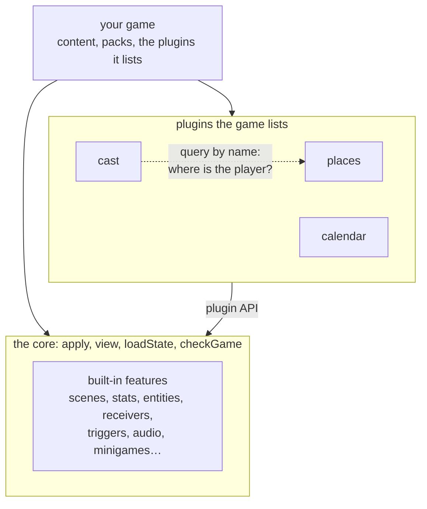

A plugin adds one system to the engine, such as a calendar, locations or quests. The rules each plugin keeps, such as never importing another plugin, are what let a game take any combination of them.

## The core and the plugins a game chooses

The core is the same in every game. It's made of built-in features, such as scenes, stats, entities, receivers and triggers, each keeping its own piece of the state and its own conditions, effects and commands. A plugin is a part the game chooses. It brings conditions, effects and commands of its own, its own part of the state and the view, and its own checks of its content. It plugs into the core through the plugin API, and reaches other plugins only by name:

Add a plugin when your game needs the system it brings, and leave it out otherwise. A novel needs none. A game lists its plugins in the base's `plugins`, and the engine runs them in that order, after the game's own rules.

## Hooks change the state, providers answer

A plugin's members follow one naming rule, the same one the game's rules follow:

- **A hook** runs at an event and returns the next state. It's named `on` and the event: `onTurn`, `onTurnDone`, `onStat`, `onCommand`.
- **A provider** answers a question and never changes the state. It's named by the noun it gives: `guard`, `price`, `label`, `scene`, `view`, `profile`.
- **A table** holds the named functions content calls: `conditions`, `effects`, `macros`, `commands`, `queries`, `values`.

The split matters because the engine calls the two at different times. A hook runs once, at its event, in a fixed order. A provider can be asked any number of times, by the view, by `apply` before a command runs, or by a tool, so it must change nothing. A guard that refused a command and also wrote to the state would make the same question give different answers. Nothing is nested, so every hook sits beside the rest of the plugin and you can see all a plugin does by reading its top level.

## Content goes in data, never in options

A plugin's factory takes options, such as `places({ start: 'flat' })`. Options are code, set once when the game is built, and a mod can't change them. Content a mod could reasonably change goes in `data` instead: the quests, the achievements, the vendors' goods. The game gives a plugin its content under `data`, by the plugin's id, such as `data.quests.quests`.

The rule follows from [Content, packs and the base](/docs/0.1.2/explanation/content-and-packs). A mod is a pack of data, so a list kept in a plugin's options would be out of every mod's reach. Keeping it in `data` means a mod adds a quest the same way it adds a scene. When a plugin gives meaning to an entity instead, such as a location or a character, it reads a trait on that entity, and the entity goes in content's `entities` like any other.

## Plugins cooperate by name

No first-party plugin imports another, and none requires another. That's what lets a game take any combination. The cast, for example, wants to know where the player is, so it can say who is here. It asks with a query, `places/here`, which the places plugin answers. Without places, the query has no answer, and the cast says nobody is here.

The engine declares no plugin's answers. The answering plugin declares its own, and the asking plugin, which never imports it, gives the type of the answer it reads, such as `query<{ day: number }>('calendar/now')`. The answer comes from the owning plugin, and the fallback when there's no answer comes from the plugin that asked.

Content can name another plugin too. A plugin lists the plugins it `cooperates` with, and content written for it may then use their conditions and effects in a game that leaves them out. The shop cooperates with the calendar, so a vendor's opening hours can use `calendar/period`. In a game without the calendar, that condition is false, an effect from it does nothing, and a command from it is refused. The content checker lets those names pass rather than reporting them.

Plugins also share the world without asking each other anything. The shop, the wardrobe and the inventory never cooperate. Each reads its own trait on each thing, so one scarf can be sold, worn and dropped, and the shop hands what it sells over with a `receive` that names no plugin. The core passes it to the first plugin that keeps things and claims it, a [receiver](/docs/0.1.2/reference/glossary#receiver), and keeps nothing itself. [Entities, things and traits](/docs/0.1.2/explanation/entities-and-traits#who-has-what) explains why.

## Each plugin is its own package

Each first-party plugin is a package of its own, such as `@ifloom/plugin-shop`, so a game that doesn't use one doesn't ship it. A plugin peers on the engine rather than depending on it, so a game has one copy of the engine, at the version it chose. And a first-party plugin imports nothing but the engine's public API, the same API your own plugins use. Anything one of them does, a plugin of yours can do too.

A plugin declares each of its conditions, effects and commands once, with what each takes. That one declaration types the calls a game writes, lets the content checker report a missing or misspelled argument, and gives the plugin's helpers their writers, such as `places.at('cafe')`. Once your game imports a plugin, a call to it with a wrong argument fails to compile.

## A plugin's UI ships beside it

A plugin's engine side has no UI. Its part of the screen goes in the view, under `view.plugins.<id>`, and every action it offers there is a ready `RenderedChoice`, refused in advance and worded by the plugin. So a UI in any framework renders a plugin's buttons as it renders any other, and never builds a plugin's command or words itself.

A first-party plugin with something for the player also ships a React UI in a `/react` subpath, such as `@ifloom/plugin-shop/react`. React is an optional peer of that subpath, so a game rendered another way never installs or loads it. A game on the React UI lists the plugin UIs it wants in its `plugins` option. The React UI itself names no plugin, which keeps it one UI among others rather than the place every plugin has to register.

For the details, see [the first-party plugins](/docs/0.1.2/reference/plugins), [Plugin API](/docs/0.1.2/reference/plugin-api), [Declaring a plugin's calls](/docs/0.1.2/reference/plugin-calls) and [Queries and partners](/docs/0.1.2/reference/plugin-queries). [Add a plugin](/docs/0.1.2/how-to/add-a-plugin), [Write a plugin](/docs/0.1.2/how-to/write-a-plugin) and [Make plugins work together](/docs/0.1.2/how-to/make-plugins-work-together) are the tasks.
