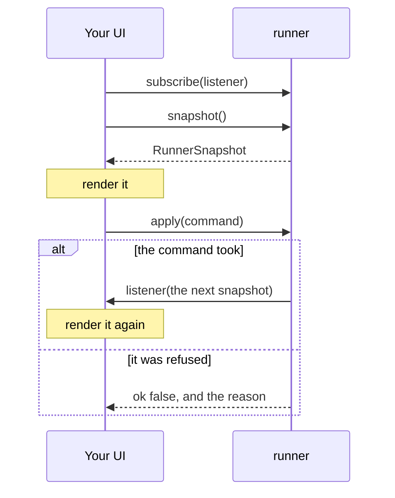

The engine keeps a game in progress as one plain state. The player changes it only by sending commands, and a UI only ever renders a view of it. Every other part of the engine hangs off that loop.

## One plain state

A game in progress is one [`GameState`](/docs/0.1.2/reference/state). It holds the turn, the scene on screen, the player's stats and [kv store](/docs/0.1.2/reference/glossary#kv), the entities' numbers, the storylines, and each plugin's own part, such as the calendar's day or what the inventory keeps. It holds no functions and no class instances, so it turns into JSON as it is. The state is the save.

The engine never changes a state in place. Every command returns a new state and leaves the old one as it was. So undo needs nothing more than the previous state, and a test can keep two states side by side and compare them.

The state also keeps less than you might expect. It never copies a definition from content. A new game's state has no stats for Ana the cook, because the engine reads her stats from content until play changes one. [Entities, things and traits](/docs/0.1.2/explanation/entities-and-traits#definitions-stay-in-content) explains why.

## Commands go through apply

The player changes the game only through commands. A command is a plain object, such as `{ type: 'choose', id: 'knock' }` for a choice in the open scene, or `{ type: 'action', id: 'wait' }` for an action. The core has a few more, such as `leave` to close the scene, `input` for a value the player typed, and `tick` for time passing in real time. Plugins add their own, such as the places plugin's command for walking to a location.

[`apply(state, game, command)`](/docs/0.1.2/reference/commands#apply) returns the next state and whether the command took. A refused command returns the state unchanged, with a reason written for the player. A command that took runs the same steps every time, in order: its handler, then the [triggers](/docs/0.1.2/reference/glossary#trigger), the bookkeeping for a new scene, the plugins' `onCommand` hooks and any level-up notices. [`apply`](/docs/0.1.2/reference/commands#apply) lists them with a diagram.

You rarely build a command by hand. Every button in the view carries the command it sends, so a UI passes it back without knowing what it does. Tests and tools send commands directly.

## Effects and conditions are data

A choice's effects are a list of plain objects, and its `when` is a condition, also a plain object:

```ts fragment
// effects
[{ stat: 'friendship', by: 5, of: 'character:ava' }, { stat: 'coins', by: -3 }]

// a condition
{ all: [{ 'places/at': { location: 'cafe' } }, { 'cast/here': { character: 'ava' } }]}
```

Each effect and condition is told apart by its key, `stat` or `places/at`, and a plugin's keys start with the plugin's id. Because they're data, the content checker can check them before anyone plays, and a mod can add them without shipping code. When a condition or an effect needs code, content calls the game's own by name with `game/` in front, such as `{ 'game/marketDay': true }`, and the code stays in the game's [rules](/docs/0.1.2/reference/glossary#rules).

The engine asks conditions all the time, not only when a command runs. It asks a choice's `when` to decide whether to show it, and its `blocked` to grey it out with a reason. Data makes that safe, because asking a condition can never change the state.

## Locks and blocked reasons

There are two ways to refuse something, and each writes its reason once. An action's or a choice's [`blocked`](/docs/0.1.2/reference/glossary#blocked) list refuses that one thing while a condition holds. A [lock](/docs/0.1.2/reference/glossary#lock) refuses whole kinds of command at once, such as every walk while the intro keeps the player at home. `apply` refuses on the first lock that matches, and the view greys out each button it covers with the same line.

The reason is the point of both. The view and `apply` read the same `blocked` or lock, so the greyed-out button and the refusal say the same thing. A rule that would otherwise be special code, such as "not until you've unpacked", becomes one lock in content.

## Triggers, notices and inputs

Some things happen without a button. A [trigger](/docs/0.1.2/reference/glossary#trigger) is a list of effects that runs by itself the first time its condition holds, such as a note under the door the morning after the player first visits the café. With `once: { per: 'turn' }` it can fire again, at most once a turn. Triggers fire after every command, in the order the content lists them.

A [notice](/docs/0.1.2/reference/notices) is something the game tells the player outside a scene, which a UI shows as a toast or counts on a badge. An [input](/docs/0.1.2/reference/inputs) is a value the player types or picks, such as their name, which the engine writes to a kv key. These are the parts a phone, a notice board or a journal is built from.

## The view is what a UI renders

[`view(state, game)`](/docs/0.1.2/reference/view) turns a state into the screen as data. It has the scene on screen with its body already split into beats, the choices, the actions on offer, the stats, and each plugin's part, such as the exits from where the player is. Each button is a ready `RenderedChoice` with its label, its price, the command it sends and, if the player can't press it, the reason.

The view is built in two passes. [`screen`](/docs/0.1.2/reference/view) renders the state once: the open scene or the room, its choices with their effects, which are available, and the pool picks and audio they imply. `view` then formats that into words and drops what the player mustn't see, such as a choice's effects. So a UI can show everything in the view without giving the story away, and the engine records the picks from the same pass the player saw.

A UI renders the view and sends commands, and never reads the state. That's what lets any framework be a UI, and lets a test check what the player sees by reading the same view.

## The runner adds what every UI wants

`apply`, `view` and a state are enough to play a game. Every UI ends up wanting the same extras, though: undo, a backlog of what was said, saves and autosave, and a log to replay a bug from. [`createRunner`](/docs/0.1.2/reference/runner) puts them in one object, and a UI runs the same loop whatever it's written in:



The listener hears about every change, not only the UI's own commands. Undo, loading a save, a new game and a changed setting all reach it, so a UI never has to render again after each one itself. A refused command changes nothing, so the listener doesn't hear about it.

Undo is off in a runner made with `createRunner` until the game turns it on. [`browserRunner`](/docs/0.1.2/reference/browser) turns it on for you, 50 steps deep, with an autosave each turn. Undo never steps back past a barrier: a choice marked `irreversible`, and, if the game asks, the start of a new turn or any state where a condition holds. A `tick` is no step of its own, so one undo goes back past the time that passed to the last thing the player did. Because draws are seeded, the choice made again after an undo deals the same result (see [Why IFLoom works this way](/docs/0.1.2/explanation/design#the-same-save-gives-the-same-draws)).

## Saves and migrations

A save is the state with a few details for a load screen, such as the turn, the player's name and the mods it was made with. A [save store](/docs/0.1.2/reference/saves) keeps one game's saves in named slots, and a driver says where they're kept: `localStorage`, IndexedDB, memory for tests, or one you write. The engine has no default driver, because only the game knows where it runs.

A save outlives the version of the game that wrote it. Every state from outside, a save included, comes into play through one door, [`loadState`](/docs/0.1.2/reference/saves). It carries the state forward through the engine's steps, each plugin's migrations and the game's own, then fills in what the game now declares. A save with no route to the current version is refused rather than misread. Your game takes part by giving its base a `version` and adding a step to its rules' `migrations` when an update renames a kv key. [Migrate your players' saves](/docs/0.1.2/upgrading/migrate-your-saves) shows how.

For the details, see [Game state](/docs/0.1.2/reference/state), [Commands](/docs/0.1.2/reference/commands), [Conditions](/docs/0.1.2/reference/conditions), [Effects](/docs/0.1.2/reference/effects), [The view](/docs/0.1.2/reference/view), [The runner](/docs/0.1.2/reference/runner) and [Saves](/docs/0.1.2/reference/saves). [Run a game in code](/docs/0.1.2/how-to/run-a-game-in-code) puts the loop to work in Node.
