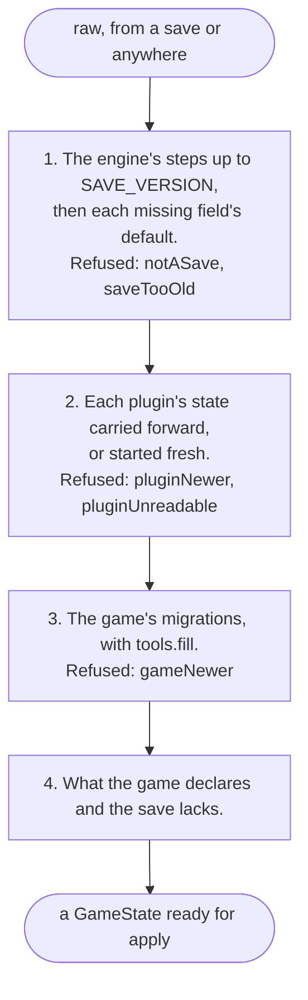

A save is the whole [`GameState`](/docs/0.1.2/reference/state) in a named slot, with a few details for a load screen. The save store, [`saves(game, driver)`](#saves-1), keeps one game's saves, and a driver decides where they're kept. [State, commands and the view](/docs/0.1.2/explanation/state-and-commands#saves-and-migrations) explains why a save is only the state, [Render saves, settings and the backlog](/docs/0.1.2/how-to/render/saves-and-settings#render-a-save-and-load-screen) renders a load screen, and [Write a save driver](/docs/0.1.2/how-to/write-a-save-driver) keeps saves somewhere of your own.

In the showcase: `examples/showcase/src/main.tsx`, which keeps its saves with `saves(game, localStorageDriver(window.localStorage))` and hands the store to its runner.

```ts
import {
  loadState, memoryDriver, saves, SAVE_VERSION,
  type BrokenSave, type FillPart, type LoadedSave, type MigrationTools, type SaveDriver, type SaveExtra, type SaveFile,
  type SaveListing, type SaveMeta, type Saves,
} from '@ifloom/engine'
```

Most games never call the store directly. They hand it to the [runner](/docs/0.1.2/reference/runner), which saves, loads and autosaves through it and counts the time played.

## SaveDriver

A store of strings by key, which keeps whatever the save store, the [profile](/docs/0.1.2/reference/profile) and the [mod store](/docs/0.1.2/reference/mods) give it. Every field is in [`SaveDriver`](/docs/0.1.2/api/engine#savedriver).

The engine has no default driver, so a game chooses one and passes it to `saves`. The engine has [`memoryDriver`](#memorydriver), and [`@ifloom/browser`](/docs/0.1.2/reference/browser) has [`localStorageDriver`](/docs/0.1.2/reference/browser#localstoragedriver), for about 5MB per origin, and [`indexedDbDriver`](/docs/0.1.2/reference/browser#indexeddbdriver), for up to the browser's quota. Every driver is asynchronous, even over storage that isn't, so one swaps for another without changing the code that calls it. `name` says where the data goes, such as `'indexedDB'`, for a debug screen or an error report.

A driver keeps these rules, or saves go missing in ways that are hard to trace:

- `get` answers `null` for a key that isn't there, and doesn't throw.
- `set` replaces any value already at the key, and `remove` on a missing key does nothing.
- `keys(prefix)` returns the whole key of every entry that starts with `prefix`, in any order.
- Values are JSON text, kept exactly as given and with no small size limit, since a save holds the whole state.
- Keys can hold any character, because a slot is whatever name the game gives it. A driver that turns keys into file names or URLs escapes them, and undoes that in `keys`.
- A failure rejects the promise. The save store catches it and answers a failing [`Result`](/docs/0.1.2/reference/common#result) with the driver's error as its `cause`.

One driver can serve everything a game stores, because each user keeps its own keys:

| Key | Meaning |
|---|---|
| `<game id>.save.<slot>` | One save, written by the save store. |
| `<game id>.profile` | The game's [profile](/docs/0.1.2/reference/profile). |
| `<game id>.mod.<mod id>` | One installed [mod](/docs/0.1.2/reference/mods). |

The keys carry the game's id because every game opened from disk in one browser shares a storage origin, and so do the games a host such as itch.io serves from one domain. So choose a `game.id` unique to your game and never change it. The keys don't carry the save format's version, which each save keeps inside it, so an update to the engine never loses a save.

## Saves

One game's saves, kept wherever its driver keeps them, as [`saves`](#saves-1) returns them. Every member is in [`Saves`](/docs/0.1.2/api/engine#saves).

Each member answers a [`Result`](/docs/0.1.2/reference/common#result) and never rejects, so a UI calls it without a `catch`. Slots are names the game chooses, such as `'auto'` for the runner's autosave or `'1'`, `'2'` and `'3'` for a save screen, with no fixed number of them.

| Field | Meaning |
|---|---|
| `write(slot, state, extra?)` | Writes a [`SaveFile`](#savefile) to the slot, replacing what was there, and answers its [`SaveMeta`](#savemeta). `extra` is a [`SaveExtra`](#saveextra). |
| `read(slot)` | Answers the slot as a [`LoadedSave`](#loadedsave), or `null` when the slot is empty. It fails with the reason a save can't be read. |
| `list()` | Answers every save of the game as [`SaveListing`](#savelisting)s, the readable ones newest first by `savedAt`, then the unreadable ones by slot. |
| `exportSlot(slot)` | Answers the save as text for the player to keep as a file, or `null` when the slot is empty. |
| `importText(text)` | Reads a file's text with the same checks as `read`, and answers the `LoadedSave`. It's synchronous and writes nothing. |
| `driver` | The [driver](#savedriver) the store was made with, to pass to [`profile`](/docs/0.1.2/reference/profile) or [`mods`](/docs/0.1.2/reference/mods) so their data sits in the same place. |

`read` and `importText` load the state in the file with [`loadState`](#loadstate) and refuse a save with the reasons under [Strings](#strings). `remove(slot)` empties a slot.

```ts given
import { memoryDriver, saves } from '@ifloom/engine'

const store = saves(game, memoryDriver())
const exported = await store.exportSlot('1')
const loaded = exported.ok && exported.value !== null ? store.importText(exported.value) : null
if (loaded?.ok) await store.write('2', loaded.value.state, { name: loaded.value.meta.name, played: loaded.value.meta.played })
```

## SaveExtra

What [`write`](#saves) records besides the state. Every field is in [`SaveExtra`](/docs/0.1.2/api/engine#saveextra).

`name` defaults to one made from the state, as [`SaveMeta`](#savemeta) describes, `played` to 0 and `savedAt` to `Date.now()`. The runner passes the time played. Code that writes an imported save passes the loaded save's `meta.name` and `meta.played`, or the copy loses the player's name for it and its time played.

## SaveFile

A save as the store writes it, in JSON: the tag `ifloom: 1`, the save's [`SaveMeta`](#savemeta) and the state. Every field is in [`SaveFile`](/docs/0.1.2/api/engine#savefile).

`ifloom` is the format of this wrapping around the state, and the store doesn't read a file without `ifloom: 1` as a save. It's separate from [`SAVE_VERSION`](#save_version), the format of the state inside, which the state keeps as `state.version`. `exportSlot` answers this text.

## SaveMeta

What a save says about itself, enough to render a row on a load screen without reading the state. Every field is in [`SaveMeta`](/docs/0.1.2/api/engine#savemeta).

| Field | Meaning |
|---|---|
| `name` | The player's name for the save, else `when`, else the [`turnLabel`](/docs/0.1.2/reference/strings#saves) string with the turn counted from 1, such as `'Turn 3'`. |
| `when` | The plugins' labels for the state, as [`view.when`](/docs/0.1.2/reference/view#view) has them, such as `'Day 5 · Friday evening · The Corner Café'`, or `null`. |
| `playerName` | The answer of the first [`saveName`](/docs/0.1.2/reference/rules#savename), the game's before any plugin's, or `null`. The engine keeps no player name, so a game that asks for one declares `saveName` to show it on its load screen. |
| `packs` | The ids of the [packs](/docs/0.1.2/reference/content#pack) the game was loaded with, such as mods and unlocked content. The game's own content has no id, so renaming or splitting your files never warns a player. |
| `plugins` | The version of each plugin's state by plugin id, such as `{ quests: 1 }`. |
| `gameVersion` | The game's own [`version`](/docs/0.1.2/reference/content#gamebase) the save was made with, 1 for a game that declares none. |

## SaveListing

One entry of [`list()`](#saves), a save's [`SaveMeta`](#savemeta) or a [`BrokenSave`](#brokensave). Its definition is in [`SaveListing`](/docs/0.1.2/api/engine#savelisting). A UI tells the two apart with `'broken' in entry`.

```ts given
import { memoryDriver, saves } from '@ifloom/engine'

const listing = await saves(game, memoryDriver()).list()
for (const entry of listing.ok ? listing.value : []) {
  console.log('broken' in entry ? `${entry.slot}: ${entry.broken}` : `${entry.name}, turn ${entry.turn + 1}`)
}
```

### BrokenSave

A save that's there but can't be read, with its slot and the reason `read` gives, such as one that isn't JSON or belongs to another game. Every field is in [`BrokenSave`](/docs/0.1.2/api/engine#brokensave). A load screen lists it so the player can delete it with `remove(slot)`.

## LoadedSave

A save read back, with its details and its state carried forward to the engine and the game as they are now. Every field is in [`LoadedSave`](/docs/0.1.2/api/engine#loadedsave).

`missingPacks` names the mods, packs whose id starts with `mod:`, that the save was made with and the game wasn't loaded with, such as one the player has since turned off. Unlocked content isn't listed, since it comes back when the player enters the code. The save still loads, and the game decides whether to warn, refuse or carry on, since a scene or thing only the mod had is gone.

`missingPlugins` names the plugins the save was made with that the game doesn't have. The save still loads, and `state.plugins` keeps that plugin's state unused, so it comes back if a later build adds the plugin again.

## MigrationTools

What a step of the game's [`migrations`](/docs/0.1.2/reference/rules#migrations) gets besides the state. Every field is in [`MigrationTools`](/docs/0.1.2/api/engine#migrationtools).

`game` is the game the save loads into, for a step that reads its content. `fill(parts)` returns the state the step was given with what the game declares and the save lacks filled in, for the [`FillPart`](#fillpart)s named, or every part when `parts` is left out. It never changes a value the save already has, and it works on the state the step was given, so a step that fills and changes calls `fill` first. A [plugin's migration](/docs/0.1.2/reference/plugin-migrations) gets the same tools, and its `fill` gives the whole game state for reading.

A game that declares a `version` fills nothing new into a loaded save unless a step calls `fill`. A game with no `version` gives a loaded save the default of each `play` setting it lacks, and fills nothing else. [Migrate your players' saves](/docs/0.1.2/upgrading/migrate-your-saves) writes the steps.

```ts
import type { GameBase } from '@ifloom/engine'

export const base: GameBase = {
  id: 'the-letter',
  title: 'The Letter',
  version: 3,
  rules: {
    migrations: {
      1: (state) => {
        const { lies, ...kv } = state.kv
        return lies === undefined ? state : { ...state, kv: { ...kv, fibs: lies } }
      },
      2: (_state, tools) => tools.fill(['stats']),
    },
  },
}
```

## FillPart

A part of the state that [`fill`](#migrationtools) fills in. Its definition is in [`FillPart`](/docs/0.1.2/api/engine#fillpart).

| Key | Meaning |
|---|---|
| `stats` | Each of the player's stats the save lacks, at its `start`. Derived stats and entities' stats need no filling, since they read their start until play changes them. |
| `kv` | Each key of the content's starting `kv` and its [`resets`](/docs/0.1.2/reference/rules#resets) that the save lacks, at its starting or reset value. |
| `settings` | Each `play` [setting](/docs/0.1.2/reference/settings) the save lacks, at its default. |

A stat the save lacks reads as its `start` either way, but a `stat` effect adds to the kept value, which is 0 for a missing stat. So `{ stat: 'patience', by: 1 }` on a save without `patience` gives 1, and a step fills a new stat whose `start` isn't 0.

## SAVE_VERSION

The current format of the state inside a save, which every new state keeps in `state.version`. Its definition is in [`SAVE_VERSION`](/docs/0.1.2/api/engine#save_version).

Code reads it from the package rather than writing the number down, since it goes up with the engine. It goes up only when a field a save already has changes shape, and the engine adds a step that reshapes the old field. A field added to `GameState` doesn't change it, because a save that lacks the field gets the field's default when it loads. [Older saves](/docs/0.1.2/upgrading/old-saves) says how.

## Functions

### saves

Returns the save store for a game, kept in a driver. Every parameter is in [`saves`](/docs/0.1.2/api/engine#saves-1).

```ts given
import { indexedDbDriver } from '@ifloom/browser'
import { saves } from '@ifloom/engine'

const store = saves(game, indexedDbDriver())
await store.write('1', state)
```

### memoryDriver

Returns a driver that keeps everything in a `Map`, gone with the page. Every parameter is in [`memoryDriver`](/docs/0.1.2/api/engine#memorydriver). Each call makes a new, empty store, for tests and previews.

```ts given
import { memoryDriver, saves } from '@ifloom/engine'

const store = saves(game, memoryDriver())
```

### loadState

Returns a state from outside, such as a save's state or a [command log](/docs/0.1.2/reference/runner#commandlog)'s start, made ready to play in this game, or the reason it can't be. Every parameter is in [`loadState`](/docs/0.1.2/api/engine#loadstate).

The save store's `read` and `importText` and [`replay`](/docs/0.1.2/reference/runner#replay) all load through it. A state that comes back from it, or from [`startingState`](/docs/0.1.2/reference/commands#startingstate), is ready for [`apply`](/docs/0.1.2/reference/commands#apply), which doesn't check the shape again. A state already in today's shape comes back equal to what went in, apart from what the game has declared since. It runs these steps in order:

1. The engine's steps, from the state's `version` up to `SAVE_VERSION`, then each missing field's default.
2. Each plugin's [migrations](/docs/0.1.2/reference/plugin-migrations) for its state, and a fresh state for a plugin the save lacks.
3. The game's own [`migrations`](/docs/0.1.2/reference/rules#migrations), from the save's `gameVersion` up to the game's `version`.
4. What the game declares and the save lacks, such as a new storyline, and in a game with no `version` its `play` settings. An entity record drops a name, stats and kv keys equal to what content declares.



```ts given
import { readFileSync } from 'node:fs'
import { createRunner, loadState } from '@ifloom/engine'

const loaded = loadState(JSON.parse(readFileSync('corner-cafe.save', 'utf8')), game)
if (loaded.ok) createRunner(game, loaded.value)
```

## State

A save keeps the state's [`version`](/docs/0.1.2/reference/state#version), the format it was written in, and its [`gameVersion`](/docs/0.1.2/reference/state#gameversion), the game's own version, which `loadState` carries forward. When a save loads, the `LoadedSave`'s `meta.gameVersion` is the version it was made with and `state.gameVersion` the version it's been carried to.

## View

The runner's snapshot lists the saves in [`saves`](/docs/0.1.2/reference/runner#saves-1), and [`view.saving`](/docs/0.1.2/reference/view#savingview) says whether the game allows saving now. To render a load screen, see [Render a save and load screen](/docs/0.1.2/how-to/render/saves-and-settings#render-a-save-and-load-screen).

## Strings

`read` and `importText` refuse a save with one of these lines, and each member that reaches the driver answers its own line when the driver fails. A game rewords them in the [strings table](/docs/0.1.2/reference/strings#saves).

| Key | Meaning |
|---|---|
| `notASave` | `That is not a save file.` refuses text that isn't JSON or isn't an IFLoom save. |
| `otherGame` | `That save belongs to another game ({game}).` refuses a save whose `meta.game` isn't this game's id. |
| `saveTooOld` | `That save is from a version this game cannot read.` refuses a state with no `version`, or one the engine can't carry forward. |
| `pluginNewer`, `pluginUnreadable` | These refuse a save whose plugin state is newer than the game's plugin, or has no migration route to it. |
| `gameNewer` | `That save was made with a newer version of this game.` refuses a save from a later `version` of the game, such as when a player goes back to an older build. |
| `notSaved`, `notLoaded`, `notListed`, `notRemoved`, `notExported` | These answer `write`, `read`, `list`, `remove` and `exportSlot` when the driver fails, with the driver's error as `cause`. |

## Caveats

- `loadState` doesn't check that fields hold the right kind of value. A hand-edited state with `stats: 'lots'` loads, and breaks the first time something reads a stat.
- A game's missing migration step is skipped without a word, so a save from before it skips that change. Keep every old step when you add a new one.
- Clearing the browser's storage clears the saves, and the profile and mods with them when they share the driver.
