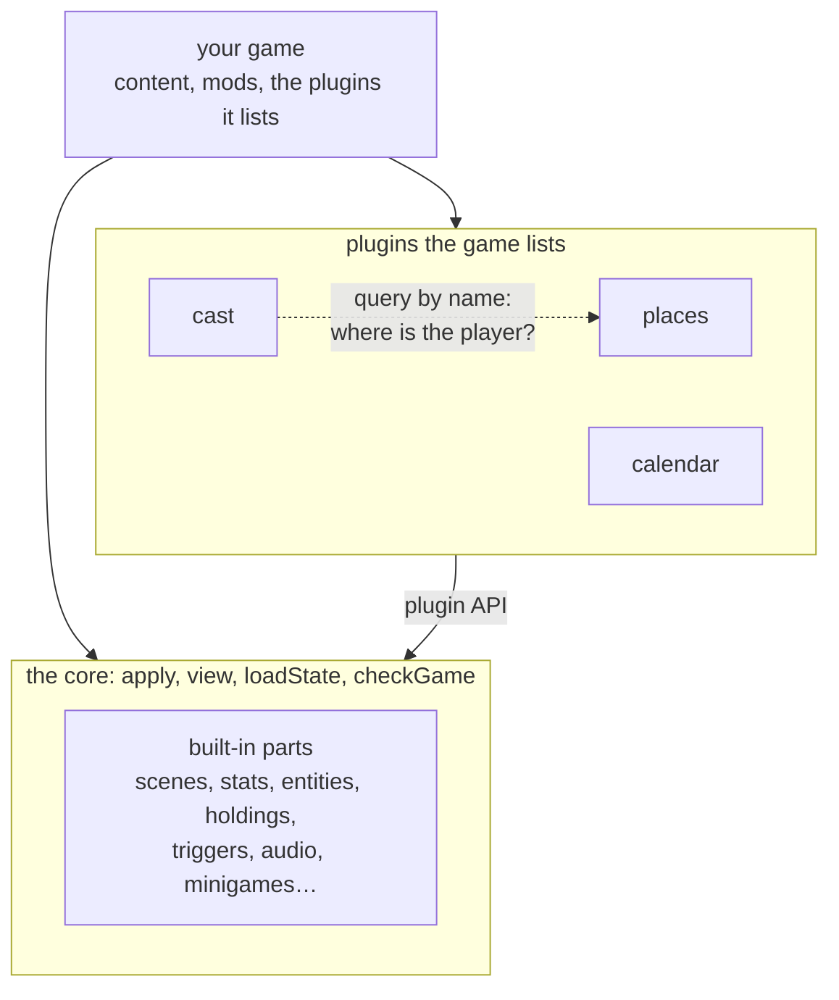

These are the ideas the engine is built on, one short section each, with a link to the reference page that has the details. The rest of the Engine track puts them to work: [Running a game](/docs/guide/running-a-game), [Saves and settings](/docs/guide/saves-and-settings), [A game with a world](/docs/guide/first-game), [A UI from scratch](/docs/guide/ui-from-scratch) and [Testing your game](/docs/guide/testing).

## The state is one plain object

Everything about a game in progress lives in one `GameState`. It holds the turn, the scene on screen, the player's stats and kv store, what everyone holds, each entity's numbers, the storylines, and each plugin's own part, such as the calendar's day. It holds no functions and no class instances, so it turns into JSON as it is. The state is the save.

The engine never changes a state in place. Every command returns a new one, so keeping the previous state is all an undo needs. The [runner](#the-runner-drives-the-game) keeps them for you.

See [Game state](/docs/reference/state).

## Commands go through `apply`

The player changes the game only through commands. The core has a few, such as `choose`, `action`, `leave`, `use` and `input`, and plugins add their own, such as the places plugin's `go('cafe')` and the cast's `talk('ava')`. `apply(state, game, command)` returns the next state, whether the command took (`ok`), and if not, why (`refused`). A refused command returns the state unchanged.

See [Commands](/docs/reference/commands).

## Effects and conditions are data

What a choice does is a list of effects. When something applies is a condition. Both are plain objects:

```ts
// effects
[{ stat: 'friendship', by: 5, of: 'character:ava' }, { stat: 'coins', by: -3 }]

// a condition
{ all: [{ 'places/at': { location: 'cafe' } }, { 'cast/here': { character: 'ava' } }, { stat: 'friendship', of: 'character:ava', gte: 10 }] }
```

Because they're data, the loader can check them. An effect that names a storyline nobody declared is caught before anyone plays, and a mod can add to them without shipping code. A plugin's conditions and effects are data too, named with the plugin's id first (`places/at` and `cast/here` above). When a test really needs code, a condition or effect can [call the game's own code](/docs/reference/custom) by name, with `game/` in front, as in `{ 'game/marketDay': true }`.

See [Effects](/docs/reference/effects) and [Conditions](/docs/reference/conditions).

## The game and its rules

The game is your content. It can hold:

- scenes, their prose and the variants of a line
- storylets, which are scenes an effect draws at random from a named set
- the scene it opens on (`introScene`), and the kv keys it starts with (`kv`), such as the phase the player is in
- stats
- kinds of entity, and the entities that exist at the start
- actions, the buttons offered in every room and the things the player can do (`actions`)
- locks, and the kv keys put back each turn (`locks`, `resets`)
- storylines
- triggers and inputs
- the words that replace the engine's own (`strings`)
- when the player may save (`saveable`), when the game counts as finished and what a New Game+ carries over (`finished`, `carryOver`)
- presentation hints for the whole game (`ui`)
- the plugins' content, under `data`

A plugin can bring content of its own too, such as the cast's `character` kind. It goes in first, under yours, so your content and any pack can replace it. The engine doesn't know any of these by name. It reads them all from the game.

Some of a game is code rather than content, such as what happens at the end of a turn, or a condition worked out from several values. That's the game's `rules`, a plain object that goes in the base beside its plugins. It can have anything a plugin can: hooks that the engine calls at fixed moments, and conditions, effects and values that content calls with `game/` in front. Leave a hook out and the engine does the plain thing.

See [The game](/docs/reference/game) and [Rules and hooks](/docs/reference/rules).

## The view is what a UI draws

`view(state, game)` turns the state into a view. It has the scene on screen, with its body already split into beats, the choices, the buttons on offer, and each plugin's own part, such as the places plugin's exits. Every button carries the command it sends, and a button that can't be pressed carries the reason.

An action's `blocked` reasons and a lock's reason are each written once, and both `apply` and `view` read them, so the greyed-out button and the refusal say the same thing. Your UI draws the view and sends commands. It never needs to read the state directly.

See [The view](/docs/reference/view).

## The turn

The engine has one clock, the turn. `state.turn` is 0 in a new game. Your game decides how long a turn is: a chapter in a novel, a week in a management game, a day in a life sim. A turn ends when the `turn` effect, `{ turn: true }`, runs. Everything the engine dates is dated in turns, such as when a scene was first seen or when a trigger last fired.

At the end of a turn the counter goes up by one, the kv keys the content lists in `resets` are put back, and the game's `onTurn` rule, each plugin's `onTurn` hook, the game's `onTurnDone` rule and each plugin's `onTurnDone` run. That's where a game that has energy fills it back up.

The core has no time of day. A game that wants days, the periods of a day and a weekday adds the [calendar plugin](/docs/plugins/calendar), which ends a turn each time its clock passes a period, a day or a week, whichever the game picks.

See [Shapes of game](/docs/guide/shapes) and [Game state: turn](/docs/reference/state#turn).

## Stats

A [stat](/docs/reference/stats) is a number the game keeps, such as coins or courage. You declare each one, with where it starts and the range it keeps to. A stat with no `of` belongs to the player and lives in `state.stats`.

A stat can also be [derived](/docs/reference/stats#derived-stats), worked out from other stats by a formula written as data, such as `{ sum: ['baking', 'patience'] }`. It's read like any other stat and never written. Any stat can have [levels](/docs/reference/stats#levels), thresholds it passes as it grows, which a `{ level }` condition and the view can read.

See [Stats](/docs/reference/stats).

## Entities, kinds and things

An [entity](/docs/reference/entities) is one of several things of the same kind, such as a member of staff, a dish, a person or a sandwich. The game declares the kinds in `kinds` and the entities there are at the start in `entities`. Content names one as `kind:id`, such as `'staff:ana'`. A stat declared with `of: 'staff'` is kept on every member of staff rather than on the player.

What an entity is stays in content: its name, description, picture, tags, starting stats and kv. The save keeps only what play changed, so an update that fixes a name reaches old saves too. The `create` and `remove` effects add and take away entities in play, and `each` runs a list of effects over every entity of a kind, or the ones that match a condition.

A few more ideas build on that:

- **Kinds.** A `unique` kind is one where each entity is one particular thing, such as a person or a place. A kind that isn't unique stacks, so two sandwiches are a count of 2. A kind's `listed` says whether the view lists its entities at all, so the cast's characters stay out of the list until you've met them.
- **Traits.** A trait is a named piece of data an entity carries, which a plugin reads. The inventory's `inventory/usable` gives a thing a button, the wardrobe's `wardrobe/wearable` names the slot it goes in, the shop's `shop/sellable` gives it a price, and the cast's `cast/person` makes it someone you can meet. A thing with no traits can still be held and counted.
- **Holders.** A thing the player has, such as a sandwich, a note or a photo, is an entity they [hold](/docs/reference/entities#holding-things). The player is a holder, and so is any unique entity: Ava can hold a scarf and the café can hold a lost glove. An entity's `at` says who holds it at the start, and the `entity` and `move` effects change it.
- **You.** `'you'` is whoever the player is playing now. A game with one protagonist never changes it, so `'you'` is the player. A game with several switches with the `you` effect.

See [Entities](/docs/reference/entities), and [Things: carrying, selling, wearing](/docs/recipes/things) for how the plugins share them.

## The kv store

The kv store holds keys with a true/false, number or text value: a name the player typed, a count of lies told, whether a door has been opened. It lives in `state.kv`. The `kv` effect sets a key `to` a value or changes its number `by` an amount, and the `{ kv }` condition reads it. A key that was never set counts as 0. Each storyline and each entity has a kv store of its own too.

The engine also remembers which choices the player has taken, so `{ chose: 'ch1.mat#open' }` asks about an earlier choice without a kv key.

See [Game state: kv](/docs/reference/state#kv) and [Conditions](/docs/reference/conditions).

## Storylines

A storyline is one thread of the story, such as a friendship with Ava. It has its own kv store and can be closed for a number of turns. `{ storyline: 'ava' }` holds while it's open.

The engine records which scenes the player has seen, and on which turn. That lets a storyline's stages come in order ("not until the scene before this one") and at a pace ("not until three turns after it").

See [Storylines](/docs/reference/storylines) and the recipe [A friendship in stages](/docs/recipes/friendship-stages).

## Notices, triggers and inputs

These are the parts a phone, a notice board or a journal is built from, with the things the player holds:

- A [notice](/docs/reference/notices) is something the game tells the player outside a scene, shown as a toast or counted on a badge.
- A [trigger](/docs/reference/triggers) is a list of effects that runs by itself the first time its condition holds, such as a note under the door the morning after the player first visits the café. It can also be set to fire at most once a turn.
- An [input](/docs/reference/inputs) is something the player types or picks, written to a kv key, such as their name.

## Locks

A lock says what the player can't do for now, and why. While its condition holds, the commands it names are refused with its line. An intro that keeps the player in one room is a lock rather than special code. `apply` refuses on the first lock that matches, and the view greys the button out with the same line.

See [Locks](/docs/reference/locks).

## Plugins

A plugin adds a system to the engine, such as a calendar, a map, people or quests. The game lists the plugins it uses in `plugins`, and the game's content gives each plugin its content under `data`, by the plugin's id. The quests plugin reads `data.quests.quests`, for example. A plugin that gives meaning to things, places or people reads a [trait](/docs/reference/entities#traits) on the entities instead: a place is an entity with the places plugin's `places/location` trait. A plugin brings its own conditions, effects and commands, its own part of the state and the view, and its own checks of its content.

First-party plugins don't import each other. One plugin asks another for an answer by name through a query, as the cast asks the places plugin where the player is. A plugin can also list the plugins it `cooperates` with. Content may then name their conditions and effects in a game that leaves them out: the condition is false and the effect does nothing.

The core is the same in every game. It's made of built-in parts, such as scenes, stats, entities, holdings and triggers, and each part keeps its own piece of the state and its own conditions, effects and commands. Plugins are the parts a game chooses. They plug into the core through the plugin API, and reach each other only by name:



See [Plugins](/docs/plugins) for the first-party ones, and [Writing a plugin](/docs/reference/plugins).

## The UI is separate

The engine has no DOM and no framework. It hands out a view and takes commands, so any UI can draw a game, and a test or a script can play one with no UI at all. [`@ifloom/react`](/docs/react) is a ready-made UI in React, and `mountGame` from it starts a game in a page with one call. To use Vue, Svelte, plain DOM or anything else, see [Choosing a UI](/docs/guide/choosing-a-ui). [How the pieces fit](/docs/guide/how-it-fits) shows where each package sits.

The engine owns what changes the state, the rules and a replay. How things look and move belongs to the UI. Content can still ask for a fade or a stat drawn as a bar, as [presentation hints](/docs/reference/ui-hints) in a `ui` field, which the engine carries to the view without reading.

## Randomness is seeded

Each save has a seed, and every random draw is worked out from the seed, a name for the draw and what it's keyed on, such as the turn. Which variant of a line shows, or whether something happens today, comes out the same for the same save every time.

That's what makes undo honest, since stepping back and trying again doesn't re-roll. It also lets a scripted playtest or a snapshot test give the same result every run. Draw your own values the same way, with `roll`, `pick`, `chance` and `weighted`, one named draw per value.

Content can carry weights where the engine picks for it: a line among its variants, a file in a pool, a track in a shuffled playlist. A [storylet](/docs/reference/storylets) is the same idea for whole scenes. You mark scenes as drawn from a named set, such as `'cafe'`, each with a weight and its own `when`, and the effect `{ scene: { from: 'cafe' } }` opens one of them.

See [Randomness](/docs/reference/random).

## The runner drives the game

`apply`, `view` and the state are enough to play a game, but every UI ends up wanting the same extras: undo, a backlog of what was said, saving and autosave, and a log to replay a bug from. `createRunner(game, state, options)` puts them in one object. The UI sends commands to `runner.apply`, draws `runner.view()`, and subscribes to hear when to draw again.

Undo, the backlog and autosave are off until the game turns them on. Undo never goes back past a barrier the game sets, such as a new turn. The command log is always kept, and because the engine is deterministic, the start state and the commands replay to the same state every time.

See [Running a game](/docs/guide/running-a-game) for the loop, and [The runner](/docs/reference/runner) for every option.

## Saves and migrations

A save is a snapshot of the state, with details for a load screen: the turn, the plugins' label for when and where it was, the player's name, the time played and the mods it was made with. `saves(game, driver)` keeps one game's saves in named slots, such as `'auto'`, `'quick'` or `'1'`, under keys that start with the game's id.

The driver says where saves are kept: `localStorage`, IndexedDB, memory for tests, or one you write for a desktop wrapper. The engine has no default, so the game chooses.

Each save carries a version. The format is at version 19 (`SAVE_VERSION`). When the state's shape changes, the engine adds a step from the old version, and an older save is carried forward one step at a time when it's loaded. A save with no route to the current version is refused rather than misread.

Your game can do the same for its own content. Give it a `version`, and when an update renames a kv key or adds a stat, raise the version and add a step to `migrations` that carries older saves forward. A step can call `tools.fill()` to add the new content an old save lacks. See [The game's own migrations](/docs/reference/saves#the-games-own-migrations).

See [Saves and settings](/docs/guide/saves-and-settings), and [Saves](/docs/reference/saves) for the details.

## Packs and mods

Your content arrives as a list, split across your files however you like, and `loadGame` merges it into one game. A mod is a pack, laid over your content. Any problems are reported with where they came from. See [Content and packs](/docs/reference/loader#content-and-packs).

A player can add a mod to a built game as a file. The game keeps it and loads it over its own content at start-up.

See [Packs and loading](/docs/reference/loader) and [Mods](/docs/reference/mods).
