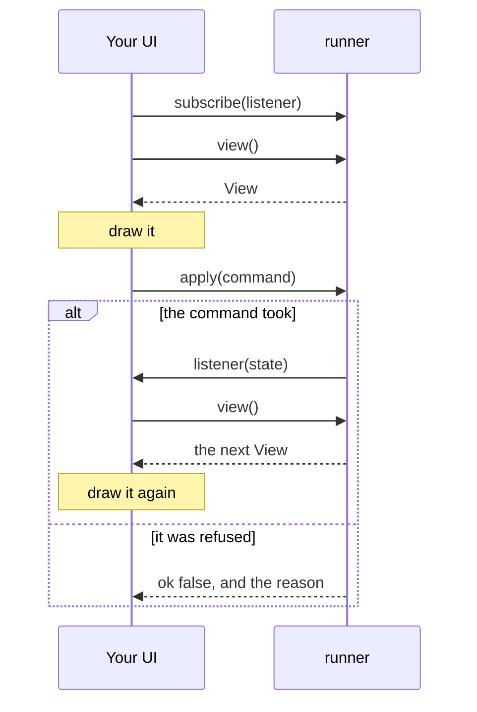

The engine has no DOM and no framework. The [React UI](/docs/react) is the ready-made way to draw a game, but you can draw one with Vue, Svelte, plain DOM or anything else that can show text and buttons. Three templates do it for you:

| Template | Draws with | Type-check |
|---|---|---|
| `vue` | Vue 3 single-file components | `vue-tsc`, as `npm run typecheck` |
| `svelte` | Svelte 5 components | `svelte-check`, as `npm run typecheck` |
| `vanilla` | Plain DOM, no framework | `npx tsc --noEmit` |

```sh
npm run new -- my-game --template vue
npm install
npm run dev -w my-game
```

Each plays the same two-scene game as the `blank` template, with no React. Each draws the scene and its beats, the choices with the reason a greyed-out one can't be pressed, any inputs the game asks for, the stats and a running minigame, and plays the game's sound with [`@ifloom/audio`](/docs/reference/audio-player). The minigame clock and the keyboard shortcuts come from [`@ifloom/browser`](/docs/reference/browser) (see [Minigames](#minigames)). They share two files:

- `src/game.ts`, the game.
- `src/styles.css`, a plain stylesheet.

The rest of this page goes through their code piece by piece, with a tab for each framework. The React tab shows React by hand, without the React UI, for when you want React but none of `@ifloom/react`. The tab you pick is remembered, and every other page of the docs shows the same one.

## The loop

A UI talks to the engine through a [runner](/docs/reference/runner). You need three things from it:

```ts
import { browserRunner } from '@ifloom/engine'

const runner = await browserRunner(game)

runner.view()              // View: what to draw right now
runner.apply(command)      // run a command, such as a choice the player pressed
runner.subscribe(listener) // call listener after every change of state; returns a function that stops it
```

The loop is the same in every framework:

1. Draw `runner.view()`.
2. When the player presses something, send its `command` with `runner.apply`.
3. When the runner calls your listener, draw `runner.view()` again.



`subscribe` hears about every change, not only your own commands. Undo, redo and loading a save all call it too, so you don't need to redraw after each of those yourself.

`runner.view()` returns the same object until the state changes (see [the view cache](/docs/reference/runner#the-view-cache)). So you can call it as often as you like, and a framework that compares values to decide what to redraw sees a new view exactly when there's something new to draw.

## Start the runner

Each template makes the runner once, in a module of its own, and turns the view into the framework's kind of state. Components import `runner` and the view from there.

```ts tab="Plain JS" tab-group="framework"
// src/main.ts
import { browserRunner, type InputView, type MinigameView, type SceneBeat, type View } from '@ifloom/engine'
import { startAudio } from '@ifloom/audio'
import { startClock, startKeys } from '@ifloom/browser'
import loaded from './game.ts'
import './styles.css'

const { game, problems } = loaded
if (problems.length) console.warn(problems)

// A new game with a random seed, undo, saves in localStorage and an autosave each turn.
const runner = await browserRunner(game)

// Plays what the game's `audio` asks for, from the first click or key press.
startAudio(runner)
// Ticks a minigame's timers, and maps the keyboard: 1 to 9 pick the choices, and a minigame's keys press its inputs.
startClock(runner)
startKeys(runner)

// ...

runner.subscribe(() => draw(runner.view()))
draw(runner.view())
```

```ts tab="React" tab-group="framework"
// src/runner.ts
import { useSyncExternalStore } from 'react'
import { browserRunner } from '@ifloom/engine'
import { startAudio } from '@ifloom/audio'
import { startClock, startKeys } from '@ifloom/browser'
import loaded from './game.ts'

export const runner = await browserRunner(loaded.game)
// Its `play` plays a file on demand, such as a voice line again.
export const player = startAudio(runner)
startClock(runner)
startKeys(runner)

/** The view, drawn again after every change. `runner.view()` returns the same object until the state changes, as useSyncExternalStore needs. */
export const useView = () => useSyncExternalStore(runner.subscribe, runner.view)
```

```ts tab="Vue" tab-group="framework"
// src/runner.ts
/**
 * The game's runner, and its view as Vue state. Components read `view` and
 * send commands with `runner.apply`; nothing else talks to the engine.
 */
import { shallowRef } from 'vue'
import { browserRunner } from '@ifloom/engine'
import { startAudio } from '@ifloom/audio'
import { startClock, startKeys } from '@ifloom/browser'
import loaded from './game.ts'

const { game, problems } = loaded
if (problems.length) console.warn(problems)

// A new game with a random seed, undo, saves in localStorage and an autosave each turn.
export const runner = await browserRunner(game)

// The view is replaced whole after every change, so a shallowRef is enough:
// Vue only needs to know that it changed, not to look inside it.
export const view = shallowRef(runner.view())
runner.subscribe(() => {
  view.value = runner.view()
})

// Plays what the game's `audio` asks for, from the first click or key press.
// Its `play` plays a file on demand, such as a voice line again.
export const player = startAudio(runner)
// Ticks a minigame's timers, and maps the keyboard: 1 to 9 pick the choices, and a minigame's keys press its inputs.
startClock(runner)
startKeys(runner)
```

```ts tab="Svelte" tab-group="framework"
// src/runner.ts
/**
 * The game's runner, and its view as a Svelte store. Components read `$view`
 * and send commands with `runner.apply`; nothing else talks to the engine.
 */
import { readable } from 'svelte/store'
import { browserRunner } from '@ifloom/engine'
import { startAudio } from '@ifloom/audio'
import { startClock, startKeys } from '@ifloom/browser'
import loaded from './game.ts'

const { game, problems } = loaded
if (problems.length) console.warn(problems)

// A new game with a random seed, undo, saves in localStorage and an autosave each turn.
export const runner = await browserRunner(game)

// A readable store fits the runner: it starts by subscribing, and stops with
// the function `subscribe` returns.
export const view = readable(runner.view(), (set) => runner.subscribe(() => set(runner.view())))

// Plays what the game's `audio` asks for, from the first click or key press.
// Its `play` plays a file on demand, such as a voice line again.
export const player = startAudio(runner)
// Ticks a minigame's timers, and maps the keyboard: 1 to 9 pick the choices, and a minigame's keys press its inputs.
startClock(runner)
startKeys(runner)
```

[`browserRunner`](/docs/reference/runner#browserrunner) gives the runner a random seed, undo 50 steps deep, saves in `localStorage` and an autosave each turn. Pass it any [`RunnerOptions`](/docs/reference/runner#runneroptions) to change those, such as `browserRunner(game, { backlog: true })`. `loadGame` returns the game and a list of problems, which `npm run check` also prints.

- **Plain JS** draws the whole page again in its listener, which is fine for a page this small.
- **React** reads it with `useSyncExternalStore`, which needs exactly what `runner.subscribe` and `runner.view` are.
- **Vue** keeps the view in a `shallowRef`. The view is replaced whole after every change, so Vue doesn't need to look inside it.
- **Svelte** wraps it in a `readable` store, which components read as `$view`. The store's start function subscribes to the runner and returns the runner's own stop function.

Then `main.ts` mounts the app on `#root` in `index.html`. Plain JS has no app to mount, so its `draw` fills `#root` itself:

```ts tab="Plain JS" tab-group="framework"
// src/main.ts
const root = document.querySelector<HTMLElement>('#root')!

/** An element with a class and some text, added to `parent`. */
function add<K extends keyof HTMLElementTagNameMap>(parent: HTMLElement, tag: K, text = '', className = ''): HTMLElementTagNameMap[K] {
  const element = parent.appendChild(document.createElement(tag))
  if (text) element.textContent = text
  if (className) element.className = className
  return element
}
```

```ts tab="React" tab-group="framework"
// src/main.ts
import { createElement } from 'react'
import { createRoot } from 'react-dom/client'
import { App } from './App.tsx'
import './styles.css'

createRoot(document.querySelector('#root')!).render(createElement(App))
```

```ts tab="Vue" tab-group="framework"
// src/main.ts
import { createApp } from 'vue'
import App from './App.vue'
import './styles.css'

createApp(App).mount('#root')
```

```ts tab="Svelte" tab-group="framework"
// src/main.ts
import { mount } from 'svelte'
import App from './App.svelte'
import './styles.css'

mount(App, { target: document.querySelector('#root')! })
```

## Add the framework's Vite plugin

Vue and Svelte each need their Vite plugin, which goes in the [Vite preset](/docs/cli#the-vite-preset)'s `vite.plugins`. The templates do this already:

```ts tab="Plain JS" tab-group="framework"
// vite.config.ts
import { ifloom } from '@ifloom/cli/vite'

// Plain DOM needs no plugin.
export default ifloom()
```

```ts tab="React" tab-group="framework"
// vite.config.ts
import { ifloom } from '@ifloom/cli/vite'

// The preset adds React's plugin itself once `react` is in package.json.
export default ifloom()
```

```ts tab="Vue" tab-group="framework"
// vite.config.ts
import vue from '@vitejs/plugin-vue'
import { ifloom } from '@ifloom/cli/vite'

// The preset adds React and Tailwind only for a game that uses them, so Vue's plugin is the only one.
export default ifloom({ vite: { plugins: [vue()] } })
```

```ts tab="Svelte" tab-group="framework"
// vite.config.ts
import { svelte } from '@sveltejs/vite-plugin-svelte'
import { ifloom } from '@ifloom/cli/vite'

// The preset adds React and Tailwind only for a game that uses them, so Svelte's plugin is the only one.
export default ifloom({ vite: { plugins: [svelte()] } })
```

The preset adds React and Tailwind only when the game depends on `@ifloom/react`, `react` or `tailwindcss`, so in these templates the framework's plugin is the only one. React by hand needs no plugin of its own. Start from the `vanilla` template, add `react` and `react-dom` to its `package.json`, and the preset adds React's plugin for you.

## Draw the scene and its choices

The app draws the title, the scene, its choices and the stats:

```ts tab="Plain JS" tab-group="framework"
// src/main.ts
function draw(view: View): void {
  root.replaceChildren()
  add(root, 'h1', view.title)

  // While a minigame runs, the scene's title and beats are the minigame's.
  if (view.scene.title) add(root, 'h2', view.scene.title)
  for (const beat of view.scene.beats) drawBeat(beat)
  if (view.minigame) drawMinigame(view.minigame)

  const inputs = add(root, 'div', '', 'inputs')
  for (const input of Object.values(view.inputs)) drawInput(inputs, input)

  const choices = add(root, 'div', '', 'choices')
  // A scene's choices, or the game's own buttons when no scene is open.
  for (const choice of [...view.scene.choices, ...view.actions]) {
    const button = add(choices, 'button', choice.label)
    button.disabled = Boolean(choice.disabled)
    if (choice.disabled) button.title = choice.disabled
    button.onclick = () => runner.apply(choice.command)
    // Why it can't be pressed, such as "You need 4 coins."
    if (choice.disabled) add(choices, 'p', choice.disabled, 'reason')
  }

  add(root, 'p', view.stats.map((stat) => `${stat.label}: ${stat.text}`).join(' · '), 'stats')
}
```

```tsx tab="React" tab-group="framework"
// src/App.tsx
import { Fragment } from 'react'
import { runner, useView } from './runner.ts'
import { Beat } from './Beat.tsx'
import { InputField } from './InputField.tsx'
import { Minigame } from './Minigame.tsx'

export function App() {
  const view = useView()
  // A scene's choices, or the game's own buttons when no scene is open.
  const choices = [...view.scene.choices, ...view.actions]
  return (
    <>
      <h1>{view.title}</h1>
      {/* While a minigame runs, the scene's title and beats are the minigame's. */}
      {view.scene.title ? <h2>{view.scene.title}</h2> : null}
      {view.scene.beats.map((beat, at) => (
        <Beat key={at} beat={beat} />
      ))}
      {view.minigame ? <Minigame minigame={view.minigame} /> : null}

      <div className="inputs">
        {Object.values(view.inputs).map((input) => (
          <InputField key={input.id} input={input} />
        ))}
      </div>

      <div className="choices">
        {choices.map((choice, at) => (
          <Fragment key={at}>
            <button disabled={Boolean(choice.disabled)} title={choice.disabled} onClick={() => runner.apply(choice.command)}>
              {choice.label}
            </button>
            {/* Why it can't be pressed, such as "You need 4 coins." */}
            {choice.disabled ? <p className="reason">{choice.disabled}</p> : null}
          </Fragment>
        ))}
      </div>

      <p className="stats">{view.stats.map((stat) => `${stat.label}: ${stat.text}`).join(' · ')}</p>
    </>
  )
}
```

```vue tab="Vue" tab-group="framework"
<!-- src/App.vue -->
<script setup lang="ts">
import { computed } from 'vue'
import { runner, view } from './runner.ts'
import Beat from './Beat.vue'
import InputField from './InputField.vue'
import Minigame from './Minigame.vue'

// A scene's choices, or the game's own buttons when no scene is open.
const choices = computed(() => [...view.value.scene.choices, ...view.value.actions])
</script>

<template>
  <h1>{{ view.title }}</h1>
  <!-- While a minigame runs, the scene's title and beats are the minigame's. -->
  <h2 v-if="view.scene.title">{{ view.scene.title }}</h2>
  <Beat v-for="(beat, at) in view.scene.beats" :key="at" :beat="beat" />
  <Minigame v-if="view.minigame" :minigame="view.minigame" />

  <div class="inputs">
    <InputField v-for="input in Object.values(view.inputs)" :key="input.id" :input="input" />
  </div>

  <div class="choices">
    <template v-for="(choice, at) in choices" :key="at">
      <button :disabled="Boolean(choice.disabled)" :title="choice.disabled" @click="runner.apply(choice.command)">
        {{ choice.label }}
      </button>
      <!-- Why it can't be pressed, such as "You need 4 coins." -->
      <p v-if="choice.disabled" class="reason">{{ choice.disabled }}</p>
    </template>
  </div>

  <p class="stats">{{ view.stats.map((stat) => `${stat.label}: ${stat.text}`).join(' · ') }}</p>
</template>
```

```svelte tab="Svelte" tab-group="framework"
<!-- src/App.svelte -->
<script lang="ts">
  import { runner, view } from './runner.ts'
  import Beat from './Beat.svelte'
  import InputField from './InputField.svelte'
  import Minigame from './Minigame.svelte'

  // A scene's choices, or the game's own buttons when no scene is open.
  const choices = $derived([...$view.scene.choices, ...$view.actions])
</script>

<h1>{$view.title}</h1>
<!-- While a minigame runs, the scene's title and beats are the minigame's. -->
{#if $view.scene.title}<h2>{$view.scene.title}</h2>{/if}
{#each $view.scene.beats as beat, at (at)}<Beat {beat} />{/each}
{#if $view.minigame}<Minigame minigame={$view.minigame} />{/if}

<div class="inputs">
  {#each Object.values($view.inputs) as input (input.id)}<InputField {input} />{/each}
</div>

<div class="choices">
  {#each choices as choice, at (at)}
    <button disabled={Boolean(choice.disabled)} title={choice.disabled} onclick={() => runner.apply(choice.command)}>
      {choice.label}
    </button>
    <!-- Why it can't be pressed, such as "You need 4 coins." -->
    {#if choice.disabled}<p class="reason">{choice.disabled}</p>{/if}
  {/each}
</div>

<p class="stats">{$view.stats.map((stat) => `${stat.label}: ${stat.text}`).join(' · ')}</p>
```

Every button the player can press is a [`RenderedChoice`](/docs/reference/view#renderedchoice). It carries its `label`, its `command`, and `disabled` with the reason when it can't be pressed. The templates grey the button out and print the reason under it. The button sends the command as it is, so your UI never builds a command for a choice itself.

`view.scene.choices` are the open scene's choices. When no scene is open, the game's own buttons are in `view.actions` instead, so drawing both covers either case.

## Beats

A scene's prose comes as [beats](/docs/reference/prose#scenebeat): a paragraph, a spoken line, a picture, a video, a letter or a prop such as a sticky note. Draw `view.scene.beats` rather than `view.scene.body`, which is the raw prose with its markup.

```ts tab="Plain JS" tab-group="framework"
// src/main.ts
/** One paragraph of a scene: narration, a spoken line, a picture, a letter. A sound beat is heard, not drawn. */
function drawBeat(beat: SceneBeat): void {
  switch (beat.kind) {
    case 'text':
      add(root, 'p', beat.text)
      break
    case 'mono':
      add(root, 'p', beat.text, 'beat-mono')
      break
    case 'say':
      add(root, 'p', beat.text, 'beat-say').dataset.who = beat.who
      break
    case 'image':
      Object.assign(add(root, 'img', '', 'beat-image'), { src: beat.src, alt: beat.alt ?? '' })
      break
    case 'video':
      Object.assign(add(root, 'video', '', 'beat-image'), {
        src: beat.src,
        poster: beat.poster ?? '',
        autoplay: beat.autoplay,
        loop: beat.loop,
        muted: beat.muted,
        controls: beat.controls,
        playsInline: true,
      })
      break
    case 'mail': {
      const mail = add(root, 'div', '', 'beat-prop')
      for (const line of beat.headers) add(mail, 'p', `${line.key}: ${line.value}`)
      add(mail, 'p', beat.body)
      break
    }
    case 'prop':
      add(root, 'div', beat.text, 'beat-prop')
      break
  }
}
```

```tsx tab="React" tab-group="framework"
// src/Beat.tsx
import type { SceneBeat } from '@ifloom/engine'

/** One paragraph of a scene: narration, a spoken line, a picture, a letter. A sound beat is heard, not drawn. */
export function Beat({ beat }: { beat: SceneBeat }) {
  switch (beat.kind) {
    case 'text':
      return <p>{beat.text}</p>
    case 'mono':
      return <p className="beat-mono">{beat.text}</p>
    case 'say':
      return (
        <p className="beat-say" data-who={beat.who}>
          {beat.text}
        </p>
      )
    case 'image':
      return 
    case 'video':
      return (
        <video
          className="beat-image"
          src={beat.src}
          poster={beat.poster}
          autoPlay={beat.autoplay}
          loop={beat.loop}
          muted={beat.muted}
          controls={beat.controls}
          playsInline
        />
      )
    case 'mail':
      return (
        <div className="beat-prop">
          {beat.headers.map((line) => (
            <p key={line.key}>
              {line.key}: {line.value}
            </p>
          ))}
          <p>{beat.body}</p>
        </div>
      )
    case 'prop':
      return <div className="beat-prop">{beat.text}</div>
    default:
      return null
  }
}
```

```vue tab="Vue" tab-group="framework"
<!-- src/Beat.vue -->
<script setup lang="ts">
import type { SceneBeat } from '@ifloom/engine'

// One paragraph of a scene: narration, a spoken line, a picture, a letter. A sound beat is heard, not drawn.
defineProps<{ beat: SceneBeat }>()
</script>

<template>
  <p v-if="beat.kind === 'text'">{{ beat.text }}</p>
  <p v-else-if="beat.kind === 'mono'" class="beat-mono">{{ beat.text }}</p>
  <p v-else-if="beat.kind === 'say'" class="beat-say" :data-who="beat.who">{{ beat.text }}</p>
  
  <video
    v-else-if="beat.kind === 'video'"
    class="beat-image"
    :src="beat.src"
    :poster="beat.poster"
    :autoplay="beat.autoplay"
    :loop="beat.loop"
    :muted="beat.muted"
    :controls="beat.controls"
    playsinline
  />
  <div v-else-if="beat.kind === 'mail'" class="beat-prop">
    <p v-for="line in beat.headers" :key="line.key">{{ line.key }}: {{ line.value }}</p>
    <p>{{ beat.body }}</p>
  </div>
  <div v-else-if="beat.kind === 'prop'" class="beat-prop">{{ beat.text }}</div>
</template>
```

```svelte tab="Svelte" tab-group="framework"
<!-- src/Beat.svelte -->
<script lang="ts">
  import type { SceneBeat } from '@ifloom/engine'

  // One paragraph of a scene: narration, a spoken line, a picture, a letter. A sound beat is heard, not drawn.
  let { beat }: { beat: SceneBeat } = $props()
</script>

{#if beat.kind === 'text'}
  <p>{beat.text}</p>
{:else if beat.kind === 'mono'}
  <p class="beat-mono">{beat.text}</p>
{:else if beat.kind === 'say'}
  <p class="beat-say" data-who={beat.who}>{beat.text}</p>
{:else if beat.kind === 'image'}
  
{:else if beat.kind === 'video'}
  <video
    class="beat-image"
    src={beat.src}
    poster={beat.poster}
    autoplay={beat.autoplay}
    loop={beat.loop}
    muted={beat.muted}
    controls={beat.controls}
    playsinline
  ></video>
{:else if beat.kind === 'mail'}
  <div class="beat-prop">
    {#each beat.headers as line (line.key)}<p>{line.key}: {line.value}</p>{/each}
    <p>{beat.body}</p>
  </div>
{:else if beat.kind === 'prop'}
  <div class="beat-prop">{beat.text}</div>
{/if}
```

A spoken line's `who` is `'character'` or `'player'`, which the stylesheet uses to set the player's lines apart. The speaker's name and picture are `view.scene.speaker` and `view.scene.stageImage`. A sound beat draws nothing, because the audio player plays it.

## Inputs

An [input](/docs/reference/inputs) is a value the game asks the player for, such as a name. Each is an [`InputView`](/docs/reference/view#inputview) in `view.inputs`, and you send what the player enters as an `input` command:

```ts tab="Plain JS" tab-group="framework"
// src/main.ts
/** A value the game asks for, such as the player's name. What they enter goes back as an `input` command. */
function drawInput(parent: HTMLElement, input: InputView): void {
  if (input.kind === 'choice') {
    for (const option of input.options) {
      add(parent, 'button', option.label).onclick = () => runner.apply({ type: 'input', id: input.id, to: option.value })
    }
    return
  }
  const form = add(parent, 'form')
  const label = add(form, 'label', input.label)
  const field = add(label, 'input')
  field.type = input.kind === 'number' ? 'number' : 'text'
  field.value = input.value === null ? '' : String(input.value)
  if (input.maxLength !== null) field.maxLength = input.maxLength
  if (input.min !== null) field.min = String(input.min)
  if (input.max !== null) field.max = String(input.max)
  add(form, 'button', 'OK').type = 'submit'
  form.onsubmit = (event) => {
    event.preventDefault()
    runner.apply({ type: 'input', id: input.id, to: input.kind === 'number' ? Number(field.value) : field.value })
  }
}
```

```tsx tab="React" tab-group="framework"
// src/InputField.tsx
import { useState, type FormEvent } from 'react'
import type { InputView } from '@ifloom/engine'
import { runner } from './runner.ts'

/** A value the game asks for, such as the player's name. What they enter goes back as an `input` command. */
export function InputField({ input }: { input: InputView }) {
  const [value, setValue] = useState(input.value === null ? '' : String(input.value))
  if (input.kind === 'choice') {
    return (
      <div className="inputs" role="group" aria-label={input.label}>
        {input.options.map((option) => (
          <button key={String(option.value)} onClick={() => runner.apply({ type: 'input', id: input.id, to: option.value })}>
            {option.label}
          </button>
        ))}
      </div>
    )
  }
  const submit = (event: FormEvent) => {
    event.preventDefault()
    runner.apply({ type: 'input', id: input.id, to: input.kind === 'number' ? Number(value) : value })
  }
  return (
    <form onSubmit={submit}>
      <label>
        {input.label}
        <input
          value={value}
          onChange={(event) => setValue(event.target.value)}
          type={input.kind === 'number' ? 'number' : 'text'}
          maxLength={input.maxLength ?? undefined}
          min={input.min ?? undefined}
          max={input.max ?? undefined}
        />
      </label>
      <button type="submit">OK</button>
    </form>
  )
}
```

```vue tab="Vue" tab-group="framework"
<!-- src/InputField.vue -->
<script setup lang="ts">
import { ref } from 'vue'
import type { InputView } from '@ifloom/engine'
import { runner } from './runner.ts'

// A value the game asks for, such as the player's name. What they enter goes back as an `input` command.
const props = defineProps<{ input: InputView }>()
const value = ref(props.input.value === null ? '' : String(props.input.value))

function submit() {
  runner.apply({ type: 'input', id: props.input.id, to: props.input.kind === 'number' ? Number(value.value) : value.value })
}
</script>

<template>
  <div v-if="input.kind === 'choice'" class="inputs" role="group" :aria-label="input.label">
    <button v-for="option in input.options" :key="String(option.value)" @click="runner.apply({ type: 'input', id: input.id, to: option.value })">
      {{ option.label }}
    </button>
  </div>
  <form v-else @submit.prevent="submit">
    <label>
      {{ input.label }}
      <input
        v-model="value"
        :type="input.kind === 'number' ? 'number' : 'text'"
        :maxlength="input.maxLength ?? undefined"
        :min="input.min ?? undefined"
        :max="input.max ?? undefined"
      />
    </label>
    <button type="submit">OK</button>
  </form>
</template>
```

```svelte tab="Svelte" tab-group="framework"
<!-- src/InputField.svelte -->
<script lang="ts">
  import type { InputView } from '@ifloom/engine'
  import { runner } from './runner.ts'

  // A value the game asks for, such as the player's name. What they enter goes back as an `input` command.
  let { input }: { input: InputView } = $props()
  // svelte-ignore state_referenced_locally
  let value = $state(input.value === null ? '' : String(input.value))

  function submit(event: SubmitEvent) {
    event.preventDefault()
    runner.apply({ type: 'input', id: input.id, to: input.kind === 'number' ? Number(value) : value })
  }
</script>

{#if input.kind === 'choice'}
  <div class="inputs" role="group" aria-label={input.label}>
    {#each input.options as option (option.value)}
      <button onclick={() => runner.apply({ type: 'input', id: input.id, to: option.value })}>{option.label}</button>
    {/each}
  </div>
{:else}
  <form onsubmit={submit}>
    <label>
      {input.label}
      <input
        bind:value
        type={input.kind === 'number' ? 'number' : 'text'}
        maxlength={input.maxLength ?? undefined}
        min={input.min ?? undefined}
        max={input.max ?? undefined}
      />
    </label>
    <button type="submit">OK</button>
  </form>
{/if}
```

An input of kind `choice` has its `options`, each with a `value` and a `label`, so the templates draw a button for each. The input stays in `view.inputs` while its `when` holds, which for a name is usually until the player has given one.

## Minigames

While a [minigame](/docs/reference/minigames) runs, `view.minigame` describes it, and the scene shows its words: `view.scene.title` is the minigame's label and `view.scene.beats` are the running state's words. The choices are empty. So the app draws the scene as usual, and adds a panel for the minigame's timer and inputs:

```ts tab="Plain JS" tab-group="framework"
// src/main.ts
/** The minigame being played: a bar counting down its timer, and a button for each input that does something now. */
function drawMinigame(minigame: MinigameView): void {
  const section = add(root, 'section', '', 'minigame')
  section.dataset.state = minigame.state
  if (minigame.timeLeft !== null && minigame.timeTotal) {
    const timer = add(section, 'div', '', 'timer')
    timer.setAttribute('role', 'progressbar')
    timer.setAttribute('aria-label', 'Time left')
    add(timer, 'span').style.transform = `scaleX(${minigame.timeLeft / minigame.timeTotal})`
  }
  const inputs = add(section, 'div', '', 'choices')
  for (const input of minigame.inputs) add(inputs, 'button', input).onclick = () => runner.apply({ type: 'minigame', input })
}
```

```tsx tab="React" tab-group="framework"
// src/Minigame.tsx
import type { MinigameView } from '@ifloom/engine'
import { runner } from './runner.ts'

/** The minigame being played: a bar counting down its timer, and a button for each input that does something now. */
export function Minigame({ minigame }: { minigame: MinigameView }) {
  return (
    <section className="minigame" data-state={minigame.state}>
      {minigame.timeLeft !== null && minigame.timeTotal ? (
        <div className="timer" role="progressbar" aria-label="Time left">
          <span style={{ transform: `scaleX(${minigame.timeLeft / minigame.timeTotal})` }} />
        </div>
      ) : null}
      <div className="choices">
        {minigame.inputs.map((input) => (
          <button key={input} onClick={() => runner.apply({ type: 'minigame', input })}>
            {input}
          </button>
        ))}
      </div>
    </section>
  )
}
```

```vue tab="Vue" tab-group="framework"
<!-- src/Minigame.vue -->
<script setup lang="ts">
import type { MinigameView } from '@ifloom/engine'
import { runner } from './runner.ts'

// The minigame being played: a bar counting down its timer, and a button for each input that does something now.
defineProps<{ minigame: MinigameView }>()
</script>

<template>
  <section class="minigame" :data-state="minigame.state">
    <div v-if="minigame.timeLeft !== null && minigame.timeTotal" class="timer" role="progressbar" aria-label="Time left">
      <span :style="{ transform: `scaleX(${minigame.timeLeft / minigame.timeTotal})` }" />
    </div>
    <div class="choices">
      <button v-for="input in minigame.inputs" :key="input" @click="runner.apply({ type: 'minigame', input })">{{ input }}</button>
    </div>
  </section>
</template>
```

```svelte tab="Svelte" tab-group="framework"
<!-- src/Minigame.svelte -->
<script lang="ts">
  import type { MinigameView } from '@ifloom/engine'
  import { runner } from './runner.ts'

  // The minigame being played: a bar counting down its timer, and a button for each input that does something now.
  let { minigame }: { minigame: MinigameView } = $props()
</script>

<section class="minigame" data-state={minigame.state}>
  {#if minigame.timeLeft !== null && minigame.timeTotal}
    <div class="timer" role="progressbar" aria-label="Time left">
      <span style:transform={`scaleX(${minigame.timeLeft / minigame.timeTotal})`}></span>
    </div>
  {/if}
  <div class="choices">
    {#each minigame.inputs as input (input)}
      <button onclick={() => runner.apply({ type: 'minigame', input })}>{input}</button>
    {/each}
  </div>
</section>
```

Pressing an input sends `{ type: 'minigame', input }`. A minigame with timers needs something more, because the engine has no clock. Something has to send a [`tick`](/docs/reference/commands#tick) with the time that passed. The templates start two helpers from [`@ifloom/browser`](/docs/reference/browser) once, beside the runner, as [Start the runner](#start-the-runner) shows:

- [`startClock(runner)`](/docs/reference/browser#startclock) sends a `tick` about every 100 ms while a timer runs and the page is visible, with the real time that passed. Time while the page is hidden is dropped, so the round waits for the player.
- [`startKeys(runner)`](/docs/reference/browser#startkeys) maps the keyboard: a minigame's own `keys`, or the arrow keys and space, press its inputs, and 1 to 9 pick the choices on screen.

They're plain DOM, so every framework uses them the same way, and the React UI runs the same code. Each returns a function that stops it.

The [Minigames guide](/docs/guide/minigames#your-own-panel) draws a panel for one minigame by its id, in each framework.

## What else to draw

The [view reference](/docs/reference/view) lists every field. Beyond what the templates draw, these are the ones games most often want:

- `when`, where the game is in time and place, when a plugin says.
- `notices`, news the player hasn't dismissed. Send `{ type: 'dismiss' }` to clear them.
- `scene.speaker` and `scene.stageImage`, who is talking and the picture to show with them.
- `plugins`, each plugin's own part of the view, by plugin id. The places plugin's exits are at `plugins.places`, for example. Each plugin's page documents its slice, and [Building UI for plugins](/docs/guide/plugin-ui) draws some of them.
- `settings`, for a settings page. See [The title screen and settings](/docs/guide/title-screen#add-settings).

`entities`, `collections` and `pack` are there when your game has them.

## Sound

If your game lists tracks in [`game.audio`](/docs/reference/audio), the templates already play them. [`startAudio`](/docs/reference/audio-player#startaudio) follows the runner, not your components, so it works the same whatever draws the page. Start it once, next to the runner, as each template's runner module does. Nothing plays until the player first clicks or presses a key, because browsers don't allow it sooner. Pass `{ log: console.debug }` to see what the player is doing in the console.

A spoken line with a voice is a `say` [beat](/docs/reference/prose#scenebeat) with a `voice` track id. To offer a button that plays it again, keep the player `startAudio` returned and call its [`play`](/docs/reference/audio-player#audioplayer) with the track's file:

```ts
import { audioSrc } from '@ifloom/engine'

const player = startAudio(runner)
const track = game.audio?.tracks[beat.voice]
if (track && 'src' in track) player.play(audioSrc(track.src), 'voice', track.volume ?? 1)
```

## Next

- [The runner](/docs/reference/runner) lists everything else a runner does, such as undo, saves and the backlog.
- [The view](/docs/reference/view) describes every field you can draw.
- [Commands](/docs/reference/commands) lists the commands you can send.
- [Building your own HUD](/docs/guide/hud), [Building UI for plugins](/docs/guide/plugin-ui) and [The title screen](/docs/guide/title-screen) show what they build in each framework.
