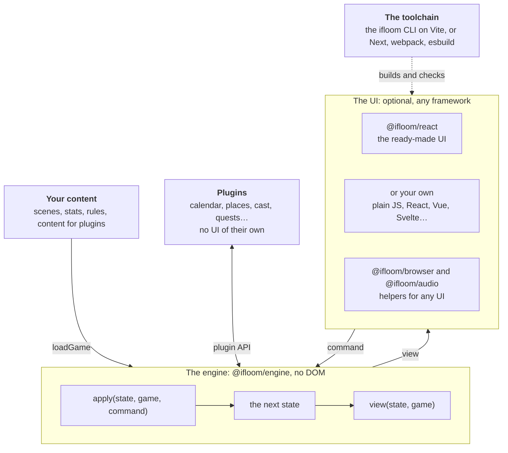

An IFLoom game is built in four layers. Only the engine is required. You can use each of the others as it comes, leave it out or replace it.



| Layer | Packages | Needed? |
|---|---|---|
| [The engine](#the-engine) | `@ifloom/engine` | Always. |
| [Plugins](#plugins) | `@ifloom/plugin-*`, `@ifloom/phone` | Only the ones your game uses. A novel uses none. |
| [The UI](#the-ui) | `@ifloom/react`, or your own code with `@ifloom/browser` and `@ifloom/audio` | To play in a browser. Tests and scripts don't need one. |
| [The toolchain](#the-toolchain) | `@ifloom/cli`, or the bundler you already use | To build and check the game. |

## The engine

The engine is a library. Your content goes in, a description of the screen comes out, and the player's commands go back in. It has no DOM and imports no framework, so the same code runs in a browser, in Node, in a test or in a worker.

- **Content in.** A game is one or more packs of plain data: scenes, choices, stats, prose and the content plugins read. [`loadGame`](/docs/reference/loader#loadgame) merges them into a `Game` and checks them.
- **A view out.** The [view](/docs/reference/view) is everything a UI needs to draw: the scene's paragraphs, each button with the command it sends and, if it can't be pressed, the reason why. It also has the stats, inputs, audio and each plugin's part.
- **Commands in.** When the player presses a button, the UI sends that button's command. The engine checks it and returns the next state, or the reason it was refused.

A [runner](/docs/reference/runner) wraps those three in one object, with undo, saves and autosave. This plays the `ifloom new` template's game in Node, with no browser at all:

```ts
import { createRunner, startingState } from '@ifloom/engine'
import loaded from './src/game.ts'

const { game } = loaded
const runner = createRunner(game, startingState(game))

runner.view().scene.title                       // 'The door'
runner.view().scene.choices.map((c) => c.label) // ['Knock', 'Wait for someone to open it']
runner.apply({ type: 'choose', id: 'knock' })
runner.view().scene.title                       // 'Inside'
runner.state.stats.courage                      // 2
```

[Running a game](/docs/guide/running-a-game) goes through the runner loop in full.

## Plugins

A plugin adds a system to the engine: the [calendar](/docs/plugins/calendar)'s days and times, the [places](/docs/plugins/places) the player walks between, the [cast](/docs/plugins/cast) who keep their own hours. It brings its own state, commands, conditions, effects and part of the view, and it imports nothing but the engine.

Plugins have no UI. What a plugin wants on screen goes into the view, under `view.plugins.<id>`, and any UI draws it from there. The React UI has a ready-made panel for some of them. In your own UI, you draw the parts you want. [Plugins](/docs/plugins) lists them all, and [Plugin UI](/docs/recipes/plugin-ui) shows how to draw their views.

## The UI

A UI does two things. It draws the view, and it sends a command when the player presses something. Anything that can do both can be an IFLoom UI.

- **[`@ifloom/react`](/docs/react) is one ready-made UI.** It draws the whole game in the browser with React, Tailwind and shadcn/ui: the scene, the choices, the stats, saves, menus, a title screen and settings. [`mountGame`](/docs/react#mountgame) starts it in one call, and you can restyle it with presets and plain CSS or replace any part. It's optional. Nothing else in IFLoom depends on it.
- **Your own UI** can use any framework, or none. The `vanilla`, `vue` and `svelte` templates each draw the game themselves with no React. [A UI from scratch](/docs/guide/ui-from-scratch) explains the plain JS one line by line, and [Your own UI in any framework](/docs/guide/frameworks) shows the same code in React, Vue and Svelte.
- **[`@ifloom/browser`](/docs/browser) and [`@ifloom/audio`](/docs/browser/audio-player) are helpers for any UI.** The first runs a minigame's clock, the keyboard shortcuts, numbers for new save slots and the timing of revealed prose. The second plays the game's music and sounds. Both are plain DOM, import only the engine, and work the same under every framework. The React UI uses them itself.

[Choosing a UI](/docs/guide/choosing-a-ui) helps you pick.

## The toolchain

The packages are compiled JavaScript with type declarations, so any bundler can build your page with them, with no special settings. The `ifloom` [CLI](/docs/cli) is the easiest way, but you don't have to use it.

The CLI is a convenience built on Vite. `ifloom dev` serves the game while you edit, and `ifloom new` starts a game from a template. The main reason it exists is `ifloom build`, which makes the game into one `index.html` with relative paths and checks that it opens from disk with no server. A player can download that file and play it offline, which is what most interactive fiction is expected to do. See [Shipping a game](/docs/guide/shipping).

Three more commands work on any setup, because they load `src/game.ts` with the CLI's own Vite rather than your app's build:

- [`ifloom check`](/docs/cli#ifloom-check) lists every problem in the content.
- [`ifloom playtest`](/docs/cli#ifloom-playtest) plays the game with no one at the keyboard and writes down what it saw.
- [`ifloom snapshot`](/docs/cli#ifloom-snapshot) records how every scene reads, and tells you when one changes.

Other bundlers work too, each with a recipe:

- [Next.js](/docs/recipes/next), for a game that lives on a website. `ifloom new --template next` starts one. Next can't make the single offline file.
- [webpack](/docs/recipes/webpack), which can make the single file with two plugins.
- [esbuild](/docs/recipes/esbuild), which can make it with a short build script.

## Which pieces you need

| You want | You use |
|---|---|
| A game in the browser, as quickly as possible | The `react` template: the engine, `@ifloom/react` and the CLI. |
| Your own look, in Vue, Svelte or plain JS | The `vue`, `svelte` or `vanilla` template: the engine, `@ifloom/browser`, `@ifloom/audio` and the CLI. |
| A game on a page of your website | The `next` template, or the [Next recipe](/docs/recipes/next) in an app you already have. |
| Tests for your game, or a script that plays it | The engine on its own, with `@ifloom/cli` for playtests. See [Testing your game](/docs/guide/testing). |

Next, [install IFLoom](/docs/guide/installation) and write [your first story](/docs/guide/first-story).
