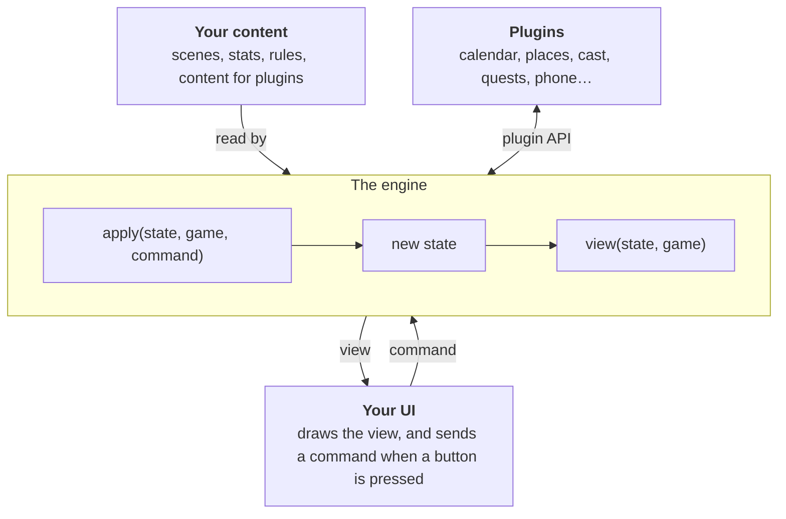

IFLoom is a TypeScript engine for interactive fiction. You can write a linear novel with it, a management game played a week at a time, or a life sim with a calendar, a map and characters who keep their own hours. All three run on the same small core, and you add the rest with plugins. See [Shapes of game](/docs/guide/shapes) for each one.

:::warning[Pre-release]
IFLoom is pre-release. Nothing is a stable API yet, and the packages aren't on npm. See [API status](/docs/guide/status).
:::

## Who it's for

IFLoom is for people who write games in TypeScript and want the bookkeeping handled for them. The core keeps the turn, scenes and choices, stats, entities, a kv store, collections, storylines, triggers, notices, inputs, and saves that survive a game update. It also works out what the player can do right now, and why not.

Time of day, places and people aren't in the core. If your game needs them, the [calendar](/docs/plugins/calendar), [places](/docs/plugins/places) and [cast](/docs/plugins/cast) plugins add them. A linear novel needs none of them.

You bring the story, and the screen if you want your own. The engine has no UI. It hands you a description of what to draw, called the [view](/docs/reference/view), and you draw it with whatever you like. The [React UI](/docs/react), `@ifloom/react`, is the ready-made option: it draws the whole game in the browser, and you can restyle or extend it. To use Vue, Svelte or plain DOM instead, see [Using another framework](/docs/guide/frameworks).

## How it differs from other tools

Twine and Ink are built around branching passages. The story is a graph of text, and the player walks it. If your story is a branching narrative and nothing more, they're the faster route. IFLoom handles that too (see [Your first story](/docs/guide/first-story)), but it's built for games that also keep state, such as numbers that change and things the game has several of. With plugins it adds a clock, a map and characters. Its conditions and effects are plain data, so the engine can check every scene before anyone plays it. If you already know SugarCube or Harlowe, [Coming from SugarCube or Harlowe](/docs/guide/coming-from-twine) maps what you know to IFLoom.

Ren'Py and other visual-novel engines give you a complete presentation layer (sprites, backgrounds, a text box, menus) and a script that drives it. IFLoom's engine is game logic with no DOM. The React UI gives you a ready-made screen with the scene, its choices, the stats, saves and menus, and it can show a picture for a scene. It doesn't do sprites, transitions or a visual-novel text box. If you want those, you draw them yourself from the view.

## The rules the engine keeps

- **Replays match.** Every random draw is seeded from the save, so the same save on the same turn gives the same result. Undo can't be used to re-roll, and a scripted playtest gives the same result every run. See [Randomness](/docs/reference/random).
- **Everything is bundled.** The engine never fetches anything or loads code while the game runs, because a game opened from disk can't. See [Shipping a game](/docs/guide/shipping).
- **No DOM and no framework.** The engine is plain TypeScript. It runs the same in a browser, in Node and in a test.
- **No genre.** The engine knows no stat, place or person by name. Your game declares them and supplies its own logic through [rules](/docs/reference/rules).

## The architecture in one picture

1. The **game** is your content: scenes, activities, stats, the rules that are yours rather than the engine's, and the plugins you pick, with the content they read. A game with a map lists the [places plugin](/docs/plugins/places) and gives it locations, for example.
2. The **plugins** sit beside the core and talk to it through the [plugin API](/docs/reference/plugins). Places and people are plugins (places and cast), as are the calendar, quests and the phone. Each adds its own state, commands, conditions and part of the view.
3. The **state** is one plain object, and it's also the save.
4. A **command** such as `choose`, `activity` or `leave` goes through `apply`, as does a plugin's own command, such as the places plugin's `places/go` or the cast plugin's `cast/talk`. `apply` returns the next state and whether the command took.
5. The **view** is what `view` makes of the state: the scene on screen, what can be done and why not, and each plugin's own part, such as the places plugin's exits. Your UI, or the React UI, draws the view and sends the next command.

Next, [install it](/docs/guide/installation), then write [your first story](/docs/guide/first-story).
