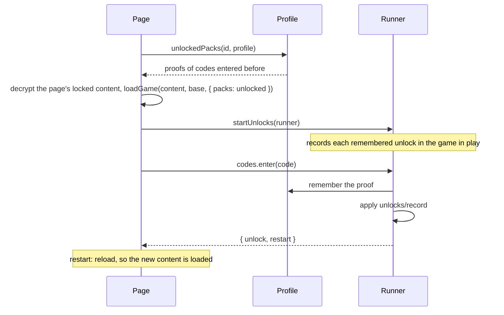

`@ifloom/plugin-unlocks` lets the player enter a code, such as the one a game's supporters get, to unlock things. An unlock can open a cheat or a scene through the `unlocks/has` condition. It can also carry content of its own: packs that `ifloom build` encrypts with a key only the code can make, so the shipped game can't be read or patched open without it.

The game never contains a code. It has a slow hash of each one, which can check a code but can't give it back. A code that works is remembered in the player's [profile](/docs/reference/profile), so it outlives saves and new games, and is entered once.

```ts
import {
  unlocks, startUnlocks, unlockedPacks, hasUnlock, recordUnlock, unlockDefs,
  unlockHash, codeFits, normaliseCode, envName, lockContent, contentScript, lockedContent, ITERATIONS,
  type UnlockDef, type UnlocksState, type UnlocksProfile, type UnlocksView, type UnlockView,
  type UnlockCodes, type Entered, type LockedContent,
} from '@ifloom/plugin-unlocks'
```

[Supporter content and cheats](/docs/recipes/supporter-content) puts it together for a game funded by supporters, and says what each kind of gate protects.

## What it protects

- **Locked content is protected.** A pack in `src/unlocks/` ships only encrypted (AES-GCM, under a key derived from the code). Without the code, nobody can read it or switch it on by editing the game.
- **A condition gate only deters.** `unlocks/has` reads the save. A cheat or a choice behind it is in the game's code, so anyone who edits the code or the save can open it.
- **A code can be shared.** Nothing checks who enters it, and there's no server. Give each release new codes, as [the recipe](/docs/recipes/supporter-content#a-release) shows.

## Install

List the package in your game's `package.json`, beside the engine:

```json
{
  "dependencies": {
    "@ifloom/engine": "^0.0.0",
    "@ifloom/plugin-unlocks": "^0.0.0"
  }
}
```

Then add `unlocks()` to the game's `plugins`. [Adding one](/docs/plugins#adding-one) has the details. It needs no other plugin. The [cheats plugin](/docs/plugins/cheats#supporter-cheats) cooperates with it by name.

Codes are checked with WebCrypto (`crypto.subtle`), which every current browser has, on a page opened from disk too, and Node 20 and later.

## unlocks

```ts
function unlocks(): DefinedPlugin<UnlocksState, UnlocksView>
```

Builds the plugin, with the id `unlocks`. A new game has nothing unlocked.

## Writing unlocks

Unlocks are content. They go in your content's [`data`](/docs/reference/loader#content) under `unlocks.unlocks`. This is the showcase's one:

```ts
import type { Content } from '@ifloom/engine'
import type { UnlockDef } from '@ifloom/plugin-unlocks'

const supporter: UnlockDef = {
  id: 'supporter',
  label: 'Supporter edition',
  description: 'A thank-you scene in the café, and the Full energy cheat.',
  // From `ifloom unlock-hash supporter`. The code itself is in .env, never here.
  hash: '7b141ff9f5210e0e3064dd089920697c712fa1b31ff56c2e42737dcd71bbed5f',
}

const town: Content = { data: { unlocks: { unlocks: [supporter] } } }
```

### UnlockDef

```ts
type UnlockDef = {
  id: string
  label: string
  description?: string
  hash: string
  salt?: string
  iterations?: number
}
```

| Field | What it is |
|---|---|
| `id` | Unique among unlocks. `unlocks/has` names it by this, and its locked content is `src/unlocks/<id>.ts`. |
| `label` | Its name for the player, in the list of unlocks. |
| `description` | What it opens, under the label. |
| `hash` | The code's hash, 64 hex digits, as [`ifloom unlock-hash`](/docs/cli#ifloom-unlock-hash) prints it. |
| `salt` | Extra salt for the hash. Change it to get a new hash for the same code. |
| `iterations` | PBKDF2's rounds for this code. `600000` if left out. Use fewer only in tests. |

### Making the hash

Put the code in an environment variable named after the unlock, then ask the CLI for its hash:

```sh
# .env.local, which git leaves out
IFLOOM_UNLOCK_SUPPORTER=BREAD-2026-OVEN
```

```sh
ifloom unlock-hash supporter
```

Paste the `hash` it prints into the unlock. The hash is salted with the game's id and the unlock's id (and `salt`), so the same code gives a different hash in another game or another unlock. `envName(id)` gives the variable's name.

### Locked content

Content that only an unlock opens goes in `src/unlocks/<id>.ts`, one file per unlock, exporting a [pack](/docs/reference/loader#pack) (or a list of packs) as `default`. It's a pack rather than content because it's laid over the game, like a mod: it has an `id`, which saves record, and the `schema` it was written for. It must be data, as a [mod](/docs/reference/mods) is: scenes, prose, plugin content, no functions. `ifloom build` encrypts it under the unlock's code and puts it in the page, and refuses any import of it from your code. [The CLI](/docs/cli#locked-content) has the details.

```ts
// src/unlocks/supporter.ts
import { SCHEMA, type Pack } from '@ifloom/engine'
import { hasUnlock } from '@ifloom/plugin-unlocks'

const supporter: Pack = {
  id: 'supporter',
  schema: SCHEMA,
  scenes: [
    {
      id: 'cafe.back-room',
      title: 'The back room',
      drawnFrom: ['cafe'],
      weight: 5,
      when: { all: [hasUnlock('supporter'), { not: { seen: 'cafe.back-room' } }] },
      body: [{ prose: 'cafe.back-room' }],
      choices: [{ id: 'leave', label: 'Thank her and head back out', effects: [{ scene: null }] }],
    },
  ],
  prose: {
    'cafe.back-room': 'Ava lifts the counter flap and waves you through to the back room…',
  },
}

export default supporter
```

The game's own content can't point into a locked pack without a problem when the pack isn't there. Reach locked content from inside it, as this storylet does by joining a deck the base game draws from, or only behind `unlocks/has`. `ifloom check` [lists](/docs/cli#locked-content-in-a-check) any reference into locked content it finds.

Your [game module](/docs/cli#the-game-module)'s `build` takes the packs as `unlocked`, and passes them to `loadGame` as `packs`, over its content:

```ts
// src/game.ts
import { loadGame } from '@ifloom/engine'
import { defineGame } from '@ifloom/cli/game'
import { unlocks } from '@ifloom/plugin-unlocks'
import { town } from './town.ts'

export default defineGame({
  build: ({ unlocked }) => loadGame([town], { id: 'small-town', title: 'Small Town', plugins: [unlocks()] }, { packs: unlocked }),
})
```

## Entering codes

A game with unlocks does two things at start-up. Before it builds the game, it opens the content of every unlock the player has entered a code for, with [`unlockedPacks`](#unlockedpacks). After it makes the runner, it starts taking codes with [`startUnlocks`](#startunlocks).



```ts tab="Plain JS" tab-group="framework"
// src/main.ts
import { browserRunner, localStorageDriver } from '@ifloom/browser'
import { profile } from '@ifloom/engine'
import { startUnlocks, unlockedPacks } from '@ifloom/plugin-unlocks'
import module from './game.ts'

// The profile browserRunner uses, opened before the game is built.
const opened = await unlockedPacks('small-town', profile({ id: 'small-town' }, localStorageDriver()))
const { game } = module.build({ unlocked: opened.packs })
const runner = await browserRunner(game)
const codes = startUnlocks(runner)

const form = document.body.appendChild(document.createElement('form'))
const input = form.appendChild(document.createElement('input'))
input.placeholder = 'Code'
form.appendChild(document.createElement('button')).textContent = 'Unlock'
const said = form.appendChild(document.createElement('p'))
form.onsubmit = async (event) => {
  event.preventDefault()
  const result = await codes.enter(input.value)
  said.textContent = result.ok ? `Unlocked: ${result.value.label}.` : result.reason
  if (result.ok && result.value.restart) location.reload()
}
```

```tsx tab="React" tab-group="framework"
// src/main.tsx
import { localStorageDriver } from '@ifloom/browser'
import { createRunner, profile, saves, startingState } from '@ifloom/engine'
import { GameShell } from '@ifloom/react'
import { unlockedPacks } from '@ifloom/plugin-unlocks'
import { unlocksUiWith } from '@ifloom/plugin-unlocks/react'
import { createRoot } from 'react-dom/client'
import module from './game.ts'

const driver = localStorageDriver()
const stored = profile({ id: 'small-town' }, driver)
const opened = await unlockedPacks('small-town', stored)
const { game } = module.build({ unlocked: opened.packs })
const runner = createRunner(game, startingState(game), { saves: saves(game, driver), profile: stored })

// A code box on the settings page, and in the menu without pages.
const plugins = [unlocksUiWith({ problems: opened.problems, onChange: () => location.reload() })]
createRoot(document.getElementById('root')!).render(<GameShell runner={runner} pages={{}} plugins={plugins} />)
```

```vue tab="Vue" tab-group="framework"
<!-- src/CodeBox.vue. In src/runner.ts, build the game with unlockedPacks first, as the Plain JS tab does,
     then add: export const codes = startUnlocks(runner) -->
<script setup lang="ts">
import { ref } from 'vue'
import { codes } from './runner.ts'

const code = ref('')
const said = ref('')
async function enter() {
  const result = await codes.enter(code.value)
  said.value = result.ok ? `Unlocked: ${result.value.label}.` : result.reason
  if (result.ok && result.value.restart) location.reload()
}
</script>

<template>
  <form @submit.prevent="enter">
    <input v-model="code" placeholder="Code" />
    <button>Unlock</button>
    <p v-if="said">{{ said }}</p>
  </form>
</template>
```

```svelte tab="Svelte" tab-group="framework"
<!-- src/CodeBox.svelte. In src/runner.ts, build the game with unlockedPacks first, as the Plain JS tab does,
     then add: export const codes = startUnlocks(runner) -->
<script lang="ts">
  import { codes } from './runner.ts'

  let code = $state('')
  let said = $state('')
  async function enter(event: SubmitEvent) {
    event.preventDefault()
    const result = await codes.enter(code)
    said = result.ok ? `Unlocked: ${result.value.label}.` : result.reason
    if (result.ok && result.value.restart) location.reload()
  }
</script>

<form onsubmit={enter}>
  <input bind:value={code} placeholder="Code" />
  <button>Unlock</button>
  {#if said}<p>{said}</p>{/if}
</form>
```

The plugin's [React UI](#the-react-ui) draws the code box for you with [`UnlocksPanel`](#unlockspanel) when the game lists `unlocksUi`, or `unlocksUiWith(...)` as above, in `plugins` on `GameShell`, `GameProvider` or `mountGame`.

### unlockedPacks

```ts
function unlockedPacks(
  game: string,
  profile: Profile,
  content?: Readonly<Record<string, LockedContent>>,
): Promise<{ packs: Pack[]; problems: string[] }>
```

The content of every unlock the profile remembers a code for, decrypted and checked that this engine can read its schema, ready to pass to `loadGame` as `packs`, over the game's content. `loadGame` upgrades it with [`upgradePack`](/docs/reference/loader#upgradepack), with the game's plugins. `content` is the page's, from [`lockedContent`](#lockedcontent), unless you pass it (in a test, say).

Call it before you build the game, with the game's id and its profile. [`profile`](/docs/reference/profile#profile) reads only the id, so `profile({ id: 'small-town' }, driver)` opens it before the game exists. Use the same driver the runner will use.

Content that won't open is left out and listed in `problems` as `unlock:<id> · its code has changed since it was entered; enter the new one`. That happens after a release with new codes, or to a page someone has tampered with. It never throws.

### startUnlocks

```ts
function startUnlocks(runner: Runner, options?: { content?: Readonly<Record<string, LockedContent>> }): UnlockCodes
```

Starts taking codes on a runner. It reads the profile, checks each remembered unlock against this release's hash, and records the ones that match in the game in play with `unlocks/record`. From then on it records them into every new game and loaded save as well, so `unlocks/has` holds wherever the player has the code. Needs the runner's `profile`.

### UnlockCodes

```ts
type UnlockCodes = {
  ready: Promise<void>
  enter(code: string): Promise<Result<Entered>>
  stop(): void
}
```

| Member | What it does |
|---|---|
| `ready` | Settles once the remembered unlocks have been checked and recorded. |
| `enter` | Tries the code against every unlock in turn. On a match it stores a proof made from the code in the profile, records the unlock in the game in play, and says what it unlocked. It never throws. |
| `stop` | Stops recording remembered unlocks into new games and loaded saves. |

`enter` refuses an empty code with `Type a code first.`, a code that matches nothing with `That code doesn't unlock anything.`, and a runner with no profile with `This game can't remember codes here.`. Checking takes a moment on purpose: a fraction of a second per unlock on a phone.

### Entered

```ts
type Entered = { unlock: string; label: string; already: boolean; restart: boolean }
```

| Field | What it is |
|---|---|
| `unlock`, `label` | The unlock the code opened. |
| `already` | It was unlocked already. The code worked and nothing changed. |
| `restart` | It has locked content that the game in play doesn't have yet. Build the game again to add it, usually by reloading the page, as for [mods](/docs/reference/mods). |

## Conditions

| Content writes | Helper | Holds when |
|---|---|---|
| `{ 'unlocks/has': { unlock } }` | `hasUnlock(id)` | The unlock is recorded in this save. |

Use it anywhere a condition goes: a [cheat's](/docs/plugins/cheats#supporter-cheats) `blocked`, a choice's `when`, a storylet's `when`.

```ts
import { hasUnlock } from '@ifloom/plugin-unlocks'

const choice = { id: 'back-room', when: hasUnlock('supporter'), effects: [{ scene: 'cafe.back-room' }] }
```

It reads the save, not the profile. Conditions must give the same answer when a save is [replayed](/docs/reference/runner#replay), and the profile is outside the save. So the save keeps its own record, which `startUnlocks` keeps in step with the profile.

## The command

| Content writes | Helper | Does |
|---|---|---|
| `{ 'unlocks/record': { id } }` | `recordUnlock(id)` | Records the unlock in this save. |

`startUnlocks` sends it once a code has worked. It ignores locks, so it works during an intro that locks everything else, and it's in the command log, so a replay plays it. It's refused with `There's no such unlock.` for an id the game doesn't have, and `That's unlocked already.` for one already recorded.

It checks no code. Anyone who can run commands, from the browser's console say, can send it. That's why a condition gate only deters, and why content you want kept from people without the code belongs in a locked pack.

## Strings

| Key | English |
|---|---|
| `unlocks/wrong` | `That code doesn't unlock anything.` |
| `unlocks/empty` | `Type a code first.` |
| `unlocks/noProfile` | `This game can't remember codes here.` |
| `unlocks/notSaved` | `The code worked, but it couldn't be remembered. Try again.` |
| `unlocks/unknown` | `There's no such unlock.` |
| `unlocks/already` | `That's unlocked already.` |

## The view

`runner.view().plugins.unlocks` is an `UnlocksView`. Its [React UI](#the-react-ui) draws it with [`UnlocksPanel`](#unlockspanel), and [`useUnlocks`](#useunlocks) gives it with no markup.

### UnlocksView

```ts
type UnlocksView = {
  unlocks: UnlockView[]
  unlocked: number
  total: number
}

type UnlockView = { id: string; label: string; description: string; unlocked: boolean }
```

| Field | What it is |
|---|---|
| `unlocks` | Every unlock, in the order the game declares them. `unlocked` is whether this save has it recorded. `description` is `''` without one. |
| `unlocked` | How many are unlocked. |
| `total` | How many there are. |

### Drawing it yourself

A list of the unlocks, with which the player has:

```ts tab="Plain JS" tab-group="framework"
import type { View } from '@ifloom/engine'
import type { UnlocksView } from '@ifloom/plugin-unlocks'

export function unlockList(view: View): HTMLElement | null {
  const shown = view.plugins.unlocks as UnlocksView | undefined
  if (!shown?.total) return null
  const list = document.createElement('ul')
  for (const unlock of shown.unlocks) {
    list.appendChild(document.createElement('li')).textContent = `${unlock.label}: ${unlock.unlocked ? 'unlocked' : 'locked'}`
  }
  return list
}
```

```tsx tab="React" tab-group="framework"
import { useUnlocks } from '@ifloom/plugin-unlocks/react'

export function UnlockList() {
  const unlocks = useUnlocks()
  if (!unlocks?.total) return null
  return (
    <ul>
      {unlocks.unlocks.map((unlock) => (
        <li key={unlock.id}>
          {unlock.label}: {unlock.unlocked ? 'unlocked' : 'locked'}
        </li>
      ))}
    </ul>
  )
}
```

```vue tab="Vue" tab-group="framework"
<script setup lang="ts">
import { computed } from 'vue'
import type { UnlocksView } from '@ifloom/plugin-unlocks'
import { view } from './runner.ts'

const shown = computed(() => view.value.plugins.unlocks as UnlocksView | undefined)
</script>

<template>
  <ul v-if="shown?.total">
    <li v-for="unlock in shown.unlocks" :key="unlock.id">{{ unlock.label }}: {{ unlock.unlocked ? 'unlocked' : 'locked' }}</li>
  </ul>
</template>
```

```svelte tab="Svelte" tab-group="framework"
<script lang="ts">
  import type { UnlocksView } from '@ifloom/plugin-unlocks'
  import { view } from './runner.ts'

  const shown = $derived($view.plugins.unlocks as UnlocksView | undefined)
</script>

{#if shown?.total}
  <ul>
    {#each shown.unlocks as unlock (unlock.id)}
      <li>{unlock.label}: {unlock.unlocked ? 'unlocked' : 'locked'}</li>
    {/each}
  </ul>
{/if}
```

## The React UI

`@ifloom/plugin-unlocks/react` draws the code box, for a game drawn with [`@ifloom/react`](/docs/react). List `unlocksUi` in the game's [`plugins`](/docs/react/kit#the-plugins-option) and codes start on the runner, and the [`UnlocksPanel`](#unlockspanel) is on the settings page with pages on, or behind an **Enter a code** button in the menu without them.

It's yours to leave out. Draw the plugin yourself from `view.plugins.unlocks`, or from [`useUnlocks`](#useunlocks) with your own markup, and nothing of ours is drawn: that's as much a way to use the plugin as ours. React and `@ifloom/react` are optional peers of the plugin, and a game drawn with another UI never loads this subpath.

```tsx
import { mountGame } from '@ifloom/react'
import { unlocksUi } from '@ifloom/plugin-unlocks/react'

mountGame(game, { plugins: [unlocksUi] })
```

### unlocksUi

```ts
const unlocksUi: PluginUi
```

The plugin's [`PluginUi`](/docs/react/kit#pluginui): codes start on the runner, and the [`UnlocksPanel`](#unlockspanel) is on the settings page with pages on, or behind an **Enter a code** button in the menu without them.

Its words are in `UNLOCKS_WORDS`. A game rewords any of them with `ui.<key>` in its strings, as it does the React UI's own: `{ 'ui.checkingCode': '…' }`.

| Key | English |
|---|---|
| `ui.checkingCode` | `Checking…` |
| `ui.code` | `Code` |
| `ui.enterCode` | `Enter a code` |
| `ui.locked` | `Locked` |
| `ui.restartForUnlock` | `Restart to add it` |
| `ui.unlock` | `Unlock` |
| `ui.unlocked` | `Unlocked` |
| `ui.unlockedAlready` | `{label} was unlocked already.` |
| `ui.unlockedNow` | `Unlocked: {label}.` |

### unlocksUiWith

```ts
function unlocksUiWith(options?: UnlocksUiOptions): PluginUi

type UnlocksUiOptions = {
  problems?: string[]
  onChange?: () => void
  start?: (runner: Runner) => UnlockCodes
}
```

`unlocksUi` with what the code box shows and does, for a game that opens what the player unlocked before it's built. `unlocksUi` is `unlocksUiWith()`.

| Field | What it is |
|---|---|
| `problems` | What [`unlockedPacks`](#unlockedpacks) couldn't open, shown under the code box. |
| `onChange` | Builds the game again with the content a code has just opened, usually `() => location.reload()`. Without it, the box never offers to restart. |
| `start` | How codes start on the runner. [`startUnlocks`](#startunlocks) if left out. A test passes its own locked content here. |

```tsx
import { GameShell } from '@ifloom/react'
import { unlockedPacks } from '@ifloom/plugin-unlocks'
import { unlocksUiWith } from '@ifloom/plugin-unlocks/react'

const opened = await unlockedPacks('small-town', stored)
// … build the game with opened.packs, and make the runner …
<GameShell runner={runner} pages={{}} plugins={[unlocksUiWith({ problems: opened.problems, onChange: () => location.reload() })]} />
```

The codes start when the game is drawn, and stop when it goes.

### UnlocksUiOptions

What [`unlocksUiWith`](#unlocksuiwith) takes, above.

### UnlocksPanel

```tsx
function UnlocksPanel(props: { className?: string }): JSX.Element | null
```

Entering a code, and the game's [unlocks](/docs/plugins/unlocks). Under an **Enter a code** heading (`ui.enterCode`) are a text box (`ui.code`) and an **Unlock** button (`ui.unlock`), which says **Checking…** (`ui.checkingCode`) while the code is checked. A wrong code shows the plugin's reason as an alert. One that works says **Unlocked: Supporter edition.** (`ui.unlockedNow`, or `ui.unlockedAlready`), and when it opened content the game in play doesn't have, a **Restart to add it** button (`ui.restartForUnlock`) calls `onChange` from [`unlocksUiWith`](#unlocksuiwith). The `problems` it was given follow, then each unlock (`data-unlock`, and `data-unlocked` once it's unlocked) with its label, a **Locked** or **Unlocked** badge (`ui.locked`, `ui.unlocked`) and its description.

The box shows only when the game lists the unlocks UI and its codes have started. Without it the list still shows. It draws nothing in a game without the plugin, or with no unlocks. The settings page and the menu draw it for you.

Replaceable as `UnlocksPanel` in [`components`](/docs/react/components#components). Parts: `unlocks`, `unlocks-title`, `unlock-form`, `unlock-input`, `button`, `unlocks-message`, `unlocks-entered`, `unlock-problem`, `unlocks-list`, `unlock` (with `data-unlock` and `data-unlocked`), `unlock-name`, `unlock-state` and `unlock-text`.

### useUnlocks

```ts
function useUnlocks(): UnlocksControls | null

type UnlocksControls = UnlocksView & {
  available: boolean
  enter: (code: string) => Promise<boolean>
  checking: boolean
  entered: Entered | null
  message: string | null
  restart: (() => void) | undefined
  problems: string[]
}
```

The unlocks plugin's view ([`UnlocksView`](/docs/plugins/unlocks#unlocksview): `unlocks`, `unlocked` and `total`) and the code box's state, or `null` in a game without the plugin.

| Field | What it is |
|---|---|
| `available` | Whether codes can be entered: the game lists the unlocks UI, and its codes have started. |
| `enter` | Tries a code with [`UnlockCodes.enter`](/docs/plugins/unlocks#unlockcodes). Resolves to whether it worked. |
| `checking` | True while a code is being checked. |
| `entered` | What the last code that worked unlocked, as [`Entered`](/docs/plugins/unlocks#entered), or `null`. |
| `message` | Why the last code didn't work, or `null`. |
| `restart` | `onChange` from `unlocksUiWith`, when the last code opened content that needs it. Otherwise undefined. |
| `problems` | The `problems` given to `unlocksUiWith`. |

```tsx
import { useState } from 'react'
import { useUnlocks } from '@ifloom/plugin-unlocks/react'

function CodeBox() {
  const unlocks = useUnlocks()
  const [code, setCode] = useState('')
  if (!unlocks?.available) return null
  return (
    <form onSubmit={(event) => { event.preventDefault(); void unlocks.enter(code) }}>
      <input value={code} onChange={(event) => setCode(event.target.value)} />
      <button disabled={unlocks.checking}>Unlock</button>
      {unlocks.message ?? (unlocks.entered ? `Unlocked: ${unlocks.entered.label}.` : null)}
      {unlocks.restart ? <button type="button" onClick={unlocks.restart}>Restart</button> : null}
    </form>
  )
}
```

## The state and the profile

### UnlocksState

```ts
type UnlocksState = { unlocked: string[] }
```

What the plugin keeps in a save, at `state.plugins.unlocks`: the unlocks recorded in it, in the order they were. A save from before the plugin was added loads with none.

### UnlocksProfile

```ts
type UnlocksProfile = { unlocked: Record<string, { proof: string }> }
```

What the plugin keeps in the player's profile, under `unlocks`: for each code that worked, a proof made from it, in hex. The profile never holds the code. The proof can't give the code back, but it opens this release's content for that unlock, so treat a profile as the player's own.

## How codes are checked

A code goes through these steps, all in WebCrypto:

1. **Normalised** with `normaliseCode`: Unicode-normalised (NFKC), spaces and hyphens taken out, in capitals. `bread-2026`, `BREAD 2026` and `Bread2026` are one code.
2. **Stretched** with PBKDF2-SHA256, salted with `ifloom-unlock:<game id>:<unlock id>` (and `:<salt>`), for `iterations` rounds (`ITERATIONS`, 600,000, unless the unlock says). That gives a 32-byte proof. This is the slow step, which makes guessing codes one at a time expensive.
3. **Split** with HKDF-SHA256 into two keys with different labels. One is the unlock's `hash`. The other is the AES-GCM key for its locked content. Knowing the hash gives neither the proof nor the key.

Locked content is the packs as JSON, encrypted with AES-256-GCM under that key, with a fresh 12-byte nonce, and the game's and unlock's ids bound to it. Changing a byte of it, or moving it to another game or unlock, makes it fail to open.

Even so, a short code can be guessed. Every guess costs the same slow step, but a four-letter code has few enough possibilities to try them all. Use codes of 12 characters or more, letters and digits, picked at random.

### The functions behind it

These are what the CLI and `startUnlocks` use. A game rarely calls them itself.

```ts
const ITERATIONS: 600000
function normaliseCode(code: string): string
function envName(unlock: string): string
function unlockHash(code: string, game: string, def: Pick<UnlockDef, 'id' | 'salt' | 'iterations'>): Promise<string>
function codeFits(code: string, game: string, def: UnlockDef): Promise<boolean>
function lockContent(code: string, game: string, def: UnlockDef, packs: readonly Pack[]): Promise<LockedContent>
function contentScript(locked: readonly LockedContent[]): string
function lockedContent(): Readonly<Record<string, LockedContent>>
function unlockDefs(game: Game): UnlockDef[]
```

| Function | What it does |
|---|---|
| `envName` | The variable a build reads an unlock's code from: `IFLOOM_UNLOCK_SUPPORTER` for `supporter`, `IFLOOM_UNLOCK_EARLY_ACCESS` for `early-access`. |
| `unlockHash` | The hash of a code, as `ifloom unlock-hash` prints it. |
| `codeFits` | Whether a code is the unlock's. |
| `lockContent` | Encrypts packs under a code. Throws if the code isn't the unlock's, or a pack has a function in it. |
| `contentScript` | The `<script>` the build puts in the page's head, setting `window.__ifloomUnlocks`. |
| `lockedContent` | What that script set, by unlock, or `{}` in a page without it. |
| `unlockDefs` | The game's unlocks, merged from its content and packs: `game.data.unlocks.unlocks`. |

### LockedContent

```ts
type LockedContent = { ifloomUnlock: 1; game: string; unlock: string; iv: string; data: string }
```

One unlock's content as the page holds it: the game's and unlock's ids, the nonce and the encrypted packs, both in base64.

## Checks

When the game loads, the plugin reports these against the content or pack each unlock came from, with `where` as `unlocks <id>`:

- An unlock with an empty label (`has no label`).
- A hash that isn't 64 hex digits (`its hash isn't one ifloom unlock-hash printed (64 hex digits)`), such as a code pasted in by mistake.
- `iterations` that isn't a whole number above 0.
- Two unlocks with one id, in a game built by hand.

An `unlocks/has` condition or `unlocks/record` command that names an unlock the game doesn't have gives `unknown unlock "…"` where it's written. [`ifloom check`](/docs/cli#locked-content-in-a-check) checks the code in the environment against the hash, and the game with its locked content.

## Gotchas

- **New codes, new hashes.** Change a code and the old proof no longer matches. A player who entered the old code sees the unlock as locked, and its content is listed in `unlockedPacks`'s problems until they enter the new one.
- **A save made with locked content** loads in a game without it, and isn't flagged: [`missingPacks`](/docs/reference/saves#loadedsave) lists only mods. If the save sits in a locked scene, check `unlocks/has` in your own load handling and say so.
- **Pictures, sound and video aren't encrypted.** Only the packs are. A file in `public/` ships as it is, even if only locked content names it.
- **No server.** Codes are checked on the player's machine, so nothing stops a code being shared, and nothing can take an unlock back.

## See it in an example

Small Town: the unlock `supporter` in `data.unlocks` in [`examples/showcase/src/world/cheats.ts`](https://github.com/IFLoom/ifloom/blob/main/examples/showcase/src/world/cheats.ts), its locked scene in [`src/unlocks/supporter.ts`](https://github.com/IFLoom/ifloom/blob/main/examples/showcase/src/unlocks/supporter.ts), and the code, public for the example, in `examples/showcase/.env`: `SMALL-TOWN-SUPPORTER`. `src/main.tsx` opens the content with `unlockedPacks` before it builds the game, and gives `startUnlocks` to `GameShell`. Enter the code on the settings page and the "Full energy" cheat opens at once. After the restart, "Sit a while" at the café can draw the back room.
