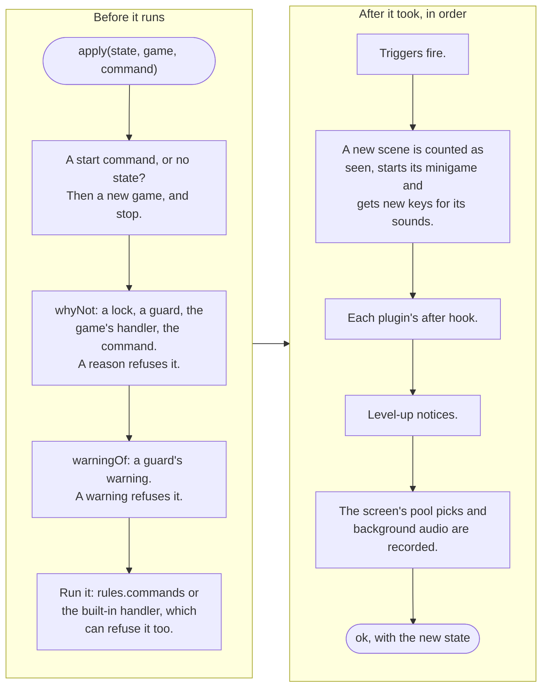

A command is one thing the player does, such as picking a choice, using an item or starting an activity. Your UI sends commands, and the engine returns the next [state](/docs/reference/state). Running a command is a pure function, so the same state, game and command always give the same result.

```ts
import { apply, dispatch, startingState, type Command } from '@ifloom/engine'
```

## apply

```ts
function apply(state: GameState | null, game: Game, command: CommandRef): Applied

type Applied =
  | { ok: true; state: GameState }
  | { ok: false; state: GameState; reason: string }
```

Runs a command and says whether it took. On a refusal, `ok` is `false`, `state` is the state you passed in, and `reason` says why. It's the shape of a [`Result`](/docs/reference/runner#result), with the state on both sides. The runner's `apply` gives a plain `Result` with the new state as its `value`.

```ts
import { apply } from '@ifloom/engine'
import { go } from '@ifloom/plugin-places'

const out = apply(state, game, go('cafe'))
if (!out.ok) console.log(out.reason) // the reason, such as a place's `blocked` line
state = out.state
```

Use `apply` wherever the answer matters, because a refused command and one that changed nothing leave the same state behind. It takes a [`CommandRef`](/docs/reference/custom#commandref), so a plugin's command in short works too.

`refused` is always a sentence you can show the player. It's the same line [`whyNot`](/docs/reference/actions#whynot) gives, and the view greys the button out with it. The lines quoted on this page are the engine's English from the [strings table](/docs/reference/strings#refusals), and a game, a pack or a translation can reword them (`finishFirst`, `noSuchScene` and so on). Lines your game wrote, such as a lock's or a `blocked` entry's `reason`, are printed as written.

### What happens, in order

1. **A new game?** `{ type: 'start' }` returns a brand-new game and stops there. If `state` is `null`, any other command also returns a new game, as `startingState(game)` with no options, and the command isn't run.
2. **Can it be done?** [`whyNot`](/docs/reference/actions#whynot) answers, and if it gives a reason the command is refused with it. It checks a [lock](/docs/reference/locks) first, then a plugin's [guard](/docs/reference/plugins#guards), then the game's own handler if it has one, then what the command itself needs (described below). A plugin command marked `ignoresLocks` skips the lock and guard checks, and so does [`setting`](#setting). The view greys buttons out with the same function, so a button and its refusal always read the same.
3. **A warning?** If [`warningOf`](/docs/reference/actions#warningof) has one, the command is refused with it. This is a plugin guard's soft refusal, such as the [calendar](/docs/plugins/calendar#the-guard)'s `That would run past dawn.` The view puts the same line on the button as its `warning`.
4. **Run it.** If [`rules.commands`](/docs/reference/rules#commands) has a function for this type, it runs instead of the built-in handler. Otherwise the built-in handler described below runs.
5. **Triggers.** Each [trigger](/docs/reference/triggers) that's due and whose condition now holds fires, in the order the game lists them, each on the state the one before it left. See [When triggers fire](/docs/reference/triggers#when-triggers-fire).
6. **Seen.** If the player is now looking at a different scene than before, that scene's [`seen`](/docs/reference/state#seen) count goes up by one, and [`seenOn`](/docs/reference/state#seenon) records the current [turn](/docs/reference/state#turn) if it's the first time. A scene a trigger opened counts.
7. **A scene's minigame.** If that new scene has a [`minigame`](/docs/reference/minigames#minigamescenefields), it starts.
8. **The scene's sounds.** If a new scene was entered, [`state.audio.shown`](/docs/reference/audio#audiostate) goes up by one, so that scene's sounds get keys of their own and play. See [Sounds and voices](/docs/reference/audio#sounds-and-voices).
9. **After hooks.** Each plugin's [`onCommand` hook](/docs/reference/plugins#hooks-and-providers) runs, in the order `game.plugins` lists them, with the state from before the command and the state after it.
10. **Level-ups.** Each of the player's stats that went up a level, and has a [`notice`](/docs/reference/stats#the-notice), raises one. This comes after the hooks, so a level a hook's reward reached is noticed too.
11. **What the screen shows.** The engine draws the new state's [`screen`](/docs/reference/view#screen) once and records what the save doesn't hold yet: the [pool picks](/docs/reference/media#remembered-picks) on it, in a game with pools, and what each background channel is now playing, in [`state.audio.started`](/docs/reference/audio#audiostate), in a game with audio.



Locks are checked before the game's own handler, so a lock can stop a command the game handles itself.

## dispatch

```ts
function dispatch(state: GameState | null, game: Game, command: CommandRef): GameState
```

Returns `apply(...).state`. Use it where a refusal needs no handling, such as replaying a known-good list of commands in a test.

## startingState

```ts
function startingState(game: Game, options?: StartOptions): GameState

type StartOptions = {
  seed?: number
  kv?: Record<string, KvValue>
  settings?: Record<string, unknown>
  carry?: GameState
}
```

Returns a new game at turn 0, with `introScene` open and counted as seen. Every other state, such as a save, comes in through [`loadState`](/docs/reference/saves#loadstate). `apply` expects a state from one of the two and doesn't check its shape itself. A game without `introScene` starts with no scene open and nothing seen, on its [idle screen](/docs/reference/view#the-idle-screen).

- Each [plugin](/docs/reference/plugins)'s state is its `start`. For example, where the player stands is the [places plugin](/docs/plugins/places#placesoptions)'s `start` option.
- The phase is `game.startPhase`, or `''`.
- Every declared storyline is empty.
- Each item is held `start` times, or not at all if it gives no `start`. `itemStart(item)` gives that number for one item.
- Each declared [stat](/docs/reference/stats) is at its `start`. The engine adds no stats of its own.
- Each `play` [setting](/docs/reference/settings) is at the value given in `settings`, or its default.

See [Game state](/docs/reference/state) for the other starting values. The options object is optional, and so is each field in it:

| Option | What it does | Default |
|---|---|---|
| `seed` | The save's [seed](/docs/reference/state#seed), which fixes every random draw it makes. | A hash of `game.id`, so every new game deals the same way. |
| `kv` | Keys written to the [kv store](/docs/reference/state#kv) before the first scene, such as a name asked for on a title screen. | None. |
| `settings` | The player's stored values for the game's `play` [settings](/docs/reference/settings), usually the [profile](/docs/reference/profile)'s `core:settings`. Unknown ids, `ui` settings and values a setting can't take are ignored. | Each setting's default. |
| `carry` | The state a finished game ended on, for a [New Game+](/docs/reference/state#new-game). What `game.carryOver` lists is copied from it. | Nothing carried. |

```ts
import { startingState } from '@ifloom/engine'

// A UI starting a new game: a fresh seed, and the name from the title screen.
let state = startingState(game, { seed: Math.floor(Math.random() * 2 ** 31), kv: { playerName: 'Sam' } })

// A test: the same seed every run.
let fixed = startingState(game)
```

`apply(null, game, { type: 'start', seed, kv })` does the same.

**Gotcha.** If you leave the seed out, it's the same for every new game of the same game, so every playthrough draws the same [variants](/docs/reference/random) and [rolls](/docs/reference/random#roll). That's what a test wants, but a UI should pass a fresh seed for each new game.

The engine keeps no player name. A name is a key in the kv store like any other, so pass it in `kv` or ask for it with an [input](/docs/reference/inputs). Prose reads it back with `{{playerName}}`, and [`SaveMeta.player`](/docs/reference/saves#savemeta) shows whatever the game's [`saveName`](/docs/reference/game#savename) makes of it.

## Command

```ts
type Command =
  | { type: 'start'; seed?: number; kv?: Record<string, KvValue> }
  | { type: 'activity'; id: string }
  | { type: 'scene'; id: string }
  | { type: 'choose'; id: string }
  | { type: 'leave' }
  | { type: 'use'; id: string }
  | { type: 'dismiss'; id?: string }
  | { type: 'input'; id: string; to?: KvValue }
  | { type: 'setting'; id: string; to: KvValue }
  | { type: 'tick'; ms: number }
  | { type: 'minigame'; input: string }
  | { type: 'closePanel' }
  | { type: 'custom'; name: string; with?: Record<string, unknown> }
```

A command that names one thing names it `id`, and one that sets a value takes it as `to`. Plugins' commands follow the same rule, as in `{ type: 'custom', name: 'places/go', with: { id: 'cafe' } }`.

The union is closed, so a game can't add a command type. Something new for the player to do is an [activity](/docs/reference/actions), not a command. A [plugin](/docs/reference/plugins) adds its commands under the one type `custom`, by name. For example, walking somewhere is the [places plugin](/docs/plugins/places#commands)'s `places/go`, which you write as `go('cafe')`, and talking to someone is the [cast](/docs/plugins/cast#commands)'s `cast/talk`, written `talk('ava')`.

Each built-in handler below runs only if no lock or plugin [guard](/docs/reference/plugins#guards) stopped the command and the game has no handler for its type. The refusals listed for each come after a lock's and a guard's, and before a [warning](/docs/reference/actions#warningof).

While a [minigame](/docs/reference/minigames) runs, every command but `tick`, `minigame`, `dismiss`, `setting` and `closePanel` is refused with `Finish this first.`, and so is a plugin command that doesn't ignore locks. This comes before the locks.

### start

Starts a new game, with this seed and these kv keys if given. It's never refused and isn't checked against locks. See [`startingState`](#startingstate).

### activity

Runs the [activity](/docs/reference/actions) with this id. It pays the activity's cost, then applies its effects.

It's refused with `There is no such thing to do.` if there's no such activity. After that comes the first reason from [`activityBlocked`](/docs/reference/actions#activityblocked): a scene is open, a lock, a `blocked` entry (such as the places plugin's [`onlyAt`](/docs/plugins/places#helpers)), or too little of a stat the cost spends. Last comes a plugin guard's [warning](/docs/reference/actions#warningof).

### scene

Opens a scene by id. It's refused with `Finish this first.` if a scene is already open, or `There is no such scene.`

### choose

Takes a choice in the scene on screen. The scene is rendered against the current state and the choice is found by id. Its count in [`chosen`](/docs/reference/state#chosen), under `scene#choice`, goes up by one, and then its effects run in order.

It's refused with, in order:

- `There is nothing to choose.` when no scene is open
- `That is not on offer.` when there's no such choice, or it's hidden
- the choice's own `disabled` text
- a plugin guard's [warning](/docs/reference/actions#warningof), such as the calendar's `That would run past dawn.` for a choice that passes time over the end of the day

If the open scene's id no longer exists in the game, `choose` closes it instead of refusing. See [How choose checks a choice](/docs/reference/scenes#how-choose-checks-a-choice).

### leave

Closes the scene on screen. It's never refused by the engine, even with no scene open, though a lock can stop it.

### use

```ts
{ type: 'use', id: 'umbrella' }
```

Uses one of the item `id`. It spends one, then runs the item's `use.effects`.

It's refused with `There is no such thing.` for an unknown item, `The <name> does not do anything.` for an item with no `use`, and `You have no <name>.` when the player has none.

### dismiss

```ts
{ type: 'dismiss', id: 'rent' }   // that notice
{ type: 'dismiss' }               // all of them
```

Marks one [notice](/docs/reference/notices), or every notice, as seen. It has no refusal of its own, so it works with a scene open and with nothing to dismiss. Only a lock stops it. It doesn't end a turn.

### input

```ts
{ type: 'input', id: 'catName', to: 'Biscuit' }
```

Writes what the player typed or picked to the [input](/docs/reference/inputs)'s kv key (its `key`, or the input's id), with text trimmed. A button can carry the command without `to` so the UI asks for one, but if it's sent without a value, it's refused. It takes no time and works with a scene open.

After a lock, it's refused with the line from [`inputRefusal`](/docs/reference/inputs#inputrefusal): `There is no such thing to fill in.`, `Not now.`, `Enter something first.`, `Keep it to <n> characters.`, `Enter a number.`, `Between <min> and <max>.`, `At least <min>.`, `At most <max>.`, `That is not one of the options.`

### setting

```ts
{ type: 'setting', id: 'difficulty', to: 'hard' }
```

Changes a `play` [setting](/docs/reference/settings) in the state. A settings screen sends it when the player changes one mid-game. It's a command like any other, so it goes in the runner's [log](/docs/reference/runner#commandlog) and [`replay`](/docs/reference/runner#replay) gives the same game. A runner with a [profile](/docs/reference/profile) also stores the new value there, so the next new game starts with it.

No lock or plugin guard stops it, because changing a setting is the menu's business, not the story's. It's refused with:

- `There is no such setting.` for an id the game doesn't declare
- `That setting does not change the game.` for a `ui` setting, which never enters the state (use [`runner.setSetting`](/docs/reference/runner#setsetting))
- `Choose on or off.` for a toggle given anything but `true` or `false`
- `That is not one of the options.` for a choice given a value it doesn't list
- `Enter a number.`, `Between <min> and <max>.` or `In steps of <step>.` for a range

### tick

```ts
{ type: 'tick', ms: 100 }
```

Time passing in the [minigame](/docs/reference/minigames) being played. It adds `ms` to how long the minigame has been in its state. When that reaches the state's `after.ms`, the timer's transition is taken, and whatever is left of `ms` carries on into the next state. So one long tick can run out several timers in a row, up to 1,000 transitions, and it stops when the minigame ends. A UI sends it at a steady rate (about every 100 ms) while [`view.minigame.timeLeft`](/docs/reference/minigames#minigameview) isn't `null`.

No lock or plugin guard stops it. It's refused with `Nothing is being played.` when no minigame runs, `Nothing is counting down.` when the running state has no timer, and `A tick is a number of milliseconds above 0.` for an `ms` that isn't.

Ticks go in the runner's [log](/docs/reference/runner#commandlog), so [`replay`](/docs/reference/runner#replay) is exact. The runner's undo steps over them, the backlog ignores them, and they don't autosave as commands. See [In the runner](/docs/reference/minigames#in-the-runner).

### minigame

```ts
{ type: 'minigame', input: 'left' }
```

An input to the [minigame](/docs/reference/minigames) being played. It takes the running state's first `on` entry for that input whose `when` holds: its effects, then where it goes. No lock or plugin guard stops it. It's refused with `Nothing is being played.` when no minigame runs, and `That does nothing now.` when the input isn't live. [`view.minigame.inputs`](/docs/reference/minigames#minigameview) lists the live ones.

### closePanel

```ts
{ type: 'closePanel' }
```

Closes the open [panel](/docs/reference/panels). A UI sends it when the player dismisses the panel's dialog. No lock or plugin guard stops it, so a lock can't hold a panel open. It's refused with `Nothing is open.` when no panel is open. It ends no turn and changes nothing else.

### custom

```ts
{ type: 'custom', name: 'quests/track', with: { id: 'bread' } }
```

Runs a [plugin's command](/docs/reference/plugins#plugincommand) by its full name, with the plugin's id in front. `with` is passed as its arguments, or `{}` when left out.

Content, `apply` and the runner also take it in short, with the full name as the only key: `{ 'quests/track': { id: 'bread' } }` (see [`CommandRef`](/docs/reference/custom#commandref)). The view always gives it in this long form.

It's refused with `There is no such thing to do.` if none of the game's plugins has a command by that name, and then with the plugin's own `whyNot` line. A command its plugin marks `ignoresLocks` skips the lock and guard checks.

The [content checker](/docs/reference/checks#in-a-command) reports a button whose command names no plugin command, unless the plugin is an [absent partner](/docs/reference/checks#absent-partners).

## See it in an example

- Each example exports a `start` built on `startingState`: Small Town's in [`examples/showcase/src/game.ts`](https://github.com/IFLoom/ifloom/blob/main/examples/showcase/src/game.ts), The Letter's in [`examples/novel/src/game.ts`](https://github.com/IFLoom/ifloom/blob/main/examples/novel/src/game.ts) with a name already typed, and The Corner Café's in [`examples/cafe/src/game.ts`](https://github.com/IFLoom/ifloom/blob/main/examples/cafe/src/game.ts) with the opening scene closed.
- The tests send commands with `apply`: the `read` helper in [`examples/novel/tests/novel.test.ts`](https://github.com/IFLoom/ifloom/blob/main/examples/novel/tests/novel.test.ts) and the `play` helper in [`examples/cafe/tests/cafe.test.ts`](https://github.com/IFLoom/ifloom/blob/main/examples/cafe/tests/cafe.test.ts).
