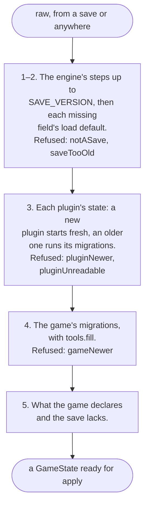

To save a game, you write its whole [`GameState`](/docs/reference/state) to a slot, along with a few details for a load screen. Nothing else needs storing, because the same state in the same game gives the same draws (see [Randomness](/docs/reference/random)).

Saving has two parts:

- **The driver** decides where saves are kept: `localStorage`, IndexedDB, memory, or somewhere of your own.
- **The save store**, [`saves(game, driver)`](#saves), handles slots, the details for a load screen, export and import, and carrying old saves forward.

```ts
import {
  saves, memoryDriver, localStorageDriver, indexedDbDriver,
  loadState, SAVE_VERSION,
  type Saves, type SaveDriver, type SaveFile, type SaveMeta, type LoadedSave,
  type StorageLike, type IndexedDbLike,
} from '@ifloom/engine'

const store = saves(game, indexedDbDriver())
await store.write('quick', state)
```

Most games never call the store directly. They hand it to the [runner](/docs/reference/runner), which saves, loads and autosaves through it and counts the time played.

## Drivers

The engine never picks where saves live. There's no default driver, so your game chooses one and hands it to `saves`.

| Driver | Where | Room | Use it for |
|---|---|---|---|
| [`memoryDriver()`](#memorydriver) | A `Map`, gone with the page. | Memory. | Tests, previews. |
| [`localStorageDriver()`](#localstoragedriver) | `localStorage`, or any Web Storage. | About 5MB per origin, shared. | Short games. It's the simplest driver that keeps saves. |
| [`indexedDbDriver()`](#indexeddbdriver) | IndexedDB. | Large, up to the browser's own quota. | Long games, big backlogs, mod data. |
| [Your own](#a-driver-of-your-own) | Anywhere: a desktop wrapper's file system, a sync service. | Whatever it has. | Games shipped outside a browser. |

Every driver is asynchronous, even over storage that isn't, so you can swap one for another without changing the code that calls it.

### SaveDriver

```ts
type SaveDriver = {
  name: string
  get: (key: string) => Promise<string | null>
  set: (key: string, value: string) => Promise<void>
  remove: (key: string) => Promise<void>
  keys: (prefix: string) => Promise<string[]>
}
```

A driver stores strings by key. `name` is for diagnostics (`'localStorage'`, `'indexedDB'`). `get` returns `null` for a key that isn't there. `keys(prefix)` returns every key that starts with `prefix`, which the save store uses to list one game's saves.

### memoryDriver

```ts
function memoryDriver(): SaveDriver
```

Saves in memory, gone when the page is. Each call is a new, empty store.

```ts
const store = saves(game, memoryDriver())
```

### localStorageDriver

```ts
function localStorageDriver(storage?: StorageLike): SaveDriver
```

Saves in `globalThis.localStorage`, or in the Web Storage you pass. It works everywhere but it's small, around 5MB per origin. In Chromium every page opened from disk shares one origin, so every `file://` game the player has shares those 5MB.

The driver looks for the storage when a save is first read or written, not when you make it. Where there's none (Node, a locked-down iframe), that read or write rejects with `localStorage is not available here`.

### StorageLike

```ts
type StorageLike = {
  getItem: (key: string) => string | null
  setItem: (key: string, value: string) => void
  removeItem: (key: string) => void
  key: (index: number) => string | null
  readonly length: number
}
```

The parts of the Web Storage API the driver needs. `localStorage` and `sessionStorage` are both one.

### indexedDbDriver

```ts
function indexedDbDriver(options?: {
  database?: string
  store?: string
  indexedDB?: IndexedDbLike
}): SaveDriver
```

Saves in IndexedDB, which has far more room. It opens one database, `database` (default `'ifloom'`), creating it if needed. That database holds one object store of strings by key, `store` (default `'saves'`). `indexedDB` defaults to `globalThis.indexedDB`. Pass another for tests, such as `fake-indexeddb`.

```ts
const store = saves(game, indexedDbDriver())
```

Every game can share the default database, because keys carry the game's id (see [Keys](#keys)).

**Gotcha:** the database is opened at version 1, and the store is only created along with the database. If you open an existing database with a different `store` name, there's no such store and every call rejects. Give a new store a new `database` too. If IndexedDB isn't there at all, every call rejects with `IndexedDB is not available here`.

### IndexedDbLike

```ts
type IndexedDbLike = { open: (name: string, version?: number) => OpenRequest }
```

The part of `indexedDB` the driver needs, typed by the engine because it carries no DOM types. The browser's `indexedDB` is one.

### A driver of your own

A driver is a name and four functions over strings. Here's one for a desktop wrapper that writes each save as a file:

```ts
import type { SaveDriver } from '@ifloom/engine'

// `files` is whatever your wrapper exposes, such as Tauri's fs plugin or an Electron preload.
function fileDriver(folder: string): SaveDriver {
  const path = (key: string) => `${folder}/${key}.json`
  return {
    name: 'files',
    get: async (key) => ((await files.exists(path(key))) ? files.readText(path(key)) : null),
    set: (key, value) => files.writeText(path(key), value),
    remove: (key) => files.remove(path(key)),
    keys: async (prefix) =>
      (await files.list(folder))
        .filter((name) => name.endsWith('.json'))
        .map((name) => name.slice(0, -'.json'.length))
        .filter((key) => key.startsWith(prefix)),
  }
}
```

Keys contain dots (`corner-cafe.save.auto`), and the slot part is whatever the game named it. A driver that turns keys into file names or URLs should keep them intact, or escape them in a way it can undo.

## saves

```ts
function saves(game: Game, driver: SaveDriver): Saves
```

One game's saves, kept wherever its driver keeps them. `Saves` is `ReturnType<typeof saves>`.

Slots are names your game picks, such as `'auto'` for the runner's autosave, `'quick'` for a quicksave key, or `'1'`, `'2'` and `'3'` for a save screen. There's no fixed number of them.

| Member | What it does |
|---|---|
| `driver` | The driver it was given. |
| `write(slot, state, extra?)` | Writes a [`SaveFile`](#savefile) to the slot, replacing what was there, and returns its [`SaveMeta`](#savemeta). `extra` is `{ name?, played?, savedAt? }`. |
| `read(slot)` | The slot read back as a [`LoadedSave`](#loadedsave). `null` if the slot is empty, or a string saying why if it couldn't be read. |
| `list()` | The `SaveMeta` of every readable save this game has, newest first by `savedAt`. Unreadable ones are left out. |
| `remove(slot)` | Empties a slot. |
| `exportSlot(slot)` | The save as text, for the player to keep as a file. `null` if the slot is empty. |
| `importText(text)` | Reads text from a file the player picked, with the same checks as `read`. Synchronous, and writes nothing. |

```ts
// A load screen.
for (const meta of await store.list()) {
  addRow(meta.name, new Date(meta.savedAt), meta.played)
}

// The player's own copy, and back again.
download('corner-cafe.save', await store.exportSlot('1'))
const loaded = store.importText(await pickedFile.text())
if (typeof loaded === 'string') showMessage(loaded)
else await store.write('1', loaded.state, { name: loaded.meta.name, played: loaded.meta.played })
```

`read` and `importText` refuse a save with a line the player can read:

| Returns | When |
|---|---|
| `'That is not a save file.'` | Not JSON, or JSON that isn't an IFLoom save. |
| `'That save belongs to another game (<id>).'` | The save's `meta.game` isn't this game's id. |
| `'That save is from a version this game cannot read.'` | The save's format [version](#save_version) is one the engine can't carry forward. |
| `'That save was made with a newer version of <plugin>.'` | A [plugin](/docs/reference/plugins)'s state in the save is newer than the game's plugin. |
| `'That save's <plugin> is from a version this game cannot read.'` | A plugin's state has no [migration](/docs/reference/plugins#when-a-save-loads) route to its current version. |
| `'That save was made with a newer version of this game.'` | The save's [game version](#the-games-own-migrations) is higher than `game.version`. |

These are the engine's English. A game rewords them in the [strings table](/docs/reference/strings#saves) as `notASave`, `otherGame`, `saveTooOld`, `pluginNewer`, `pluginUnreadable` and `gameNewer`.

The state inside the file is loaded with [`loadState`](#loadstate), which carries it forward or refuses it with one of these reasons.

**Gotchas:**
- `write` without `played` records `0`. The runner passes the time played for you. When you write an imported save yourself, pass `loaded.meta.played` on.
- `write` without `name` makes one from the state, so an imported save written that way loses the player's name for it. Pass `loaded.meta.name`.

### Keys

| What | Key |
|---|---|
| Slot `s` | `<gameId>.save.<s>` |

The keys carry the game's id because a game opened from disk shares one storage origin with every other game opened from disk in the same browser, and game hosts such as itch.io serve many games from shared domains. Without the id, two IFLoom games would overwrite each other's `'auto'`. The id is `game.id`, so pick one unique to your game and never change it.

The keys don't carry the save format's version. That's stored inside each save and handled by [`loadState`](#loadstate). A key that changed with each version would lose every existing save on the first update.

## SaveFile

```ts
type SaveFile = { ifloom: 1; meta: SaveMeta; state: GameState }
```

A save as it's written, as JSON: the tag `ifloom: 1`, the save's details, and the state. This is the text `exportSlot` returns.

## SaveMeta

```ts
type SaveMeta = {
  game: string
  slot: string
  name: string
  savedAt: number
  played: number
  turn: number
  when: string | null
  player: string | null
  packs: string[]
  plugins: Record<string, number>
  version: number
  gameVersion: number
}
```

What a save says about itself, which is enough to draw a row on a load screen without reading the state.

| Field | What |
|---|---|
| `game` | The game's id. Another game's save is refused. |
| `slot` | The slot it was written to. |
| `name` | The player's name for it, or one made from `when`, else `Turn <n>` (the [`turnLabel`](/docs/reference/strings#saves) string, with the turn counted from 1). With the [calendar](/docs/plugins/calendar#the-label) and the [places plugin](/docs/plugins/places#the-label): `'Day 5 · Friday evening · The Corner Café'`. With no plugin that has a label, `'Turn 3'`. |
| `savedAt` | When it was written, epoch milliseconds. Default `Date.now()`. |
| `played` | Time played, in milliseconds, as the [runner](/docs/reference/runner) counted it. |
| `turn` | How many turns had passed: [`state.turn`](/docs/reference/state#turn), from 0. |
| `when` | When and where the game was, in its plugins' [labels](/docs/reference/plugins#labels), as the view shows it in [`view.when`](/docs/reference/view#the-clock-and-the-player): `'Day 5 · Friday evening · The Corner Café'` with the calendar and the places plugin, `'Day 5 · Friday evening'` with the calendar alone. `null` when no plugin says. |
| `player` | What [`game.saveName`](/docs/reference/game#savename) returns for the state, or `null` when the game has no `saveName`. The engine keeps no name of its own, so a game that asks the player's name declares `saveName` to show it on its load screen. |
| `packs` | The ids of the packs the game was loaded from ([`game.packs`](/docs/reference/game)). |
| `plugins` | Each [plugin](/docs/reference/plugins) the game was built with, by id, and the version of its state: `{ quests: 1 }`. |
| `version` | The state's save format, `state.version`. |
| `gameVersion` | The game's own [version](#the-games-own-migrations) the save was made with. 1 for a game that declares none, and for a save from before game versions. |

## LoadedSave

```ts
type LoadedSave = {
  meta: SaveMeta
  state: GameState
  missingPacks: string[]
  missingPlugins: string[]
}
```

A save read back: its details, and the state carried forward to the current version.

`missingPacks` names packs the save was made with that this game wasn't loaded from, such as a mod the player has since removed. The save still loads, and your game decides whether to warn, refuse or carry on. A state that refers to scenes, items or storylines from a missing pack may not play as it did.

`missingPlugins` names [plugins](/docs/reference/plugins) the save was made with that this game doesn't have. The save still loads, and the plugin's state is kept in `state.plugins`, unused, so it comes back if a later build adds the plugin again.

```ts
const loaded = await store.read('1')
if (loaded && typeof loaded !== 'string' && loaded.missingPacks.length) {
  showMessage(`This save used mods you do not have: ${loaded.missingPacks.join(', ')}.`)
}
```

## loadState

```ts
function loadState(raw: unknown, game: Game): GameState | string
```

Makes a state from anywhere ready to play in this game: a save's state, the start of a [command log](/docs/reference/runner#commandlog), or a state you parsed yourself. It returns the state, or the reason it can't, as one of the [refusals](#saves) above.

```ts
import { createRunner, loadState } from '@ifloom/engine'

const state = loadState(JSON.parse(text), game)
if (typeof state === 'string') throw new Error(state)
const runner = createRunner(game, state)
```

It does these in order:

1. The engine's own steps, from the state's `version` up to `SAVE_VERSION`. A state with no `version`, or one higher than `SAVE_VERSION`, is refused.
2. Each field the state lacks gets its load default, such as `[]` for `removed` or empty audio for `audio`. A field an older format didn't have needs no step of its own.
3. Each [plugin's state](/docs/reference/plugins#when-a-save-loads) is carried forward, and a plugin added since starts fresh.
4. The game's own [migrations](#the-games-own-migrations), if the game declares a `version`.
5. What the game declares and the save lacks is added: a storyline, and in a game with no `version`, its `play` settings and declared entities. See [Filling new content](#filling-new-content).

Each step can refuse the state, with the [string](/docs/reference/strings#saves) named in its box:



The [save store](#saves)'s `read` and `importText`, and [`replay`](/docs/reference/runner#replay), all load through it. A state that comes back from it, or from [`startingState`](/docs/reference/commands#startingstate), is ready for [`apply`](/docs/reference/commands#apply), which doesn't check the shape again.

A state already in today's shape comes back equal to what went in, apart from anything the game has declared since.

### The engine's steps

These are the changes to the save format so far, with what loading a save from before each one does:

- **1 → 2** moves the player's name out of the top level (`playerName`, `playerFirst`, `playerLast`) into flags (now the [kv store](/docs/reference/state#kv)) of the same names, so `{{playerName}}` still fills in, and adds an empty [`chosen`](/docs/reference/state#chosen).
- **2 → 3** brings in the [turn](/docs/reference/state#turn). Before it, a day was the only turn there was, so `turn` is set to `time.day` (0 if the save has no `time`), and everything stamped with a day is stamped with that turn: flags named `day:<id>` (the [once-a-turn](/docs/reference/progress#onceperturn) records) become `turn:<id>`, each storyline's `closedUntilDay` becomes [`closedUntil`](/docs/reference/state#storylines), and each [collection](/docs/reference/collections) entry's and [notice](/docs/reference/notices)'s `day` becomes `turn`. `seenOn` and `fired` keep their numbers, which now read as turns.
- **3 → 4** brings in [entities](/docs/reference/entities): the save gets an empty [`entities`](/docs/reference/state#entities) and an empty [`created`](/docs/reference/state#created), The game's declared entities are added in step 5, or by the game's own steps in a game with a `version`.
- **4 → 5** takes the clock out of the engine. The save's `time: { day, period }` moves into the [calendar plugin](/docs/plugins/calendar#calendarstate)'s state, `plugins.calendar = { version: 1, state: { day, period } }`, with the old last period `'sleep'` renamed `'late'`, the calendar's word for it. A save that already has a `plugins.calendar` keeps it. A game without the calendar keeps the entry unused, as it keeps the state of any plugin it doesn't have.
- **5 → 6** takes places out of the engine. The save's `locationId` is dropped from the top level and moves into the [places plugin](/docs/plugins/places#placesstate)'s state, `plugins.places = { version: 1, state: { at: locationId } }`. A save that already has a `plugins.places` keeps it, and one whose `locationId` was `null` gets no entry. A game with the places plugin then starts that save at the plugin's [`start`](/docs/plugins/places#placesoptions), because a plugin missing from a save gets its starting state when it loads. A game without the places plugin keeps the entry unused.
- **6 → 7** brings in [`removed`](/docs/reference/state#removed), empty on an older save, the list of declared entities removed in play. Older saves didn't record them, so a declared entity removed in a save from before version 7 isn't on the list, and loading puts it back at its start.
- **7 → 8** takes `standing` and `rapport` off every [storyline](/docs/reference/state#storylines), keeping its `closedUntil` and `flags` (a missing `closedUntil` becomes `null`, missing `flags` `{}`). They're dropped, not carried anywhere. A relationship is now a [stat](/docs/reference/stats#entity-stats) the game declares on the [cast](/docs/plugins/cast)'s `character` kind, and the engine can't know which stat a game meant.
- **8 → 9** brings in [`settings`](/docs/reference/state#settings), empty on an older save. Step 5 then gives each `play` [setting](/docs/reference/settings) the game declares its default, so an old save plays with the defaults rather than the player's stored choices.
- **9 → 10** adds [`audio`](/docs/reference/audio#audiostate): `{ channels: {}, cues: [], seq: 0, shown: 0, started: {} }`. No `audio` effect had run, so every channel plays the place's audio or the game's default, and the count of scenes entered starts again from 0.
- **10 → 11** adds [`media`](/docs/reference/media#mediastate): `{ picks: {} }`. Nothing had been picked from a pool, so the next view picks as it always would, and the next command records the picks.
- **11 → 12** renames `flags` to [`kv`](/docs/reference/state#kv) at the top level, on every [storyline](/docs/reference/state#storylines) and on every [entity](/docs/reference/state#entities). The keys and values are kept as they are.
- **12 → 13** moves `plugins.effects` to `plugins.statuses`, because the timed-effects plugin is now the [statuses plugin](/docs/plugins/statuses). A save that already has `plugins.statuses` keeps it.
- **13 → 14** rekeys [`chosen`](/docs/reference/state#chosen) from `scene/choice` to `scene#choice`. A choice's once-a-turn record isn't moved, so in a save made partway through a turn, a `once` choice already taken that turn can be taken once more.

A save from version 0 doesn't load.

**Gotcha.** `loadState` doesn't check that fields hold the right kind of value. A hand-edited state with `stats: 'lots'` loads, and breaks the first time something reads a stat.

## SAVE_VERSION

```ts
const SAVE_VERSION: 14
```

The current save format. Every new state carries it in `state.version`.

It only goes up when something an existing save already has changes shape, such as a field that's renamed, moved or holds a different kind of value. That bump ships with a step that reshapes the old field, which [`loadState`](#loadstate) runs on older saves.

A field added to `GameState` doesn't bump it. The engine declares the new field's load default next to its new-game value, and a save that lacks the field gets the default when it loads, whatever its version. [`minigame`](/docs/reference/state#minigame) was added this way, so a save from before minigames loads with `null` and the version stayed at 11. Version 12 renamed a field, so it has a step.

Versions 4, 7, 9, 10 and 11 only added fields. They're from before this rule and have no step of their own, so loading an older save gives those fields their defaults too.

## The game's own migrations

When an update to your game changes its content in a way old saves need to know about, such as a kv key renamed or a stat added, give the game a `version` and a step that carries older saves forward. The Letter, the novel in `examples/novel`, renamed its count of lies to `fibs` in version 2:

```ts
const { game, problems } = loadGame([letter], {
  id: 'the-letter',
  title: 'The Letter',
  // Version 2 counts `fibs` where version 1 counted `lies`. A version-1 save is carried
  // forward by the step below when it loads, so a reader mid-story keeps their count.
  version: 2,
  migrations: {
    1: (state) => {
      const { lies, ...kv } = state.kv
      return lies === undefined ? state : { ...state, kv: { ...kv, fibs: lies } }
    },
  },
  introScene: 'ch1.mat',
  // ...
})
```

A reader who saved at the door after two lies under version 1 loads with `fibs: 2`, so the door scene still shows the line for two or more (`ch3.door.tangle`). The novel's test `reads a save from version 1, when the count was called lies` loads such a save.

### Versions and steps

- `version` is a whole number from 1. A game that leaves it out is at version 1.
- `migrations` holds the steps, keyed by the version each one upgrades from. Step 1 takes a version-1 save to version 2, step 2 takes it from 2 to 3, and so on.
- A step is a function `(state, tools) => GameState`. It gets the state and [`MigrationTools`](#migrationtools), and returns a new state. Don't change the one it's given.
- A version with no step is carried forward unchanged, so you only write steps for the versions that need one.

When a save loads, the engine reads the version it was made with, runs every step from there up to the game's `version` in order, and stamps the state with the new version. A version-1 save in a version-3 game runs step 1 and then step 2. A save that's already at the game's version runs nothing.

The steps run inside [`loadState`](#loadstate), after the engine's own steps and the plugins' migrations, so a step always sees a state in today's engine shape. They run before the game's new storylines, settings and entities are added.

### Where the version is kept

A new game of a game that declares a `version` records it in `state.gameVersion`, and every save records it in [`SaveMeta.gameVersion`](#savemeta) too. A save with no `gameVersion`, from before the game declared one, is version 1.

When a save loads, [`LoadedSave`](#loadedsave)'s `meta.gameVersion` is the version it was made with, and `state.gameVersion` is the version it's been carried to.

### A newer save

A save made with a newer version of the game than the one loading it is refused with `That save was made with a newer version of this game.` (the [`gameNewer`](/docs/reference/strings#saves) string). This happens when a player goes back to an older build.

### Filling new content

Once a game declares a `version`, the engine stops filling newly declared content into old saves by itself. Nothing new is filled in unless one of your steps calls `tools.fill()`. That covers stats, items, kv keys, play settings and entities.

A game with no `version` keeps the engine's old behaviour, so a game that existed before versions doesn't change. Every time a save loads, it gets the default of each `play` setting it lacks and each declared entity it doesn't have. It doesn't fill stats, items or kv keys.

So when you set `version` for the first time, even `version: 1`, loading stops adding settings and entities. When an update declares a new setting, entity or stat, raise the version and fill it in the step:

```ts
import type { Game } from '@ifloom/engine'

const base: Partial<Game> = {
  version: 3,
  migrations: {
    1: (state) => {
      const { lies, ...kv } = state.kv
      return lies === undefined ? state : { ...state, kv: { ...kv, fibs: lies } }
    },
    // 2 → 3: version 3 adds a patience stat and Cleo, a new member of staff.
    2: (_state, tools) => tools.fill(['stats', 'entities']),
  },
}
```

`fill` works on the state the step was given, not on anything the step has done since. If a step fills and changes things, call `fill` first and change its result:

```ts
2: (_state, tools) => {
  const filled = tools.fill(['stats'])
  return { ...filled, kv: { ...filled.kv, metCleo: false } }
},
```

**Gotchas.**
- A stat the save lacks reads as its `start` in conditions and the view either way, so a missing stat doesn't break anything. But a `stat` effect adds to what's kept, which is 0 for a stat that isn't there, so `{ kind: 'stat', stat: 'patience', by: 1 }` on a save without `patience` gives 1, not `start + 1`. Fill new stats whose `start` isn't 0.
- An item the save lacks counts as 0 until it's filled, so an item the player should start with isn't there.
- A missing step is skipped without a word. Keep every old step when you add a new one, or a save from before it skips that change.

### MigrationTools

```ts
import type { MigrationTools } from '@ifloom/engine'

type MigrationTools = {
  fill: (kinds?: FillKind[]) => GameState
}
```

What a step gets besides the state. `fill(kinds)` returns the state the step was given with what the game declares and the save lacks filled in, for the kinds you name. Leave `kinds` out to fill every kind. Nothing the save already has is changed, so `fill` never resets a value the player has earned.

A [plugin's migration](/docs/reference/plugins#state-and-migrations) step gets the same tools. There, `fill` gives the whole game state as the engine carried it, filled the same way, for a step that needs to read the game; the step still returns only the plugin's own state.

### FillKind

```ts
import type { FillKind } from '@ifloom/engine'

type FillKind = 'stats' | 'items' | 'kv' | 'settings' | 'entities'
```

| Kind | What `fill` adds |
|---|---|
| `stats` | Each of the player's stats the save lacks, at its `start`, and each entity stat an entity in the save lacks, at its `start`. Not [derived stats](/docs/reference/stats#derived-stats), which are never kept. |
| `items` | Each item the save lacks, at its `start`, or 0 if it gives none. |
| `kv` | Each key in [`rules.resets`](/docs/reference/rules#resets) the save lacks, at its reset value. Other keys have no declared value, so set them in the step yourself. |
| `settings` | Each `play` [setting](/docs/reference/settings) the save lacks, at its default. |
| `entities` | Each declared [entity](/docs/reference/entities) the save doesn't have, at its start, unless [`state.removed`](/docs/reference/state#removed) says it was removed in play. |

### Checks

The [content checker](/docs/reference/checks) reports a `version` that isn't a whole number of 1 or more, and a step keyed outside 1 to `version - 1`.

## See it in an example

- Small Town: [`examples/showcase/src/main.tsx`](https://github.com/IFLoom/ifloom/blob/main/examples/showcase/src/main.tsx) keeps saves with `saves(game, driver)` on `localStorageDriver(window.localStorage)`.
- The Letter: [`examples/novel/src/game.ts`](https://github.com/IFLoom/ifloom/blob/main/examples/novel/src/game.ts) is at `version: 2` and has a migration that renames the `lies` key to `fibs`. The test `reads a save from version 1` in [`examples/novel/tests/novel.test.ts`](https://github.com/IFLoom/ifloom/blob/main/examples/novel/tests/novel.test.ts) imports an old save through `saves(game, memoryDriver())`.
